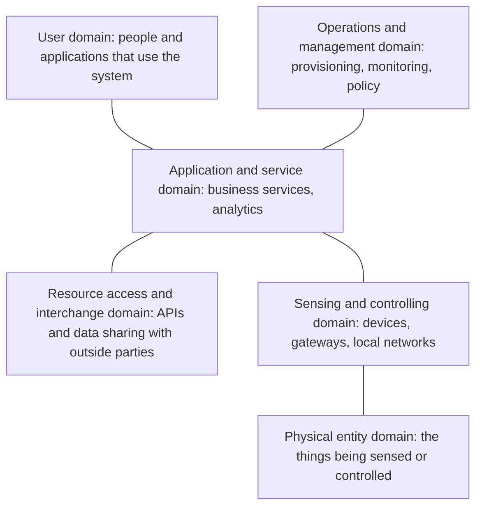

# ISO/IEC 30141

ISO/IEC 30141, *Internet of Things (IoT): Reference architecture*, gives a common vocabulary and a set of standard views for describing IoT systems. It does not prescribe technologies. Its value is in giving architects, suppliers and customers the same names for the same things, and a checklist of concerns that an IoT design should address. The first edition was published in 2018 and a revised edition in 2024.

## What it contains

- **A conceptual model**: the main entities in any IoT system (physical entities, IoT devices with sensors and actuators, gateways, services, networks, users) and how they relate.
- **Characteristics**: the qualities an IoT system needs, grouped into trustworthiness (security, privacy, safety, reliability, resilience), architecture (modularity, scalability, heterogeneity) and function (accuracy, interoperability, real-time behaviour).
- **Reference models and architecture views**: functional, system, communications, information, usage and deployment views, in the style of ISO/IEC/IEEE 42010 architecture descriptions.

## The domains

The standard groups the parts of an IoT system into domains. The six-domain model from the 2018 edition is the best-known part:

[[CAPTION:Figure]] The six domains of the ISO/IEC 30141 reference model.

| Domain | Typical contents |
| --- | --- |
| Physical entity | Buildings, machines, vehicles, environments |
| Sensing and controlling | Sensors, actuators, microcontrollers, gateways, local networks |
| Application and service | Data processing, business logic, analytics, dashboards |
| Operations and management | Device registry, provisioning, updates, monitoring, security management |
| Resource access and interchange | External APIs, data sharing with partners, access control |
| User | People, organisations and systems that use the services |

[[CAPTION:Table]] What belongs in each domain.

## Using it

- **As a checklist**: walk through each domain and characteristic when reviewing a design. Gaps in operations and management (provisioning, [updates](firmware-over-the-air.md), monitoring) are the most common.
- **As a shared vocabulary** in tenders and supplier documents, so "gateway" or "platform" means the same to everyone.
- **Alongside other models**: it complements the [C4 model](c4-model.md), which describes one specific system, and fits with security standards such as [ETSI EN 303 645](etsi-en-303-645.md) and the IEC 62443 series for industrial systems.

It is a large, abstract document. For most teams, the domain model and the list of characteristics give most of the value; the full views are useful for formal architecture descriptions.

## Where next

- [Edge computing for IoT](edge-computing-for-iot.md) maps closely onto the sensing and application domains.
- The [Handbook](../handbook/index.md) applies these ideas to IoT platform design.
- The standard is available from [iso.org](https://www.iso.org/search.html?q=30141).
