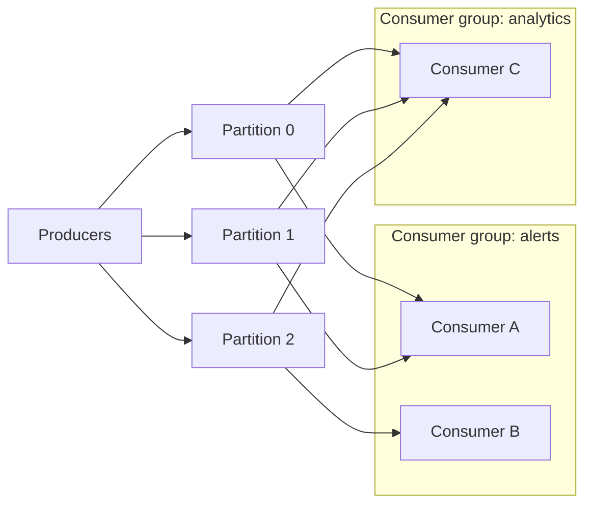

# Event streaming with Kafka

Apache Kafka is a distributed event log. Producers append records to it; consumers read them at their own pace and can re-read them later. Unlike a traditional message queue, Kafka does not delete a message when it is read. It keeps records for a configured time (or forever), which makes it a shared, replayable history of what happened.

Kafka was built at LinkedIn and open-sourced in 2011. It now underpins many [event-driven architectures](event-driven-architecture.md) and data pipelines.

## Core ideas

- **Topic**: a named stream of records, such as `device-telemetry`.
- **Partition**: each topic is split into partitions, each an ordered, append-only log. Partitions are how Kafka scales: they spread across brokers and consumers.
- **Key**: records with the same key go to the same partition, so they stay in order. Use the device ID as the key and each device's readings arrive in order.
- **Offset**: a record's position in its partition. Consumers track the offset they have reached.
- **Broker**: a Kafka server. A cluster has several, and each partition is replicated to more than one for safety.
- **Consumer group**: consumers that share the work of reading a topic. Each partition is read by one member of the group at a time. Different groups read the same topic independently.

[[CAPTION:Figure]] One topic, three partitions, two independent consumer groups.

Since Kafka 4.0, clusters manage their own metadata with the KRaft protocol; ZooKeeper is no longer used.

## Delivery guarantees

- Producers choose how many replicas must confirm a write (`acks=all` for safety).
- Consumers get at-least-once delivery by default: if a consumer crashes before committing its offset, it reads some records again. Make processing [idempotent](idempotency.md).
- Idempotent producers and transactions give exactly-once processing within Kafka (read from one topic, write to another), but not for side effects outside it.

## Ecosystem

- **Kafka Connect** moves data between Kafka and databases, object stores and other systems without custom code.
- **Kafka Streams** and **Apache Flink** process streams: filtering, joining, windowed aggregation.
- **Schema registries** keep producers and consumers agreed on Avro, Protobuf or JSON Schema formats.
- Managed services (Confluent Cloud, Amazon MSK, Azure Event Hubs with its Kafka interface) remove most of the operational work.

## When to use it

Kafka suits high-volume streams, many independent consumers, replay, and feeding analytics. It is heavy for a few hundred messages a minute or for request-response work. It is also not a device protocol: devices usually speak [MQTT](mqtt.md) to a broker, and a bridge forwards their messages into Kafka.

## Where next

- [Event-driven architecture](event-driven-architecture.md) and [consistency models](consistency-models.md) give the design background.
- The [Handbook](../handbook/index.md) covers messaging platform choices.
- [kafka.apache.org/documentation](https://kafka.apache.org/documentation/) is the reference.
