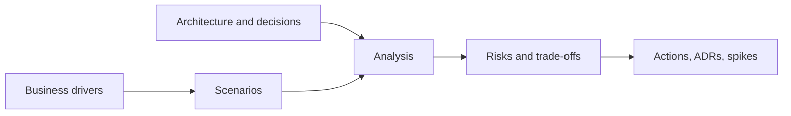

# Lightweight architecture evaluations

An architecture evaluation checks whether a design will meet the qualities that matter most (performance, availability, security, modifiability, cost) before the team commits to it. Formal methods such as ATAM take several days and a trained team. Lightweight evaluations keep the core idea and fit into a few hours, so they can be done regularly rather than once.

## The core idea

Most architecture problems come from qualities nobody stated precisely. "It must be fast" cannot be checked. A quality attribute scenario can:

| Part | Example |
| --- | --- |
| Source | 50,000 devices |
| Stimulus | reconnect at once after a regional network outage |
| Environment | normal operation, peak hour |
| Artefact | the device connection service |
| Response | accepts all connections, queues their data, sheds no data |
| Measure | all devices reconnected within 10 minutes; no data lost |

[[CAPTION:Table]] A quality attribute scenario.

The evaluation walks the design through a handful of the most important scenarios and asks: does it handle this, and how do we know?

## A simple process

1. **Prepare** (an hour or two): the architect summarises the business drivers and the design, with [C4](c4-model.md) context and container diagrams and the key [ADRs](architecture-decision-records.md).
2. **Gather scenarios** with stakeholders, and pick the top five to ten by importance and difficulty. A quality attribute tree (quality, then refinement, then scenario) helps organise them.
3. **Analyse**: for each scenario, trace how the design responds. Record:
    - **Risks**: decisions that may cause problems.
    - **Non-risks**: decisions that are sound, and why.
    - **Sensitivity points**: parameters that strongly affect a quality (queue size, timeout).
    - **Trade-offs**: decisions that help one quality and hurt another.
4. **Report**: a short list of risks, grouped into themes, each with an owner and a next step.

[[CAPTION:Figure]] The flow of a lightweight evaluation.

## Formats

- **Mini-ATAM**: the steps above in half a day.
- **Architecture review against a checklist**: quick and repeatable, though it can miss problems specific to the system.
- **Risk storming** (from Simon Brown): each participant marks risks on the architecture diagrams independently, then the group compares and discusses.
- **Decision review**: review each significant ADR when it is proposed.
- **Fitness functions**: automated tests that check an architectural quality continuously (dependency rules, response-time budgets) in the [CI pipeline](cicd-pipelines.md).

## Tips

- Do it early, when changes are cheap, and again when the design changes significantly.
- Include people who will build and run the system, not only architects.
- Separate finding risks from solving them; an evaluation that turns into a redesign session runs out of time.
- Follow up: a risk with no owner is not managed.

## Where next

- The [Handbook](../handbook/index.md) covers quality attributes and the full review process.
- The [Templates](../templates/index.md) section has an architecture review checklist.
- *Software Architecture in Practice* (Bass, Clements and Kazman) is the standard text on ATAM and quality attribute scenarios.
