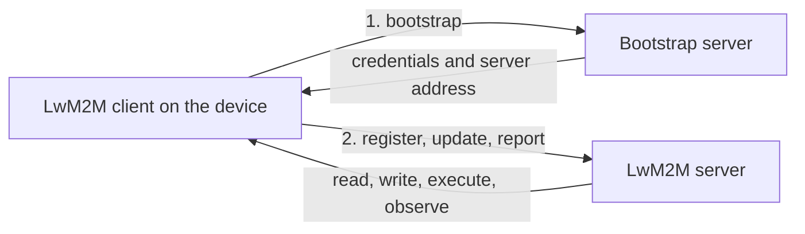

# LwM2M

LwM2M (Lightweight Machine to Machine) is a device management protocol from the Open Mobile Alliance, now maintained by OMA SpecWorks. It runs on [CoAP](coap.md) and gives a standard way for a server to provision, configure, monitor and update constrained devices. Where [MQTT](mqtt.md) moves messages and leaves their meaning to you, LwM2M defines both the transport and a data model for common device functions.

Versions 1.0 (2017), 1.1 (2018) and 1.2 (2020) are in use. 1.1 added non-IP transports and LwM2M over TCP; 1.2 added gateway support and MQTT and HTTP transports.

## The parts

[[CAPTION:Figure]] Bootstrap and registration.

- **Client**: runs on the device and exposes its resources.
- **Bootstrap server**: gives a new device the address and credentials of the management server it should use. This lets the same factory image work for any customer or region.
- **LwM2M server**: manages the device once registered.

## The object model

Everything on the device is addressed as `/object/instance/resource`. Objects are standardised and numbered:

| Object | ID | Example resource |
| --- | --- | --- |
| Security | 0 | Server URI and keys |
| Server | 1 | Registration lifetime |
| Device | 3 | `/3/0/0` manufacturer, `/3/0/9` battery level, `/3/0/4` reboot |
| Connectivity monitoring | 4 | `/4/0/2` signal strength |
| Firmware update | 5 | `/5/0/1` package URI, `/5/0/2` update |
| Location | 6 | Latitude and longitude |
| Temperature (IPSO) | 3303 | `/3303/0/5700` sensor value |

[[CAPTION:Table]] Some standard LwM2M objects.

Hundreds of further objects are registered by OMA and other bodies, including the IPSO smart objects for common sensors. Vendors can define their own.

## Operations

- **Register and update**: the device announces itself and its objects, then refreshes its registration before its lifetime expires. A sleepy device uses queue mode, and the server holds requests until the device next checks in.
- **Read, write, execute**: the server reads values, changes configuration, or triggers actions such as a reboot.
- **Observe and notify**: the server subscribes to resources, and the device reports changes, with attributes such as minimum period or "only if it changes by more than 0.5".
- **Send** (1.1 and later): the device pushes data without being asked.

Payloads use compact formats: TLV, SenML in JSON or [CBOR](cbor.md), and LwM2M CBOR in 1.2.

## Firmware updates

Object 5 defines a standard update state machine. The server gives the device a package, either by pushing it with block-wise transfer or by giving a URI to pull from. The device downloads and verifies it, the server triggers the update, and the device reports the result. Every compliant server and client agrees on this flow, which is one of LwM2M's main attractions. See [firmware over the air](firmware-over-the-air.md).

## Security

LwM2M uses DTLS with pre-shared keys, raw public keys or certificates, or OSCORE. Credentials are delivered at bootstrap, so devices can be re-keyed later without visiting them. See [TLS and DTLS](tls-and-dtls.md).

## When to choose it

LwM2M suits large fleets of constrained, often cellular, devices that need standard management, especially where devices and servers come from different suppliers. Open-source implementations include Eclipse Leshan (server), Eclipse Wakaama and Anjay (clients), and the client in Zephyr.

## Where next

- [CoAP](coap.md) covers the transport underneath.
- The [Handbook](../handbook/index.md) covers device management architecture, and the [Glossary](../glossary/index.md) defines the terms.
- OMA SpecWorks publishes the specifications and the object registry at [openmobilealliance.org](https://www.openmobilealliance.org/specifications/lwm2m).
