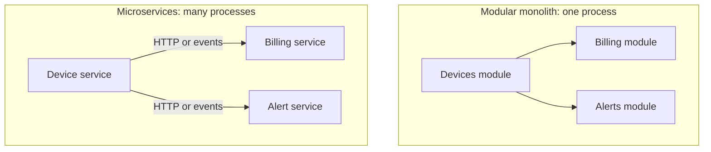

# Modular monolith or microservices

How a system is split into deployable units is one of the most expensive decisions to reverse. The two main options are a modular monolith (one deployable unit with strong internal boundaries) and microservices (many small units, each deployed on its own). The right choice depends far more on the organisation than on the technology.

## The options

- **Monolith**: one codebase, one build, one deployment. Often blamed for problems that are really the lack of internal structure.
- **Modular monolith**: still one deployment, but split into modules with clear public interfaces, each owning its own data. Modules call each other in process. Boundaries are enforced by the build or by architecture tests.
- **Microservices**: each service has its own codebase or folder, its own data store and its own deployment, and services talk over the network.

[[CAPTION:Figure]] The same three parts, in process and over the network.

## The trade-offs

| Concern | Modular monolith | Microservices |
| --- | --- | --- |
| Deployment | One pipeline; everything ships together | Independent releases per service |
| Scaling | Scale the whole application | Scale each service to its own load |
| Team autonomy | Teams share one release train | Teams own and release their services |
| Consistency | Local transactions across modules | Distributed; needs events and [sagas](saga-pattern.md) |
| Failure | One process; a crash takes everything down | Partial failure is normal and must be designed for |
| Operations | Simple: one thing to monitor | Service discovery, tracing, many pipelines, more infrastructure |
| Refactoring boundaries | Cheap: move code between modules | Expensive: change APIs and migrate data |

[[CAPTION:Table]] How the two styles compare.

## A sensible default

Start with a modular monolith unless you have a clear reason not to. Get the module boundaries right (they usually follow [bounded contexts](domain-driven-design.md)), keep each module's data private, and make modules talk through interfaces or in-process events. When a module needs to scale, release or fail independently, or a separate team owns it, extract it as a service. Good modules make that a mechanical step.

Reasons to start with microservices include several teams working at once from day one, parts with very different scaling or technology needs, or strict isolation requirements.

## Warning signs

- **The distributed monolith**: services that must be deployed together, or that share a database. You pay the costs of both styles and get the benefits of neither.
- **Nano-services**: services so small that every feature needs changes to several of them.
- **No platform**: microservices without automated deployment, monitoring and tracing become very hard to run.

Conway's law applies: a system's structure tends to mirror the communication structure of the organisation that builds it. Choose boundaries that match the teams, or change the teams.

## Where next

- [Event-driven architecture](event-driven-architecture.md) is the usual way services stay loosely coupled.
- The [Handbook](../handbook/index.md) discusses decomposition and service boundaries in more depth.
