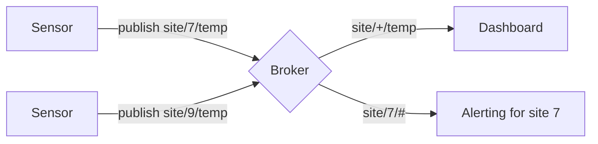

# MQTT

MQTT is a lightweight publish-subscribe messaging protocol, and the most common way for IoT devices to talk to a cloud platform. Devices and applications connect to a central broker over TCP; publishers send messages to named topics; the broker forwards each message to every client that has subscribed to that topic. Senders and receivers never need to know about each other.

It was designed by Andy Stanford-Clark (IBM) and Arlen Nipper in 1999 for monitoring oil pipelines over satellite links. It is now an OASIS standard: version 3.1.1 (also ISO/IEC 20922) and version 5.0 (2019). The name originally stood for MQ Telemetry Transport, but the standard now treats MQTT as just a name.

## How it works



[[CAPTION:Figure]] Publishers, a broker and subscribers with wildcard topics.

- **Topics** are strings with levels separated by `/`, such as `site/7/temp`. They are created simply by publishing to them.
- **Wildcards**: `+` matches one level (`site/+/temp`), `#` matches everything below (`site/7/#`). Only subscribers can use wildcards.
- **The broker** handles connections, subscriptions, delivery and authentication. Mosquitto, EMQX, HiveMQ and VerneMQ are common; most clouds offer a managed one.

## Quality of service

| QoS | Guarantee | How | Cost |
| --- | --- | --- | --- |
| 0 | At most once | Send and forget | Cheapest; messages can be lost |
| 1 | At least once | Sender repeats until it gets `PUBACK` | Duplicates possible, so receivers must be [idempotent](idempotency.md) |
| 2 | Exactly once | Four-step exchange (`PUBREC`, `PUBREL`, `PUBCOMP`) | Most traffic and state; rarely worth it |

[[CAPTION:Table]] MQTT quality of service levels.

QoS applies to each hop separately: publisher to broker, and broker to each subscriber.

## Features worth knowing

- **Retained messages**: the broker keeps the last message on a topic and sends it to new subscribers at once. Useful for "current status".
- **Last will and testament**: a message the broker publishes if a client disconnects without saying goodbye, commonly used to mark a device offline.
- **Persistent sessions**: the broker remembers a client's subscriptions and queues messages while it is offline.
- **Keep-alive**: client and broker exchange pings so dead connections are detected.
- **MQTT 5 additions**: reason codes on every acknowledgement, user properties (headers), message expiry, shared subscriptions for load-balancing consumers, topic aliases to save bytes, and request-response support.

## A Python client

```python
import paho.mqtt.client as mqtt

def on_connect(client, userdata, flags, reason_code, properties):
    print("connected:", reason_code)
    client.subscribe("site/+/temp", qos=1)

def on_message(client, userdata, msg):
    print(msg.topic, msg.payload.decode())

client = mqtt.Client(mqtt.CallbackAPIVersion.VERSION2)
client.on_connect = on_connect
client.on_message = on_message
client.tls_set()                               # use TLS in anything real
client.connect("test.mosquitto.org", 8883)
client.loop_forever()
```

[[CAPTION:Figure]] Subscribing with Eclipse Paho (version 2 of the Python library).

## Good habits

- Always use TLS (port 8883) and authenticate each device individually, ideally with a client certificate.
- Restrict each device to its own topics with broker access control lists.
- Design the topic tree up front: put the most general level first and the device identity early (`tenant/site/device/telemetry`). Do not put personal data in topic names.
- Use QoS 1 with idempotent consumers for most telemetry; QoS 0 for high-rate data where a lost sample does not matter.
- Keep payloads compact (consider [CBOR](cbor.md)) and include a timestamp and schema version.
- Reconnect with exponential backoff and jitter, so a broker restart does not cause a stampede.

## MQTT and its neighbours

MQTT needs TCP and a fairly steady connection. For very constrained devices or sleepy cellular links, [CoAP](coap.md) over UDP is lighter, and MQTT-SN is a variant for non-TCP networks. For device management (configuration, firmware updates) on top of messaging, see [LwM2M](lwm2m.md). For high-volume processing in the cloud, a bridge usually forwards MQTT into [Kafka](kafka-event-streaming.md).

## Where next

- The [Guides](../guides/index.md) and [Handbook](../handbook/index.md) cover messaging design in more depth; the [Glossary](../glossary/index.md) defines the terms.
- The [MQTT site](https://mqtt.org/) links to the specifications and to client libraries.
