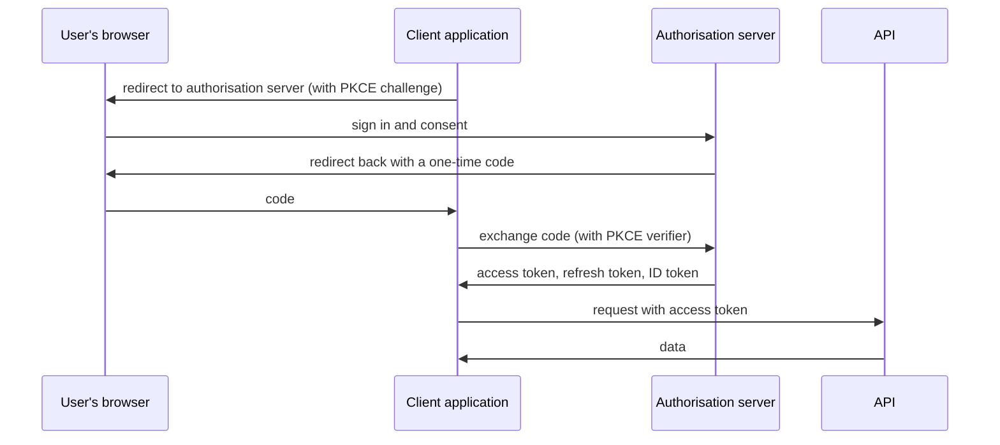

# OAuth 2.0 and OpenID Connect

OAuth 2.0 (RFC 6749) is a framework for delegated authorisation. It lets an application act on a user's behalf, with limited permissions, without ever seeing the user's password. OpenID Connect (OIDC) is a thin layer on top that adds authentication, telling the application who the user is. Together they underpin "sign in with" buttons, single sign-on in organisations, and access control for most modern APIs.

The distinction matters: OAuth answers "what may this client do?", and OIDC answers "who is the user?".

## The roles

- **Resource owner**: the user who owns the data.
- **Client**: the application that wants access.
- **Authorisation server**: signs the user in, asks for consent and issues tokens. Often an identity provider such as Microsoft Entra ID, Okta, Auth0 or Keycloak.
- **Resource server**: the API that accepts tokens.

## The authorisation code flow with PKCE

This is the flow to use for web, mobile and desktop applications.

[[CAPTION:Figure]] The authorisation code flow.

PKCE (Proof Key for Code Exchange, RFC 7636) stops an intercepted code from being used by anyone else. It is required for public clients and recommended for all.

## Other flows

| Flow | Use |
| --- | --- |
| Client credentials | Service-to-service calls with no user |
| Device authorisation (RFC 8628) | Devices without a browser or keyboard, such as a TV or an IoT gateway: the user approves on their phone using a short code |
| Refresh token | Getting a new access token without asking the user again |
| Implicit, resource owner password | Deprecated; do not use |

[[CAPTION:Table]] Which OAuth flow to use when.

## Tokens

- **Access token**: presented to the API. Often a signed JWT (JSON Web Token) containing the user, the client, the scopes and an expiry. Keep lifetimes short (minutes).
- **Refresh token**: a long-lived credential for getting new access tokens. Store it securely and rotate it on use.
- **ID token** (OIDC only): a JWT for the client that describes the sign-in: who the user is (`sub`), who issued it (`iss`), for which client (`aud`), and when.

**Scopes** limit what an access token allows (`devices:read`). OIDC adds standard scopes (`openid`, `profile`, `email`) and a UserInfo endpoint.

## Common mistakes

- Using an ID token to call an API, or an access token to identify a user.
- Not validating JWTs properly on the API: check the signature, issuer, audience and expiry, and accept only the expected algorithm.
- Storing tokens where scripts can read them in a browser. Prefer a back-end-for-front-end pattern that keeps tokens on the server.
- Redirect URIs that are not matched exactly, which lets an attacker capture codes.
- Writing your own authorisation server. Use a mature product or library.

The OAuth 2.0 Security Best Current Practice (RFC 9700, 2025) and the draft OAuth 2.1 gather the current advice in one place.

## Where next

- [Zero trust architecture](zero-trust-architecture.md) builds on strong identity.
- The [Guides](../guides/index.md) section covers integrating with an identity provider.
- [oauth.net](https://oauth.net/2/) links to all the specifications.
