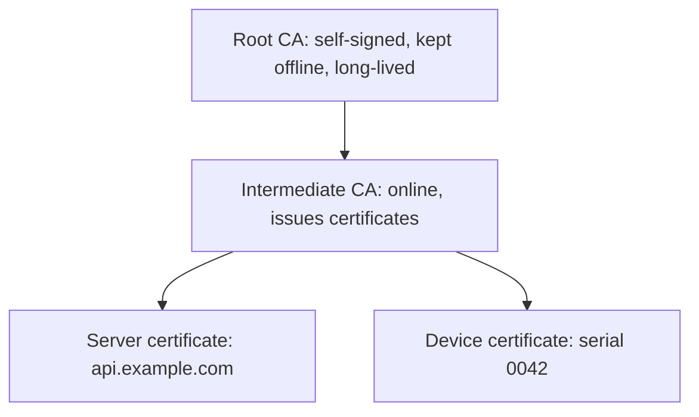

# PKI and certificates

Public-key cryptography lets anyone verify a signature with a public key, but it does not say whose key it is. A public key infrastructure (PKI) solves that. Trusted certificate authorities (CAs) sign certificates that bind a public key to an identity, such as a domain name or a device serial number. If you trust the CA, you can trust the binding.

## X.509 certificates

Almost all certificates use the X.509 format. The important fields are:

| Field | Meaning |
| --- | --- |
| Subject | Who the certificate is for: a domain, an organisation, a device ID |
| Subject Alternative Name | The names the certificate is actually valid for (browsers check this, not the subject) |
| Public key | The key being certified |
| Issuer | The CA that signed it |
| Validity | Not before and not after dates |
| Serial number | Unique per issuer; used for revocation |
| Key usage, extended key usage | What the key may do: sign, encrypt, act as a TLS server or client |
| Basic constraints | Whether this certificate may itself sign certificates (is a CA) |
| Signature | The issuer's signature over all of the above |

[[CAPTION:Table]] The main fields of an X.509 certificate.

`openssl x509 -in cert.pem -text -noout` prints them all.

## Chains of trust

[[CAPTION:Figure]] A root, an intermediate and two end-entity certificates.

A verifier holds the root certificate in its trust store. The other side presents its own certificate and the intermediates; the verifier checks each signature up to the root, plus dates, names and key usage. Keeping the root offline and issuing from intermediates means a compromised intermediate can be replaced without changing every trust store.

## The lifecycle

1. **Key generation**: ideally on the device or server itself, inside secure hardware where possible, so the private key never leaves it.
2. **Certificate signing request (CSR)**: a request containing the public key and the requested identity, signed with the private key to prove possession.
3. **Issuance**: the CA checks the request and signs the certificate.
4. **Use**: for [TLS](tls-and-dtls.md) authentication, code signing, or signing data.
5. **Renewal**: before expiry, ideally automatically. Short lifetimes limit the damage from a stolen key; public web certificates are moving to lifetimes of weeks.
6. **Revocation**: if a key is compromised, the CA revokes the certificate. Verifiers learn this from a certificate revocation list (CRL) or by asking an OCSP (Online Certificate Status Protocol) responder. Constrained devices often cannot check either, which is another reason to keep lifetimes short.

## Automation protocols

- **ACME** (RFC 8555): automated issuance and renewal, used by Let's Encrypt for web servers.
- **EST** (Enrollment over Secure Transport, RFC 7030): enrolment and renewal over HTTPS, common for devices.
- **CMP** (Certificate Management Protocol, RFC 4210 and its 2023 update RFC 9480): a fuller protocol used in industrial and telecoms PKI.
- **SCEP**: older and still common in enterprise device management.

## PKI for device fleets

Each device gets its own key pair and certificate, often in the factory, giving it an identity that cannot be copied to another device. Typical designs use a manufacturing CA to issue birth certificates, then enrol the device with an operational CA when it is first installed. Keep CA private keys in hardware security modules, and plan for how a root will be replaced long before it expires.

## Where next

- [Cryptography basics](cryptography-basics.md) explains signatures and key pairs.
- [TLS and DTLS](tls-and-dtls.md) shows certificates in use.
- The [Guides](../guides/index.md) section covers running a device PKI in practice.
