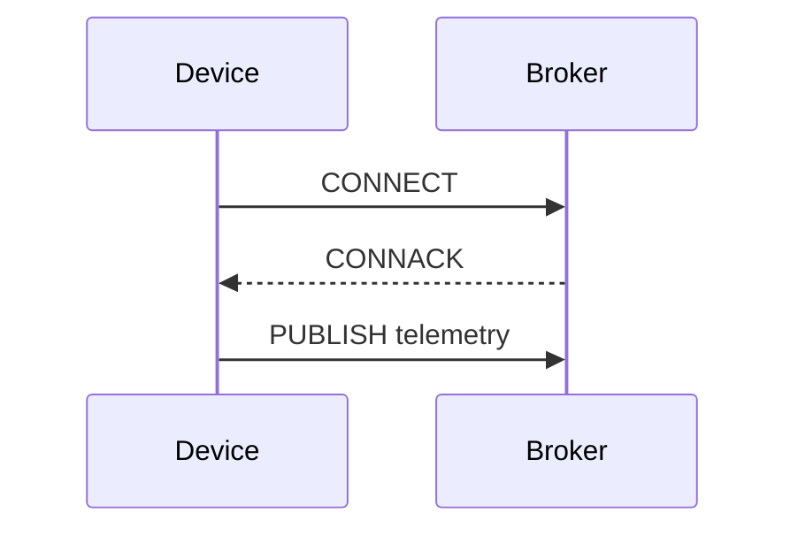
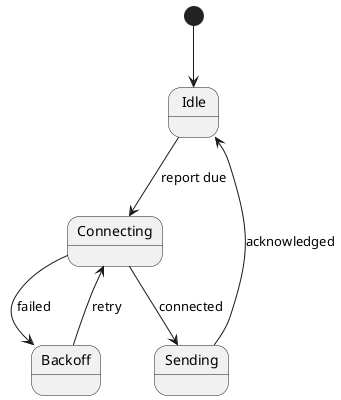

# PlantUML and Mermaid

PlantUML and Mermaid draw diagrams from text. You write a short description of the boxes and arrows; the tool lays them out and renders an image. Because the source is plain text, diagrams live in version control next to the code and changes show up as readable diffs in review. Nobody needs a drawing tool licence to fix a label.

Every diagram on this site is written this way.

## Mermaid

Mermaid is written in JavaScript and renders in the browser. GitHub, GitLab, Azure DevOps, Notion, Obsidian and MkDocs Material all display Mermaid blocks in Markdown directly, which makes it the easiest choice for documentation in repositories.

````markdown

````

[[CAPTION:Figure]] A Mermaid sequence diagram in a Markdown file.

It supports flowcharts, sequence, class, state, entity-relationship, Gantt, pie, mind map, timeline, Git graph and quadrant charts, and has experimental C4 and architecture diagrams.

## PlantUML

PlantUML is written in Java and uses Graphviz for some layouts. It is older, covers more of UML, and gives finer control over layout and styling.



[[CAPTION:Figure]] A PlantUML state diagram.

Beyond UML (sequence, use case, class, activity, component, state, deployment, timing), it draws network diagrams, Gantt charts, mind maps, wireframes, and JSON and YAML data. Its standard library adds [C4](c4-model.md) diagrams and cloud provider icons.

## Choosing

| | Mermaid | PlantUML |
| --- | --- | --- |
| Rendering | In the browser, or `mmdc` on the command line | Java (`plantuml.jar`), a server, or a container |
| Native support in GitHub and GitLab | Yes | No; needs a build step or a proxy server |
| Diagram range | Broad and growing | Broader, especially UML and C4 |
| Layout control | Limited | More options (direction, grouping, hidden links, skin parameters) |
| Best for | Diagrams in READMEs and docs viewed on code hosts | Detailed architecture and design documents built by a pipeline |

[[CAPTION:Table]] Mermaid and PlantUML compared.

Many teams use both: Mermaid for quick diagrams in repositories, PlantUML for richer architecture documents. Graphviz, D2 and Structurizr are other diagrams-as-code tools worth knowing.

## Good habits

- **One idea per diagram**, with a title. If it needs a legend to decode, it is probably two diagrams.
- **Let the tool lay out the diagram**; fighting the layout engine wastes time. Change the structure or the direction instead.
- **Keep styling in shared include files or themes**, not repeated in every diagram.
- **Check diagrams in CI** so a syntax error fails the build rather than the published page.
- **Render to SVG** for the web and PNG for documents.

## Where next

- [Docs as code](docs-as-code.md) puts diagrams into a documentation pipeline.
- [The C4 model](c4-model.md) gives a structure for architecture diagrams.
- [mermaid.js.org](https://mermaid.js.org/) and [plantuml.com](https://plantuml.com/) have the full syntax.
