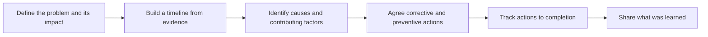

# Root cause analysis

Root cause analysis (RCA) is a structured way of finding out why a problem happened, so that it can be prevented rather than just fixed. Restarting a crashed service fixes the symptom. Finding that a log file filled the disk because new servers never had log rotation, and fixing the provisioning so it cannot happen again, fixes the cause.

## Principles

- **Blameless**: look for weaknesses in systems and processes, not for someone to blame. People hide information when they fear blame, and the next person in the same position would probably have made the same mistake.
- **Evidence over opinion**: build a timeline from logs, metrics and records before drawing conclusions.
- **Usually more than one cause**: serious incidents typically need several things to go wrong together. Stopping at the first cause found misses the others.
- **Actions, not just findings**: an RCA is only finished when the preventive actions have owners and dates.

## The process

[[CAPTION:Figure]] The steps of a root cause analysis.

## Techniques

- **Five whys**: ask "why?" repeatedly, each answer becoming the next question, until you reach something you can change in the system. Five is a guide, not a rule. It is quick but follows a single chain, so it can miss contributing causes; run it on more than one branch.
- **Fishbone (Ishikawa) diagram**: list possible causes under headings such as people, process, tools, environment, materials and measurement. Good for making sure the group considers every kind of cause.
- **Pareto analysis**: when there are many incidents, count them by cause and focus on the few causes behind most of them.
- **Fault tree analysis**: start from the failure and work down through AND and OR gates to the basic events that can produce it. Common in safety engineering, where it can be quantified with failure rates.
- **Change analysis**: ask what changed just before the problem appeared: a deployment, a configuration, a supplier, a firmware version.

## An example

A fleet of devices stops reporting for six hours.

1. Why did they stop? Their certificates expired.
2. Why did they expire? Automatic renewal failed on 30 % of devices.
3. Why did renewal fail? Those devices ran an older firmware version with a renewal bug.
4. Why was that version still in the field? A [firmware update](firmware-over-the-air.md) campaign had stalled and nobody noticed.
5. Why did nobody notice? Campaign progress was not monitored and there was no alert for certificates close to expiry.

Actions: fix the renewal bug (done), finish the campaign, add certificate-expiry monitoring, add campaign progress alerts, and review other time-limited credentials. Note that the answer to the first why was technical, but the most useful actions were about monitoring and process.

## In practice

- Run an RCA for every significant incident, and for near misses that could have been significant.
- Write it up as a postmortem: summary, impact, timeline, causes, what went well, actions. The [Templates](../templates/index.md) section has a postmortem template and a debugging checklist.
- Review open actions regularly. A backlog of unfinished preventive actions is a leading indicator of the next incident.
- Look across RCAs for repeated themes.

## Where next

- [Testing strategies](testing-strategies.md) and [code review](code-review.md) prevent many problems from reaching production.
- The [Guides](../guides/index.md) section covers incident handling and defect management.
- Google's *Site Reliability Engineering* book has a good chapter on [postmortem culture](https://sre.google/sre-book/postmortem-culture/).
