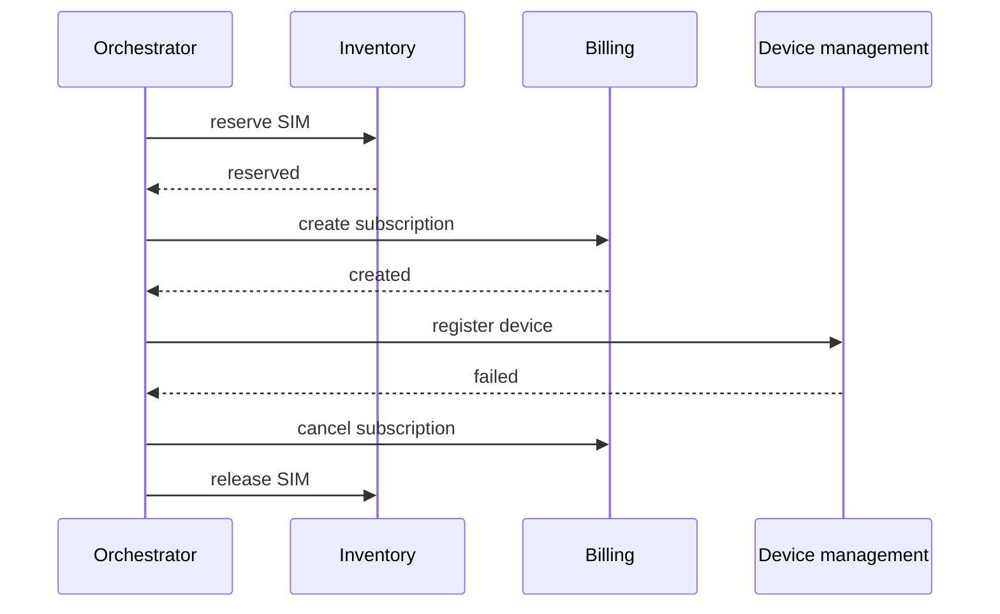

# The saga pattern

When one business operation changes data in several services, a single database transaction is no longer available. Distributed transactions (two-phase commit) exist but are slow, fragile and poorly supported by message brokers and cloud services. The saga pattern is the common alternative: a sequence of local transactions, each with a compensating action that undoes it if a later step fails.

The idea comes from a 1987 paper by Garcia-Molina and Salem on long-lived database transactions.

## An example

Provisioning a new device might involve three services:

1. Inventory reserves a SIM card.
2. Billing creates a subscription.
3. Device management registers the device.

If step 3 fails, the saga runs the compensations in reverse: cancel the subscription, then release the SIM.

[[CAPTION:Figure]] An orchestrated saga that fails at the last step and compensates.

## Orchestration or choreography

- **Orchestration**: one component (the orchestrator) tells each service what to do and tracks progress. The flow is in one place, easy to read and monitor. The orchestrator must be reliable and keeps its state durably. Workflow engines such as Temporal, Camunda or AWS Step Functions provide this.
- **Choreography**: there is no coordinator. Each service listens for events and publishes its own: `SimReserved` triggers billing, `SubscriptionCreated` triggers registration. Fewer moving parts, but the flow is spread across services and becomes hard to follow beyond three or four steps.

## Designing compensations

- A compensation is a new business action, not a rollback. A cancelled subscription may still leave an invoice line that is credited. Some actions (an email already sent) cannot be undone at all; put them last or accept them.
- Every step and every compensation must be [idempotent](idempotency.md), because they will be retried.
- Other operations can see the intermediate state. Use explicit states ("pending activation") so that half-finished work is visible and not mistaken for done.
- Decide what happens when a compensation fails. Usually: retry, then raise an alert for a person.

## The outbox

A service that updates its database and publishes an event can crash between the two. The transactional outbox pattern writes the event to an outbox table in the same transaction as the data change; a separate process then publishes from the table. This makes each saga step reliable.

## Where next

- [Event-driven architecture](event-driven-architecture.md) and [consistency models](consistency-models.md) give the background.
- The [Handbook](../handbook/index.md) covers workflow and integration patterns in more depth.
- Chris Richardson's [microservices.io](https://microservices.io/patterns/data/saga.html) describes the saga and outbox patterns with examples.
