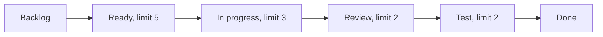

# Scrum and Kanban

Scrum and Kanban are the two most widely used ways to organise an [agile](agile-development.md) team. Scrum works in fixed-length iterations with defined roles and events. Kanban manages a continuous flow of work by making it visible and limiting how much is in progress. Both aim at the same thing: delivering value steadily and improving how the team works.

## Scrum

Scrum is defined in the *Scrum Guide* by Ken Schwaber and Jeff Sutherland, last revised in 2020.

- **Sprint**: a fixed period of one month or less, often two weeks, producing a usable increment.
- **Roles (accountabilities)**: the product owner orders the backlog and maximises value; the developers build the increment; the Scrum Master helps the team use Scrum well and removes impediments.
- **Events**: sprint planning (choose a sprint goal and the work), the daily scrum (15 minutes on progress towards the goal), the sprint review (show the increment to stakeholders) and the sprint retrospective (improve the way of working).
- **Artefacts**: the product backlog, the sprint backlog and the increment, each with a commitment: the product goal, the sprint goal and the definition of done.

## Kanban

Kanban for knowledge work was developed by David J. Anderson in the 2000s, drawing on lean manufacturing.

- **Visualise the work** on a board with a column for each stage: for example, ready, in progress, review, test, done.
- **Limit work in progress (WIP)**: each column has a maximum number of items. When a column is full, people help finish existing work rather than start new work.
- **Manage flow**: measure how long items take (cycle time) and how many finish each week (throughput), and remove the bottlenecks.
- **Make policies explicit**: what "done" means for each column, how urgent work is handled.
- **Improve continuously** using the data.

[[CAPTION:Figure]] A Kanban board with work-in-progress limits.

## Comparing them

| | Scrum | Kanban |
| --- | --- | --- |
| Cadence | Fixed sprints | Continuous flow; releases whenever ready |
| Roles | Product owner, Scrum Master, developers | None required |
| Planning | At the start of each sprint | Whenever capacity frees up |
| Change during a cycle | Avoided within a sprint | Allowed at any time |
| Main limit | Sprint capacity | WIP limits per stage |
| Main metrics | Sprint goal achieved; velocity (for the team's own planning) | Cycle time, throughput, flow |
| Best for | Product development with a stable team and a roadmap | Support, operations, maintenance, or work that arrives unpredictably |

[[CAPTION:Table]] Scrum and Kanban side by side.

## Mixing them

Many teams use Scrum's events with a Kanban board and WIP limits, sometimes called Scrumban. That is fine: the frameworks are tools. What matters is short feedback loops, finishing work before starting more, and a regular, honest look at how things are going.

## Where next

- [Agile development](agile-development.md) covers the values both frameworks share.
- The [Templates](../templates/index.md) section has definition of ready and definition of done checklists.
- [scrumguides.org](https://scrumguides.org/) has the official Scrum Guide, and the [Kanban Guide](https://kanban.university/kanban-guide/) describes the Kanban method.
