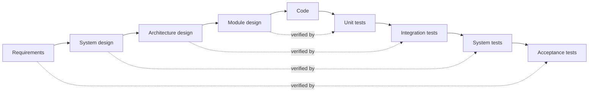

# Software development life cycles

A software development life cycle (SDLC) model describes the order in which a project does its work: understanding requirements, designing, building, testing, releasing and maintaining. Every project goes through these activities; the models differ in how they sequence them and how often they repeat them.

## Waterfall

Each phase is finished and signed off before the next begins: requirements, design, implementation, verification, maintenance. Winston Royce described it in 1970, mostly as a warning: his paper argued that the pure sequence was risky and that feedback loops were needed.

- **Strengths**: clear milestones and documents; suits fixed-price contracts and work where requirements really are stable.
- **Weaknesses**: problems surface late, in testing, when they are most expensive to fix; working software appears only at the end; change is hard.

## The V-model

The V-model is a waterfall with the testing made explicit. Each phase on the way down has a matching test phase on the way up, planned at the same time.

[[CAPTION:Figure]] Each design level is verified by its own test level.

It is common in safety-related and regulated work (automotive ISO 26262, medical IEC 62304, aerospace), where traceability from requirement to test is mandatory. In systems engineering, the V describes the whole product, hardware included.

## Spiral

Barry Boehm's spiral model (1986) repeats a cycle of planning, risk analysis, building and evaluating, with each loop producing a more complete prototype or product. Its key idea is that the biggest risks are tackled first. It suits large, novel or high-risk projects, and needs real skill in risk assessment.

## Iterative and incremental

The product is built in small slices, each one designed, built, tested and ideally delivered. Feedback from each slice shapes the next. The Rational Unified Process (RUP) formalised this, and [agile methods](agile-development.md) such as Scrum are its most popular modern form.

- **Strengths**: early working software, early feedback, room to change direction, risk reduced in small steps.
- **Weaknesses**: needs discipline to keep the architecture coherent across increments; harder to fix a price and scope up front.

## Choosing

| Situation | Good fit |
| --- | --- |
| Requirements uncertain or likely to change | Iterative or agile |
| Safety-critical, regulated, heavy verification | V-model, often with iterative development inside each phase |
| Large, novel, high technical risk | Spiral, or iterative with early risk spikes |
| Small, well-understood, fixed scope | Waterfall can work |
| Hardware and software developed together | A V-model for the product, agile for the firmware and software |

[[CAPTION:Table]] Matching the life cycle to the situation.

Real projects mix models. A medical device team might run two-week sprints for firmware inside a V-model that governs requirements, verification and release.

## Where next

- [Agile development](agile-development.md) and [Scrum and Kanban](scrum-vs-kanban.md) cover the iterative approaches used most today.
- [Testing strategies](testing-strategies.md) covers the right-hand side of the V.
- The [Guides](../guides/index.md) section describes the development process used here.
