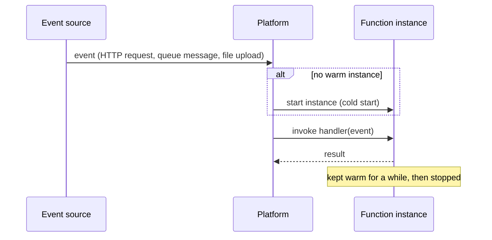

# Serverless computing

Serverless computing means running code or using services without managing the servers underneath. There are still servers; the provider runs them, scales them and charges only for actual use. A serverless function that receives no requests costs nothing.

The term covers two things:

- **Functions as a Service (FaaS)**: you upload a function, and the platform runs it in response to events. AWS Lambda, Google Cloud Run functions and Azure Functions are the main examples.
- **Serverless back-end services**: managed databases, queues, storage and API gateways that scale automatically and bill per request (DynamoDB, Firestore, S3, Pub/Sub).

## How a function runs



[[CAPTION:Figure]] A function invoked by an event.

```python
def handler(event, context):
    device_id = event["deviceId"]
    reading = float(event["temperature"])
    if reading > 70.0:
        send_alert(device_id, reading)
    return {"status": "ok"}
```

[[CAPTION:Figure]] A minimal function handler.

## Strengths

- No servers to patch or scale; the platform handles bursts automatically.
- Cost follows use, which suits spiky or low traffic.
- Natural fit for glue code: reacting to uploads, queue messages, schedules and webhooks.

## Limits

- **Cold starts**: the first request after a quiet period waits while an instance starts, from tens of milliseconds to a few seconds depending on the language and package size. Provisioned or minimum instances reduce this, at a cost.
- **Time and resource limits**: functions have maximum run times (15 minutes on Lambda) and memory limits. Long jobs need a different home.
- **Statelessness**: anything that must survive between calls goes in an external store.
- **Cost at steady high load**: per-request billing can cost more than a container that is busy all the time.
- **Lock-in and testing**: triggers and permissions are provider-specific, and a system made of many small functions can be hard to test and trace end to end.

## Good habits

- Keep functions small and focused, and keep start-up work light.
- Make handlers [idempotent](idempotency.md): event sources retry.
- Grant each function only the permissions it needs.
- Use [infrastructure as code](infrastructure-as-code.md) (AWS SAM, Serverless Framework, Terraform) rather than deploying from a console.
- Consider serverless containers (Cloud Run, AWS Fargate, Azure Container Apps) when you need longer runs or more control but still want scaling to zero.

## Where next

- [Event-driven architecture](event-driven-architecture.md) is the usual design around functions.
- The [Handbook](../handbook/index.md) covers choosing between functions, containers and virtual machines.
