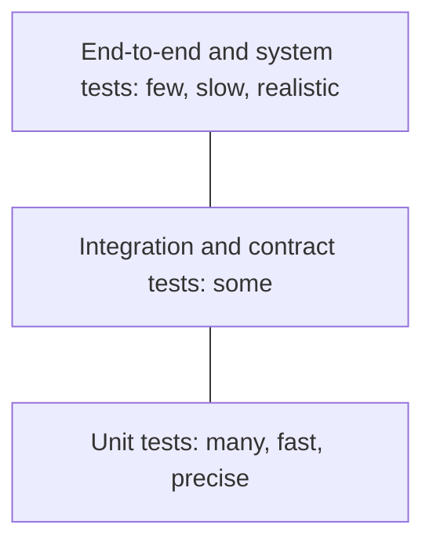

# Testing strategies

A testing strategy decides what to test, at which level, and how much, so that the team has confidence to release without spending all its time writing and maintaining tests. No strategy finds every bug. A good one finds the important ones early, when they are cheap to fix, and runs fast enough to use on every change.

## The test pyramid

[[CAPTION:Figure]] The test pyramid: most tests at the bottom.

- **Unit tests** check one function or class in isolation, in milliseconds. When one fails, it points straight at the problem.
- **Integration tests** check that components work together: code with a real database, a service with its message broker, a driver with real hardware.
- **Contract tests** check that a service and its consumers agree on an interface, without running both together. Pact is a common tool.
- **End-to-end tests** exercise the whole system as a user would. They catch the problems the other levels miss, but are slow and fragile, so keep them to the critical paths.

The shape is a guide. Some systems need more integration tests (a "testing trophy"), because most of their risk is in how parts fit together.

## Other kinds of testing

| Kind | Checks |
| --- | --- |
| Acceptance | The system does what the user or customer needs; often written with them (behaviour-driven development) |
| Performance and load | Response times and throughput under expected and peak load |
| Security | Vulnerabilities: static analysis, dependency scanning, penetration tests, fuzzing |
| Fuzzing | The code survives random and malformed input; especially valuable for parsers and protocol handlers |
| Property-based | General properties hold for many generated inputs (Hypothesis in Python, proptest in Rust) |
| Regression | Bugs once fixed stay fixed |
| Exploratory | A skilled person probing for what nobody thought to script |
| [Hardware-in-the-loop](hardware-in-the-loop-testing.md) | Firmware on real hardware, with simulated inputs and faults |

[[CAPTION:Table]] Kinds of testing beyond the pyramid.

## Good habits

- **Test behaviour, not implementation**, so refactoring does not break tests.
- **Make tests deterministic**. A flaky test is worse than none: people learn to ignore failures. Fix it or delete it.
- **Run them in the [CI pipeline](cicd-pipelines.md)** on every change, fastest first.
- **Write a failing test before fixing a bug**, so it stays fixed.
- **Use test-driven development (TDD)** where it helps: writing the test first improves design and keeps code testable.
- **Design for testability**: [dependency inversion](design-principles.md) and [hexagonal architecture](hexagonal-architecture.md) let you swap real infrastructure for fakes.
- **Treat coverage as a guide, not a target**. Low coverage shows untested code; high coverage does not prove the tests check anything. Mutation testing measures that better.

## In embedded work

Run as much as possible on the host: business logic and protocol code compiled for a PC with fakes for the hardware layer (Unity, CppUTest and GoogleTest are common frameworks). Use emulators (QEMU, Renode) for code that needs the processor, and real boards for timing, drivers and power.

## Where next

- [Code review](code-review.md) catches what tests cannot.
- The [Guides](../guides/index.md) section covers testing practice in more detail, and the [Templates](../templates/index.md) section has a definition of done.
