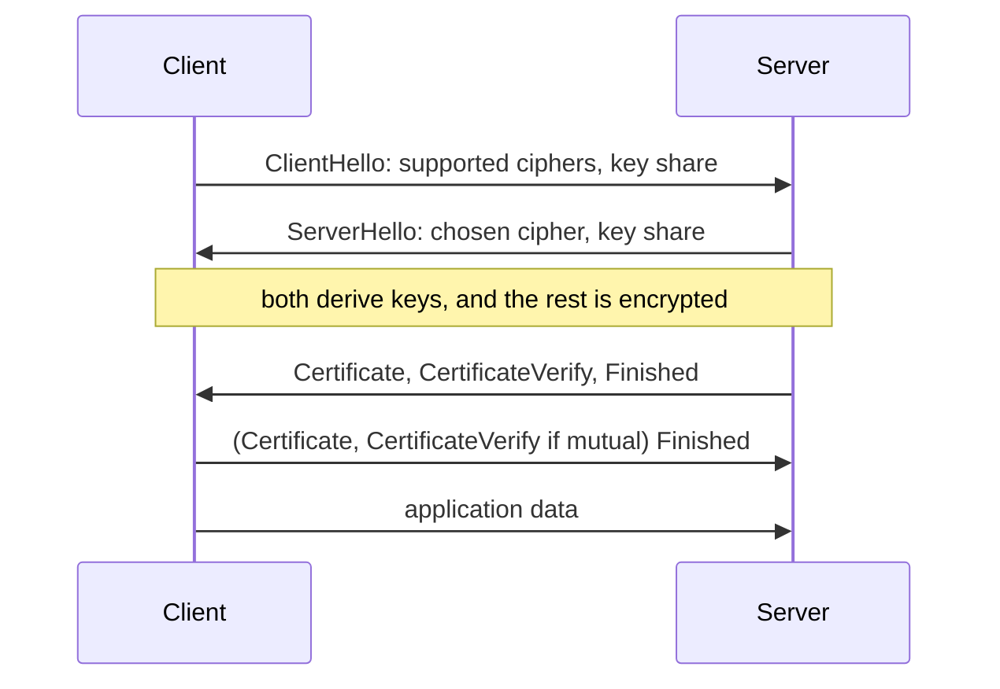

# TLS and DTLS

TLS (Transport Layer Security) creates an encrypted, authenticated channel over a reliable byte stream such as TCP. It secures HTTPS, [MQTT](mqtt.md) on port 8883, email transfer and most other internet protocols. DTLS (Datagram TLS) provides the same protection over UDP, where packets can be lost or arrive out of order, and secures [CoAP](coap.md) and [LwM2M](lwm2m.md).

TLS replaced SSL, which is long obsolete. TLS 1.0 and 1.1 are deprecated (RFC 8996). Use TLS 1.3 (RFC 8446) where you can, and TLS 1.2 with modern cipher suites where you must.

## What it provides

- **Confidentiality**: nobody on the path can read the data.
- **Integrity**: any change in transit is detected.
- **Server authentication**: the client knows it reached the right server, usually through an X.509 certificate (see [PKI and certificates](pki-and-certificates.md)).
- **Optional client authentication**: the server knows which client connected. Mutual TLS (mTLS) with a per-device certificate is the strongest common way to identify IoT devices.

## The TLS 1.3 handshake

[[CAPTION:Figure]] A full TLS 1.3 handshake takes one round trip.

TLS 1.3 removed weak options (static RSA key exchange, CBC-mode ciphers, SHA-1, RC4). It leaves five cipher suites, all with authenticated encryption and forward secrecy, so a stolen server key cannot decrypt past sessions. It also supports session resumption with pre-shared keys, and 0-RTT data, which saves a round trip but can be replayed, so use it only for idempotent requests.

## DTLS

DTLS adapts TLS to datagrams with sequence numbers, retransmission of handshake messages, and a cookie exchange to resist spoofed-source denial of service. DTLS 1.2 (RFC 6347) is the widely deployed version; DTLS 1.3 (RFC 9147) was published in 2022 and support is growing.

**Connection ID** (RFC 9146 for DTLS 1.2) matters for cellular IoT: when a sleeping device wakes up, its NAT mapping and IP address may have changed. Without a connection ID the server cannot recognise the session and a new handshake is needed, which can cost more energy than the data being sent.

## Credentials for constrained devices

- **Certificates**: the most flexible and the largest. Chains can be several kilobytes.
- **Raw public keys** (RFC 7250): just the public key, without certificate overhead, provisioned in advance.
- **Pre-shared keys (PSK)**: a symmetric key shared in advance. Very light, but the server must hold every device's key securely, and a shared key across devices is a serious weakness.

## Common mistakes

- Turning off certificate verification "temporarily" and shipping it. Always verify the chain and the host name.
- No way to update the trust store on devices, so they fail when a root CA changes.
- Clocks that are wrong at boot, so certificate validity checks fail or are skipped. Plan how a device learns the time.
- Old protocol versions or cipher suites left enabled for compatibility.

## Where next

- [Cryptography basics](cryptography-basics.md) covers the algorithms underneath.
- The [Standards](../standards/index.md) section sets the TLS versions and cipher suites used here.
- Mozilla's [server-side TLS recommendations](https://wiki.mozilla.org/Security/Server_Side_TLS) are a good reference for server configuration.
