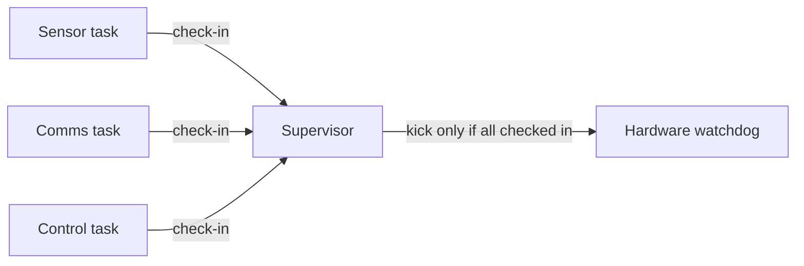

# Watchdog timers

A watchdog timer is a hardware counter that resets the microcontroller if software does not "kick" (or "feed") it within a set time. If the firmware hangs, deadlocks or runs away, the kicks stop and the watchdog restarts the device. For a device in a field or on a roof, that is often the difference between a short gap in data and a site visit.

## How it works

1. At start-up, the firmware enables the watchdog with a timeout, say two seconds.
2. During normal operation, the firmware writes to the watchdog register before the timeout expires.
3. If a kick is missed, the watchdog resets the chip.
4. After reset, the firmware reads the reset-cause register, sees a watchdog reset, logs it and carries on.

Most microcontrollers have an independent watchdog with its own clock, so it keeps working even if the main clock fails. Many also have a windowed watchdog, which resets the chip if the kick comes too early as well as too late. That catches code stuck in a tight loop that happens to include the kick.

## Kicking it properly

The common mistake is to kick the watchdog from a timer interrupt or from a low-priority idle loop. The interrupt keeps firing even when every task is deadlocked, so the watchdog never fires and the device sits hung.

A better design checks that every important task is alive:

[[CAPTION:Figure]] A supervisor kicks the watchdog only when every task has reported.

Each task sets a bit or increments a counter once per cycle. The supervisor kicks the hardware watchdog only when every task has checked in since the last kick, then clears the record.

## Good habits

- Enable the watchdog as early in start-up as possible, including in the [bootloader](bootloaders.md).
- Choose a timeout longer than the slowest legitimate operation (a flash erase, a modem attach) and short enough to recover promptly. If an operation is very long, break it up and check in between steps rather than disabling the watchdog.
- Record the reset cause and a little context (the last state, a task ID) in memory that survives reset, and report it. A rising count of watchdog resets in a fleet is an early warning of a bug.
- Avoid reset loops: if the device resets repeatedly at start-up, fall back to a safe mode or the previous firmware.
- Remember that sleep modes may or may not stop the watchdog; check the reference manual.
- Test it: deliberately hang a task on a test build and confirm the device recovers.

## Where next

- [Embedded systems design](embedded-systems-design.md) covers the wider reliability picture.
- [Hardware-in-the-loop testing](hardware-in-the-loop-testing.md) shows how to inject faults automatically.
