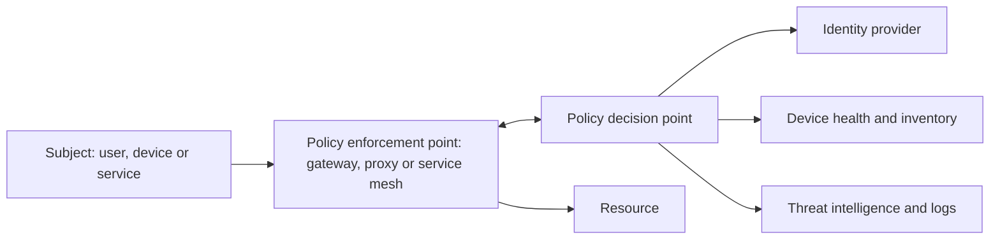

# Zero trust architecture

Traditional network security draws a perimeter: firewalls keep attackers out, and anything inside is trusted. That model fails once an attacker gets inside, through phishing, a compromised laptop or a vulnerable device. It also fits poorly with cloud services, remote working and devices spread across the internet. Zero trust drops the idea of a trusted inside. Every request is authenticated, authorised and encrypted, wherever it comes from.

The phrase is often summed up as "never trust, always verify". NIST SP 800-207 (2020) is the standard reference.

## Principles

- **Verify explicitly**: decide every access on identity (of user, device and service), device health, and context such as location and time, not on network location.
- **Least privilege**: grant only the access needed, for as short a time as needed.
- **Assume breach**: design so that one compromised component cannot reach everything. Segment, encrypt internal traffic, and monitor.

## The parts

[[CAPTION:Figure]] The logical components of NIST SP 800-207.

- **Policy decision point**: decides whether a request is allowed, using identity, device state and policy.
- **Policy enforcement point**: sits in front of the resource and enforces the decision. It might be an identity-aware proxy, an API gateway or a service mesh sidecar.
- **Signals**: identity from an identity provider, device posture from management tools, behaviour from monitoring.

## In practice

- **Strong identity for people**: single sign-on with multi-factor authentication, ideally phishing-resistant (FIDO2 passkeys). See [OAuth 2.0 and OpenID Connect](oauth-and-oidc.md).
- **Strong identity for machines**: every service and device has its own credential, such as a certificate for mutual TLS. See [PKI and certificates](pki-and-certificates.md).
- **Micro-segmentation**: small network zones, with traffic between them allowed only where needed.
- **Encrypt everything**, including traffic inside the data centre or cluster.
- **Replace VPNs** with per-application access through identity-aware proxies (zero trust network access).
- **Continuous monitoring**: log every access decision and look for anomalies.

## For IoT

Devices cannot run an agent or answer a multi-factor prompt, so zero trust for IoT relies on:

- A unique, hardware-protected identity per device, never a shared key.
- Mutual authentication with the platform, and per-device authorisation (a device can publish only to its own topics).
- Network segmentation that puts devices in their own zones with the minimum allowed traffic.
- Monitoring for behaviour that does not fit the device's profile.

## Getting there

Zero trust is a direction, not a product. Start with the most valuable resources: put strong identity in front of them, remove broad network trust around them, and add monitoring. Then extend step by step. The US CISA Zero Trust Maturity Model describes the stages.

## Where next

- [Secure coding practices](secure-coding-practices.md) and [TLS and DTLS](tls-and-dtls.md) cover parts of the picture.
- The [Handbook](../handbook/index.md) covers security architecture in more depth.
