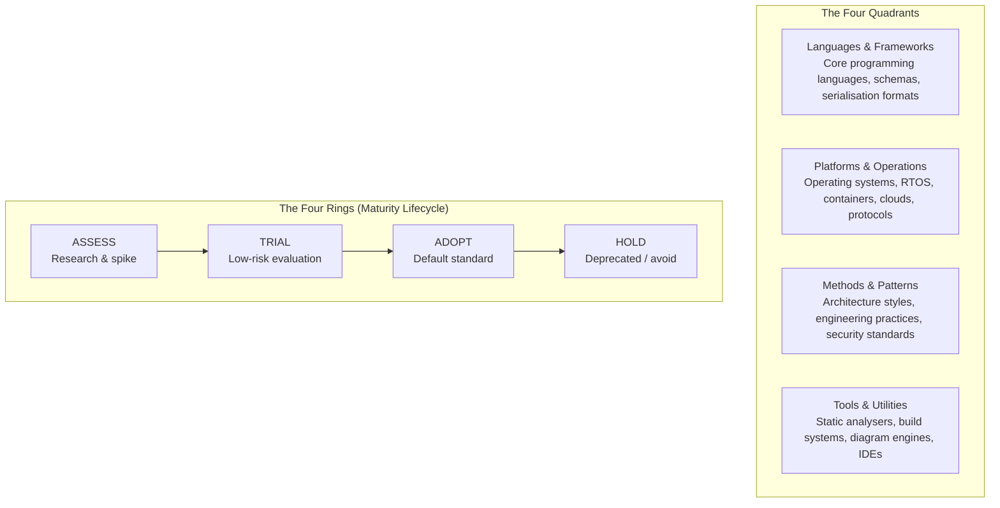
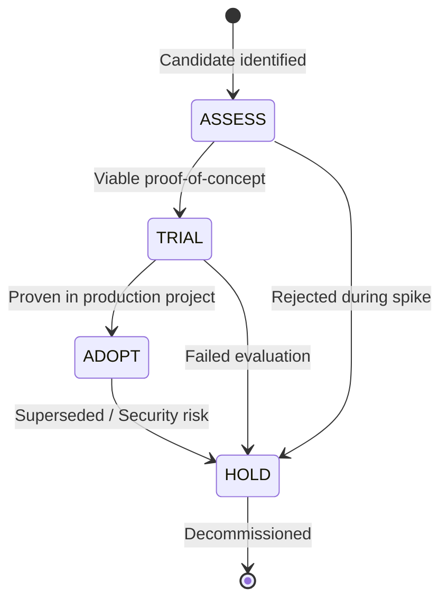

# Tech Radar

The **Technology Radar** is an opinionated, living guide that tracks the technologies, tools, architectural patterns, and operational platforms evaluated, adopted, or retired across our software engineering practice. It provides transparency into our technical stack, guides technology selection for new initiatives, prevents unnecessary architectural fragmentation, and surfaces emerging innovations.

The radar is curated collaboratively by practicing engineers through the Architecture Advisory Forum and Architecture Review Board ([ARB Guide](../guides/architecture-review-board.md)), embodying our conversational architecture approach ([Scaling Architecture Guide](../guides/scaling-architecture/02-alignment-mechanisms.md)).

---

The radar is published as four quadrant pages and a directory of every entry. On the website there is also an [interactive radar chart](https://markbac.github.io/radar-chart/), with search and filters.

| Page | Covers |
| --- | --- |
| [Languages and frameworks](languages-and-frameworks.md) | Programming languages and the frameworks around them |
| [Platforms and operations](platforms-and-operations.md) | Operating systems, runtimes, cloud platforms and protocols |
| [Methods and patterns](methods-and-patterns.md) | Architecture styles, practices and standards |
| [Tools and utilities](tools-and-utilities.md) | Development, documentation and analysis tools |
| [Directory](directory.md) | Every entry in one table, with its ring and quadrant |

[[CAPTION:Table]] The radar pages.

## Structure of the Radar

The radar categorises engineering subjects across two fundamental dimensions: **Four Quadrants** (technical domains) and **Four Concentric Rings** (lifecycle maturity).

[[CAPTION:Figure]] Conceptual structure of the Technology Radar across quadrants and lifecycle rings.

---

## The Four Rings

Every technology, tool, or practice on the radar is assigned to one of four maturity rings. Each ring conveys a precise operational recommendation and governance gate.

[[CAPTION:Figure]] Technology lifecycle transitions through the radar rings.

### 1. Adopt
- **Definition**: High-confidence, battle-tested technologies that represent the default production choice for all active squads and products.
- **Guidance**: Use whenever appropriate. Choosing an *Adopt* technology requires **zero formal ARB approval**.
- **Examples**: C (C99/C11), FreeRTOS, Docker, PlantUML, Docs-as-Code, C4 Model, Google Cloud Platform.
- **Criteria**: Proven reliability in production, strong community/vendor backing, comprehensive internal expertise, active maintainability, and alignment with corporate security benchmarks.

### 2. Trial
- **Definition**: Promising technologies that have passed initial research and are undergoing controlled evaluation on low-risk or non-critical production projects.
- **Guidance**: Squads may trial these technologies provided they establish an explicit rollback contingency and document findings in an Architecture Decision Record ([ADR Guide](../guides/decision-records.md)).
- **Examples**: Structurizr DSL, OpenTelemetry, AsyncAPI.
- **Criteria**: Successfully completed a proof-of-concept spike, demonstrated distinct advantages over current defaults, and received endorsement from the Architecture Advisory Forum.

### 3. Assess
- **Definition**: Emerging or specialized technologies under active investigation, exploration, or technical spike.
- **Guidance**: Worth exploring to understand potential future value. **Strictly prohibited in customer-facing production systems** without explicit ARB dispensation.
- **Examples**: CloudEvents, Cert C, MISRA C++, Zig, Zephyr RTOS.
- **Criteria**: Clear relevance to strategic technical goals, but unproven within our operational environment or lacking internal tooling integration.

### 4. Hold
- **Definition**: Technologies, practices, or libraries that are deprecated, obsolete, have unacceptable security postures, or generate disproportionate technical debt.
- **Guidance**: **Strictly prohibited for new greenfield projects**. Existing production workloads running *Hold* technologies should plan orderly migration or refactoring.
- **Examples**: Waterfall delivery, legacy monolithic build scripts, unsecured MQTT endpoints, outdated protocol decoders.
- **Criteria**: Superseded by modern alternatives, vendor end-of-life, persistent security vulnerabilities, or fragmentation risks.

---

## The Four Quadrants

| Quadrant | Domain Description | Representative Technologies | Guideline Alignment |
| :--- | :--- | :--- | :--- |
| **[Languages & Frameworks](languages-and-frameworks.md)** | Core programming languages, domain-specific languages, data serialisation formats, and schemas. | C, C++, C#, Rust, Python, Go, Protobuf, JSON, YAML, GraphQL. | [C Coding Standards](../standards/c-coding-standard.md), [Python Standards](../standards/python.md) |
| **[Platforms & Operations](platforms-and-operations.md)** | Hardware execution environments, embedded RTOS kernels, container runtimes, cloud platforms, and transport protocols. | FreeRTOS, Linux/Yocto, Docker, GCP, MQTT, Serverless, CloudEvents. | [Architecture Handbook: IoT & Embedded](../handbook/06-iot-and-embedded-systems.md) |
| **[Methods & Patterns](methods-and-patterns.md)** | System architecture patterns, software design principles, security specifications, and delivery methodologies. | C4 Model, Clean/Hexagonal, Modular Monolith, EDA, ETSI EN 303 645, OWASP, Agile. | [C4 Model Guide](../guides/c4-model/index.md), [Architecture Principles](../standards/software-architecture-principles.md) |
| **[Tools & Utilities](tools-and-utilities.md)** | Developer tooling, static analysis engines, compilers, diagramming tools, and automated testing suites. | PlantUML, Structurizr DSL, Mermaid, Coverity, GCC, Clang-Format, VS Code. | [Docs-as-Code Guide](../guidelines/documentation-as-code.md), [Diagrams Tooling](../guides/c4-model/02-diagrams-as-code-tooling.md) |

[[CAPTION:Table]] Summary of the four radar quadrants and their engineering documentation mappings.

---

## Technology Evaluation Lifecycle and Governance

To introduce a new technology or change an existing ring placement:

1. **Submission**: Any engineer submits an RFC ([RFC Authoring Guide](../guides/decision-records.md)) detailing the motivation, alternatives evaluated, operational risks, and migration costs.
2. **Exploration (Assess)**: The squad runs a bounded technical spike in a sandbox environment and presents quantitative metrics (binary footprint, latency, memory usage, build times).
3. **Pilot (Trial)**: If endorsed by the Architecture Advisory Forum, the technology is piloted in a scoped, non-critical service with automated test coverage and an ADR ([ADR Guide](../guides/decision-records.md)).
4. **Promotion (Adopt)**: Following successful production deployment and validation of operational runbooks, the ARB promotes the blip to *Adopt*.
5. **Sunset (Hold)**: When a technology is superseded or poses unmaintained dependencies, the ARB issues a deprecation notice and transition roadmap.

---

## Navigating the Radar

- **[Interactive Technology Radar](index.md)**: Explore the interactive visual radar canvas, filter by ring and quadrant, search blips, and click on any technology to view complete details in a popup modal.
- **[Complete Technology Blip Directory](directory.md)**: Searchable reference catalogue of all evaluated technologies, status badges, and contextual architectural rationale.
