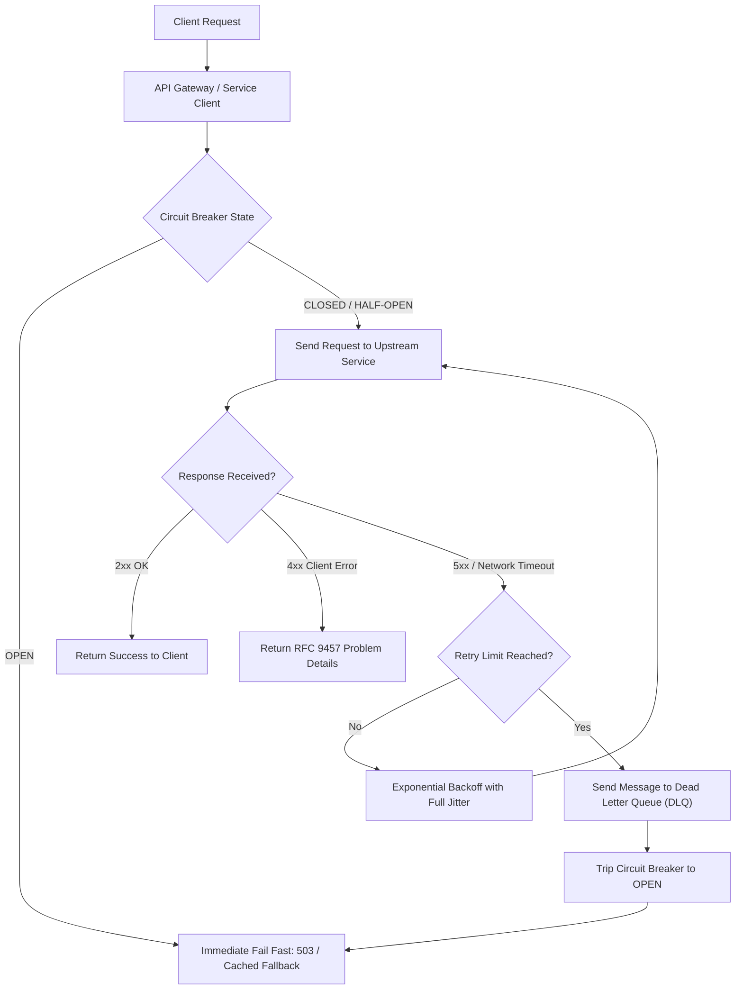

# API design and error handling

This guideline defines the engineering standards for designing robust, discoverable Application Programming Interfaces (APIs) and implementing systematic error management across cloud microservices, IoT edge gateways, and client applications.

## Purpose and Scope

Distributed systems communicate through interconnected network interfaces. Inconsistent endpoint design, ambiguous status codes, and unstandardised error responses hinder cross-team integration and complicate production troubleshooting.

This standard applies to:
- Public and partner-facing RESTful HTTP APIs.
- Internal microservice APIs deployed within cloud and on-premises environments.
- Edge-to-cloud device integration APIs and API gateways.

## 1. RESTful Resource Design Standards

All HTTP APIs MUST adhere to standard REST architectural constraints:

### 1.1 URI Structure and Naming Conventions

URIs represent resources, not actions. HTTP verbs define the operations performed upon those resources:

| Rule | Requirement | Compliant Example | Non-Compliant Example |
| :--- | :--- | :--- | :--- |
| **Resource Nouns** | Use plural nouns for collections and entities; avoid action verbs. | `/devices`, `/devices/{id}` | `/getDevice`, `/createDevice` |
| **Kebab-Case** | Use lowercase characters and hyphens for multi-word paths. | `/sensor-readings` | `/sensor_readings`, `/sensorReadings` |
| **Hierarchical Subresources** | Nest subordinate resources to denote ownership or containment. | `/devices/{id}/telemetry` | `/getTelemetryForDevice?id=12` |
| **Query Parameters** | Use query parameters exclusively for filtering, sorting, and pagination. | `/devices?status=active&page=2` | `/devices/active/page2` |

[[CAPTION:Table]] REST URI structure and naming conventions.

### 1.2 HTTP Method Semantics

APIs MUST adhere strictly to the idempotency and safety guarantees defined in RFC 9110:

| Method | Safety | Idempotency | Typical Operational Usage | Expected Success Status |
| :--- | :--- | :--- | :--- | :--- |
| `GET` | Safe | Idempotent | Retrieve a resource or collection representation. | `200 OK` |
| `POST` | Unsafe | Non-idempotent | Create a new subordinate resource or execute an operation. | `201 Created` or `202 Accepted` |
| `PUT` | Unsafe | Idempotent | Replace the target resource in its entirety with the payload. | `200 OK` or `204 No Content` |
| `PATCH` | Unsafe | Non-idempotent | Apply partial modifications to the target resource. | `200 OK` or `204 No Content` |
| `DELETE` | Unsafe | Idempotent | Remove the target resource. | `200 OK` or `204 No Content` |

[[CAPTION:Table]] HTTP method safety, idempotency, and operational semantics.

## 2. Comprehensive HTTP Status Code Reference

HTTP status codes are standardised three-digit integers informing clients of the outcome of their request. APIs MUST NOT return generic `200 OK` responses containing application-level error codes inside the response body.

### 2.1 1xx Informational Codes

- **`100 Continue`**: Indicates the server has received request headers and the client should proceed to send the request body (useful for large file or firmware uploads).
- **`101 Switching Protocols`**: The server agrees to switch protocols requested by the client Upgrade header (for example, upgrading from HTTP/1.1 to WebSocket).

### 2.2 2xx Success Codes

| Code | Name | Semantic Definition and Usage |
| :--- | :--- | :--- |
| **`200`** | OK | Standard response for successful `GET`, `PUT`, or `PATCH` operations. Response body contains the resource representation. |
| **`201`** | Created | The request succeeded and a new resource was created. The response MUST include a `Location` header containing the URI of the newly created resource. |
| **`202`** | Accepted | The request has been accepted for asynchronous processing (for example, batch firmware provisioning). Processing is incomplete. |
| **`204`** | No Content | The server fulfilled the request successfully and there is no additional content to send in the response body (typical for `DELETE`). |
| **`206`** | Partial Content | The server is delivering only part of the resource due to a `Range` header sent by the client (essential for resumable firmware updates). |

[[CAPTION:Table]] 2xx Success status codes.

### 2.3 3xx Redirection Codes

| Code | Name | Semantic Definition and Usage |
| :--- | :--- | :--- |
| **`301`** | Moved Permanently | The target resource has been assigned a new permanent URI. Clients MUST update bookmarks and caches to the URI in the `Location` header. |
| **`304`** | Not Modified | Indicates that the resource has not been modified since the version specified in request headers (`If-None-Match` or `If-Modified-Since`). Saves network bandwidth. |
| **`307`** | Temporary Redirect | The request should be repeated with another URI, but future requests should continue to use the original URI. The request method MUST NOT be changed. |
| **`308`** | Permanent Redirect | The target resource is now permanently located at another URI. Unlike 301, the request method MUST NOT change upon redirection. |

[[CAPTION:Table]] 3xx Redirection status codes.

### 2.4 4xx Client Error Codes

Client error codes indicate that the client appears to have erred (for example, malformed syntax, unauthenticated request, or invalid parameter).

| Code | Name | Semantic Definition and Usage |
| :--- | :--- | :--- |
| **`400`** | Bad Request | The server cannot process the request due to malformed request syntax, invalid query parameters, or deceptive routing. |
| **`401`** | Unauthorized | Authentication is required and has failed or has not yet been provided. The response MUST include a `WWW-Authenticate` header. |
| **`403`** | Forbidden | The server understood the request, but the authenticated identity lacks necessary permissions or scope to access the resource. |
| **`404`** | Not Found | The server cannot find the requested resource at the specified URI. |
| **`405`** | Method Not Allowed | The HTTP method used is not supported for the target resource (for example, `POST` on a read-only endpoint). Response MUST include `Allow` header. |
| **`408`** | Request Timeout | The server timed out waiting for the client to complete transmission of the request. |
| **`409`** | Conflict | The request could not be completed due to a conflict with the current state of the target resource (for example, optimistic locking collision). |
| **`410`** | Gone | The target resource is no longer available at the origin server and no forwarding address is known. Permanently removed. |
| **`413`** | Payload Too Large | The request payload exceeds the size ceiling accepted by the server or API gateway. |
| **`415`** | Unsupported Media Type | The format of the request payload (`Content-Type`) is not supported by the endpoint (for example, receiving XML on a JSON-only endpoint). |
| **`422`** | Unprocessable Content | The request syntax is well-formed, but semantic validation errors exist (for example, an invalid email address format or out-of-range sensor calibration). |
| **`429`** | Too Many Requests | The client has sent too many requests in a given time window. The response SHOULD include a `Retry-After` header indicating seconds to wait. |

[[CAPTION:Table]] 4xx Client Error status codes.

### 2.5 5xx Server Error Codes

Server error codes indicate that the server encountered an unexpected condition that prevented it from fulfilling the valid request:

| Code | Name | Semantic Definition and Usage |
| :--- | :--- | :--- |
| **`500`** | Internal Server Error | An unhandled exception or critical runtime failure occurred within the application code. |
| **`501`** | Not Implemented | The server does not support the functionality required to fulfill the request. |
| **`502`** | Bad Gateway | The server, while acting as a gateway or proxy, received an invalid response from an inbound upstream server. |
| **`503`** | Service Unavailable | The server is currently unable to handle the request due to temporary overload or scheduled maintenance. Response SHOULD include `Retry-After`. |
| **`504`** | Gateway Timeout | The server, while acting as a gateway or proxy, did not receive a timely response from the upstream back-end service. |

[[CAPTION:Table]] 5xx Server Error status codes.

## 3. Standardised Error Representation: RFC 9457 Problem Details

All error responses (4xx and 5xx) returned by HTTP APIs MUST use the RFC 9457 standard (`application/problem+json`). Custom, ad-hoc JSON error structures are prohibited.

### 3.1 Problem Details Schema

An RFC 9457 error document consists of standard top-level fields:
- `type` (string): A URI reference identifying the specific error type. Defaults to `about:blank` if no specialised document exists.
- `title` (string): A short, human-readable summary of the problem type. MUST NOT change between occurrences of the error.
- `status` (integer): The HTTP status code generated by the origin server for this occurrence.
- `detail` (string): A human-readable explanation specific to this occurrence of the problem.
- `instance` (string): A URI reference that identifies the specific occurrence of the problem (for example, an audit log identifier or tracing correlation ID).

### 3.2 RFC 9457 Payload Example

```json
{
  "type": "https://api.example.com/errors/validation-error",
  "title": "Unprocessable Content",
  "status": 422,
  "detail": "Device configuration parameters failed schema verification.",
  "instance": "/errors/txn-9843-f8a1",
  "timestamp": "2026-09-20T12:00:00Z",
  "invalidParams": [
    {
      "name": "sample_interval_sec",
      "reason": "Value must be between 10 and 3600 seconds.",
      "rejectedValue": 5
    },
    {
      "name": "reporting_mode",
      "reason": "Must be one of ['periodic', 'on_change', 'alarm'].",
      "rejectedValue": "continuous"
    }
  ]
}
```
[[CAPTION:Figure]] RFC 9457 compliant error payload with validation extensions.

## 4. Resilience and Distributed Error Management

When microservices and edge gateways communicate across unreliable networks, error management must encompass automated retry and isolation patterns.


[[CAPTION:Figure]] End-to-end distributed error handling and resilience flow.

### 4.1 Exponential Backoff with Jitter

Client libraries MUST NOT retry immediately in a tight loop. Immediate retries create "thundering herd" problems that overwhelm recovering upstream servers.

Clients MUST use exponential backoff calculated with randomized full jitter:

$$\mathrm{Sleep\ Time} = \mathrm{random}(0, \min(T_{\max}, T_{\mathrm{base}} \times 2^{\mathrm{attempt}}))$$

```python
import random
import time

def execute_with_retry(operation, max_attempts=5, base_delay_sec=0.5, max_delay_sec=10.0):
    for attempt in range(max_attempts):
        try:
            return operation()
        except (ConnectionError, TimeoutError) as exc:
            if attempt == max_attempts - 1:
                raise exc
            # Calculate exponential backoff with full jitter
            ceiling = min(max_delay_sec, base_delay_sec * (2 ** attempt))
            sleep_duration = random.uniform(0.0, ceiling)
            time.sleep(sleep_duration)
```
[[CAPTION:Figure]] Exponential backoff implementation with full jitter in Python.

### 4.2 Circuit Breaker Pattern

To protect downstream services from cascading failure, distributed clients MUST implement a Circuit Breaker with three operating states:
1. **Closed**: All requests flow normally. The circuit records failed calls. If the failure rate exceeds a threshold (for example, 50% over 10 seconds), the circuit trips to *Open*.
2. **Open**: Requests fail immediately without attempting upstream network communication, returning HTTP `503 Service Unavailable` or a cached fallback.
3. **Half-Open**: After a cooldown period, a single probe request is permitted through. If it succeeds, the circuit resets to *Closed*. If it fails, the circuit returns to *Open*.

### 4.3 Dead-Letter Queue (DLQ) Pattern

For asynchronous event-driven architectures (MQTT, Kafka, AMQP), messages that fail processing after exhausting all configured retry policies MUST be routed to a Dead-Letter Queue (DLQ).

DLQ payloads MUST include:
- The original unmutated message payload.
- Error diagnostic headers (exception type, error message, stack trace summary).
- Ingestion timestamp and total retry attempt count.
- The originating service identifier.

## Related Documents

- [Software Detailed Specification Standard](../guides/software-design-specification.md)
- [LwM2M Objects Specification](lwm2m-objects.md)
- [Architecture Review Board (ARB) Guide](../guides/architecture-review-board.md)
- [Architecture Review Checklist](../templates/architecture-review-checklist.md)
- [Fundamental Software Architecture Principles](software-architecture-principles.md)
- [Defect Management and Systematic Debugging Guide](../guides/defect-management-and-debugging.md)
