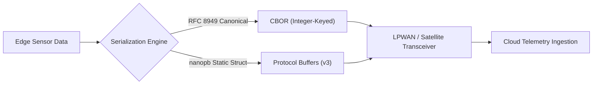
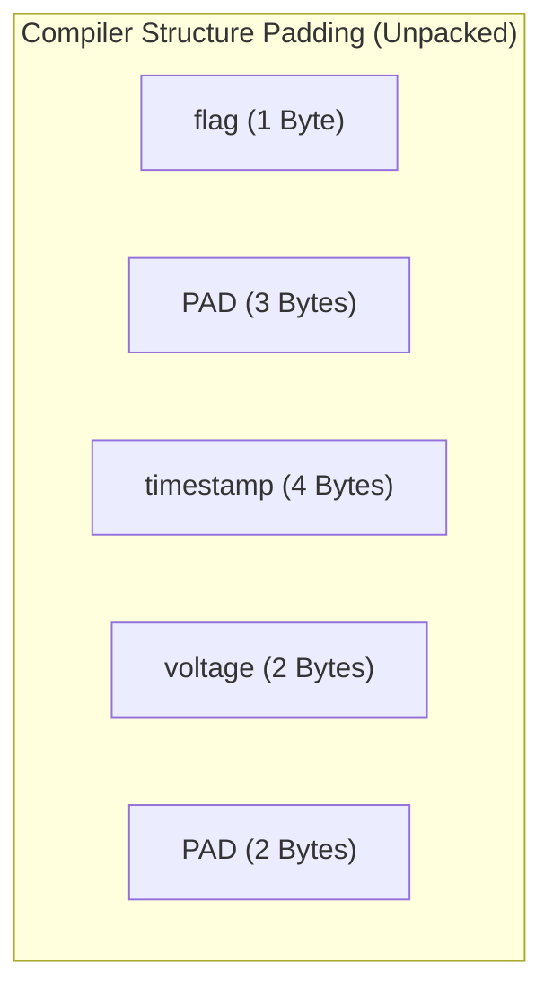

# Constrained binary payloads

## 1. Executive Summary & Policy Scope

Edge devices, industrial sensors and remote gateways often communicate over networks that are slow, metered or high-latency. Examples are cellular LPWAN (NB-IoT, LTE-M), satellite (Iridium, NTN) and wireless mesh (802.15.4, Wirepas). On these networks, sending uncompressed text such as JSON, XML or plain text costs a lot. Radio time goes up, batteries drain faster, carrier data bills rise and the microcontroller needs more RAM.

This standard establishes mandatory requirements for payload serialization across all connected devices in the enterprise portfolio.



[[CAPTION:Figure]] Approved binary serialization paths for constrained connected devices.

### 1.1 Policy Mandate

> [!IMPORTANT]
> The transmission of uncompressed textual JSON or XML over cellular LPWAN (NB-IoT, Cat-M1) or satellite links is strictly prohibited for routine periodic telemetry. All routine uplink and downlink messages must use approved compact binary serialization formats adhering to the standards defined herein.

## 2. Supported Binary Serialization Formats

Engineering teams must select between two approved serialization technologies based on system architecture requirements:

| Criterion | CBOR (RFC 8949) | Protocol Buffers (nanopb) |
| :--- | :--- | :--- |
| **Primary Standard** | IETF RFC 8949 / RFC 8610 (CDDL) | Google Protocol Buffers v3 |
| **Schema Requirement** | Optional; verified via CDDL | Mandatory `.proto` file compiled at build time |
| **Self-Describing Nature**| Yes; embedded type tags permit dynamic parsing | No; strictly positional tag-value stream |
| **MCU Memory Model** | Streaming buffer or dynamic parser (< 2 KB RAM) | Zero-allocation static C structures (< 1.5 KB RAM) |
| **Protocol Affinity** | Native standard for CoAP and LwM2M | Ideal for MQTT, gRPC, and cloud streaming |
| **Schema Evolution** | Flexible; keys can be added dynamically | Strict; field numbers must remain immutable |

[[CAPTION:Table]] Technical selection criteria for binary serialization standards.

## 3. CBOR Implementation Standards (RFC 8949)

When CBOR is selected, implementations must comply with the following architectural rules:

### 3.1 Canonical Integer-Key Mapping

To minimise payload overhead, CBOR maps must never use string literals as dictionary keys. All keys must be assigned deterministic, sequential unsigned integers:

```cddl
; Concise Data Definition Language (CDDL) Schema Specification
telemetry_message = {
    0 => uint,            ; Sequence Counter (0 to 4294967295)
    1 => uint,            ; Unix Epoch Timestamp in seconds
    2 => int,             ; Temperature in hundredths of a degree Celsius (for example, 2150 = 21.50 C)
    3 => uint,            ; Relative Humidity in tenths of a percent (for example, 552 = 55.2%)
    4 => uint,            ; Battery Terminal Voltage in millivolts (for example, 3620 mV)
    ? 5 => bstr .size 8   ; Optional Device Hardware Status Flag Mask
}
```

[[CAPTION:Figure]] Concise Data Definition Language (CDDL) schema specification.

By substituting string keys (such as `"battery_terminal_voltage"`) with single-byte integer indices (`4`), the payload size is reduced by up to 75%.

### 3.2 Canonical Deterministic Encoding

To support cryptographic hashing, signatures, and reproducible testing, CBOR encoders must follow the **Deterministic Core Encoding Rules of RFC 8949**:

1. **Integer Sizing**: Integers must be encoded using the shortest possible byte sequence. Encoders must not encode the integer `15` as a 2-byte or 4-byte sequence; it must reside in the single initial header byte.
1. **Deterministic Map Sorting**: Keys within CBOR maps must be sorted in ascending numerical order (`0`, `1`, `2`, ...).
1. **Definite Lengths Only**: Indefinite-length arrays and maps (using break codes `0xFF`) are prohibited. All collections must declare their definite length upfront.

## 4. Protocol Buffers Implementation Standards (nanopb)

When Protocol Buffers are deployed on microcontroller firmware, the implementation must use **nanopb** or an approved static memory generator.

### 4.1 Schema Definition & Tag Assignment

All message definitions must adhere to Protocol Buffers version 3 syntax (`proto3`):

```protobuf
syntax = "proto3";

package iot.telemetry.v1;

message EnvironmentalTelemetry {
    uint32 sequence_number = 1;
    uint32 timestamp_epoch = 2;
    sint32 temperature_centi_celsius = 3;  // Uses sint32 for efficient ZigZag encoding
    uint32 humidity_deci_percent = 4;
    uint32 battery_millivolts = 5;
    bytes status_flags = 6;
}
```

[[CAPTION:Figure]] Protocol Buffers telemetry schema definition.

Critical Protobuf design rules:

1. **Reserve Tags 1 to 15 for High-Frequency Fields**: Field numbers 1 through 15 require only a single byte on the wire to encode both the field number and wire type. Field numbers 16 through 2047 require 2 bytes. The most frequently transmitted measurements must use tags 1 to 15.
1. **Use `sint32` / `sint64` for Signed Negative Values**: Standard `int32` encodes negative numbers as full 10-byte varints. `sint32` uses ZigZag encoding, mapping small negative numbers (such as -1 °C) to compact 1-byte or 2-byte representations.
1. **Zero Dynamic Memory Allocation**: In embedded C firmware, `nanopb` options files (`.options`) must define fixed maximum sizes for all strings, byte arrays, and repeated fields:

```text
// telemetry.options
iot.telemetry.v1.EnvironmentalTelemetry.status_flags max_size:8
```

[[CAPTION:Figure]] Static memory options file for nanopb compilation.

This guarantees that `pb_decode()` and `pb_encode()` operate purely on static stack structures without calling `malloc()` or risking heap fragmentation.

## 5. Endianness, Struct Alignment & Padding Hazards

Directly transmitting raw C structures over radio links (`memcpy` of `struct`) is strictly prohibited due to portability and compiler alignment pitfalls:

```c
// PROHIBITED: Compilers insert silent padding bytes between fields
struct BadTelemetry {
    uint8_t  flag;        // 1 byte
    // 3 bytes of compiler padding inserted here on 32-bit MCUs!
    uint32_t timestamp;   // 4 bytes
    uint16_t voltage;     // 2 bytes
    // 2 bytes of compiler padding inserted here!
};
```

[[CAPTION:Figure]] Example of improper C structure prone to compiler padding hazards.



[[CAPTION:Figure]] Hidden compiler alignment padding wasting memory and network bandwidth.

Architectural guidelines for binary structures:

1. **Explicit Serialization**: Never cast raw pointers to structs. Use dedicated serialization helper functions or code generators.
1. **Network Byte Order**: All multi-byte numeric fields in custom binary headers must use Big-Endian (Network Byte Order) per IETF conventions, using explicit conversion macros (`htons()`, `htonl()`, `ntohs()`, `ntohl()`).

## 6. Schema Evolution and Lifecycle Management

As connected products evolve over decade-long deployments, message schemas inevitably change. Firmware and cloud platforms must maintain seamless interoperability across heterogeneous firmware revisions:

1. **Immutable Field Numbers**: In Protocol Buffers and integer-keyed CBOR, a field number once deployed must never be changed, reassigned, or repurposed for a different measurement.
1. **Field Retirement Procedure**: If a measurement is discontinued, mark the field tag as `reserved` in the schema. This prevents future firmware developers from reusing the obsolete tag:

   ```protobuf
   message EnvironmentalTelemetry {
       reserved 3, 7;
       reserved "legacy_optical_reading";
       // New fields start here
   }
   ```

   [[CAPTION:Figure]] Protocol Buffers reserved field specification.

1. **Unknown Field Resilience**: Cloud and edge decoders must ignore and discard unrecognised fields rather than aborting the decoding pipeline. Both CBOR and Protobuf inherently support skipping unknown tags.
1. **Mandatory Schema Versioning in Continuous Integration**: All `.proto` and `.cddl` files must reside in a centralised repository. Automated CI pipelines must run `buf lint` or `buf breaking` checks to fail any pull request that introduces backward-incompatible wire format alterations.
