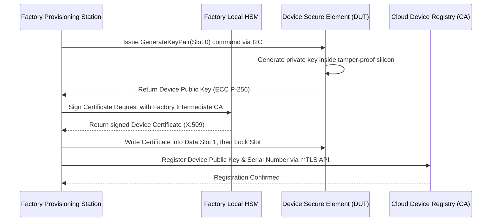
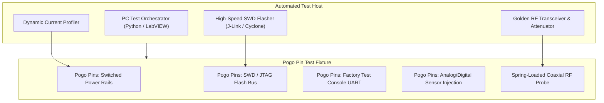

# Serialisation, provisioning and factory test

## 1. Executive Summary & Production Policy

Mass-manufacturing connected IoT devices needs rigorous automated checks before units leave the contract manufacturer. Each printed circuit board assembly (PCBA) is verified, given a deterministic identity, injected with its keys and locked. Inadequate factory testing results in high return rates and field dead-on-arrivals (DOA), while compromised provisioning processes introduce forged identities and supply chain vulnerabilities.

This standard governs hardware serialization numbering schemes, hardware root-of-trust provisioning, automated test fixtures (ATE / bed-of-nails), RF calibration, and physical debug port locking.

[[CAPTION:Figure]] Manufacturing end-of-line testing, provisioning, and locking sequence.

## 2. Universal Hardware Serialization Scheme

Every manufactured device must possess globally unique, tamper-evident identifiers inscribed in both digital non-volatile memory and physical external housing.

### 2.1 Identifier Taxonomy

| Identifier Type | Standard / Format | Storage Location | Visibility | Purpose |
| :--- | :--- | :--- | :--- | :--- |
| **Hardware Serial Number** | GS1 AI(21) alphanumeric string (16-32 chars) | Internal OTP Flash / Secure Element | Laser-etched 2D DataMatrix barcode | Inventory tracking, warranty, and field logistics |
| **IEEE MAC Address** | IEEE EUI-48 / EUI-64 hexadecimal | Secure Element / Radio OTP registers | Network frames | Local wireless addressing (BLE, Wi-Fi, 802.15.4) |
| **Cellular Identity (IMEI)** | 15-digit decimal string (3GPP TS 23.003) | Cellular Baseband NVRAM | Carrier network registration | Cellular operator whitelisting and SIM pairing |
| **Cryptographic Device ID**| SHA-256 fingerprint of Device Public Key | Secure Element X.509 Certificate | Cloud authentication handshake | Zero-touch cloud onboarding and mutual TLS (mTLS) |

[[CAPTION:Table]] Standard identifiers assigned during factory provisioning.

### 2.2 External Laser Marking & Optical Verification

1. All outer enclosures and internal PCB shields must be marked with a high-contrast **2D DataMatrix** (ISO/IEC 16022) or **QR Code** containing the serial number and device public key hash.
1. The automated test fixture must verify readability using an industrial vision camera before releasing the board clamp.

## 3. Cryptographic Provisioning & Hardware Root of Trust

Hardcoding shared symmetrical keys or compiling private keys directly into firmware binary images is strictly prohibited. Every connected device must incorporate a dedicated **Secure Element** (such as Microchip ATECC608, NXP SE050, or Infineon OPTIGA Trust M) or an on-die Hardware Security Module (HSM).

[[CAPTION:Figure]] Secure on-die key generation and certificate signing workflow.

### 3.1 Provisioning Rules

1. **On-Die Private Key Generation**: Private keys must be generated inside the Secure Element itself using a hardware True Random Number Generator (TRNG). Private keys must never leave the silicon boundary under any circumstance.
1. **Air-Gapped Factory HSM**: Device certificates must be signed locally at the contract manufacturer by a hardware security module (HSM) holding a restricted intermediate factory CA certificate. The root CA remains offline.
1. **Permanent Slot Locking**: Once the public certificate, device configuration flags, and I2C address are programmed into the Secure Element, the manufacturing script must blow the configuration fuses (`lock_config` and `lock_data`).

## 4. Automated Test Equipment (ATE) Fixture Design

To achieve deterministic test throughput (< 45 seconds per unit), production lines must use custom **Bed-of-Nails (Pogo Pin)** automated test fixtures:

[[CAPTION:Figure]] Bed-of-nails fixture subsystem layout for automated production line testing.

### 4.1 Mandatory Test Phases

Every production board must pass four sequential test gates:

1. **Power-On Short-Circuit & Quiescent Check**: Before full voltage is applied, the fixture checks for short circuits on all power rails. The power analyzer measures initial quiescent current to confirm it matches nominal baseline ($\pm 10\%$).
1. **Firmware Flashing & Integrity**: The production bootloader, primary application image, and factory diagnostic firmware are flashed via high-speed SWD. Readback CRC32/SHA-256 checksums are verified against the master build manifest.
1. **Conducted RF Verification**: To avoid antenna interference from neighboring factory equipment, RF performance is verified through a spring-loaded coaxial switch probe directly contacting the PCB RF test pad. The system verifies transmission power (Tx Power $\ge +20\,\mathrm{dBm}$) and receiver sensitivity across operating bands.
1. **Sensor Calibration**: Onboard sensors (accelerometers, temperature sensors, pressure transducers) are calibrated against precision reference standards in the fixture, and offset calibration factors are written to flash.

## 5. Security Hardening: Debug Interface Locking

Leaving physical debug interfaces (JTAG, SWD, UART bootloaders) enabled on field-deployed products allows adversaries to dump firmware binaries, reverse-engineer proprietary algorithms, and extract cryptographic credentials.

> [!CAUTION]
> Every device undergoing end-of-line packaging must have its hardware debug interfaces permanently disabled via One-Time Programmable (OTP) hardware fuses before leaving the manufacturing station.

### 5.1 Debug Port Disabling Procedure

1. After passing all functional tests and certificate verification, the test orchestrator executes the hardware lock command (for example, programming STM32 Readout Protection to RDP Level 2, or blowing NXP / Nordic access port protection fuses - APPROTECT).
1. Once RDP Level 2 is active, the SWD/JTAG debug port is permanently disabled at the silicon level. Debug probes can no longer connect, halt execution, or inspect memory.
1. The test station verifies that the debug probe can no longer read flash or registers. If the port remains open, the board is rejected.

## 6. Manufacturing Database Integration & Traceability

1. **Centralized Manufacturing Execution System (MES)**: Every test step, voltage measurement, RF power reading, and certificate hash must be logged in real time to the enterprise MES database indexed by the unique hardware serial number.
1. **Anti-Cloning Rules**: The MES must reject duplicate serial numbers or certificate requests immediately.
1. **Defect Quarantining**: Any board failing a test gate must have its serial number blacklisted in the cloud device registry, preventing rejected factory scrap from ever connecting to production cloud environments.
