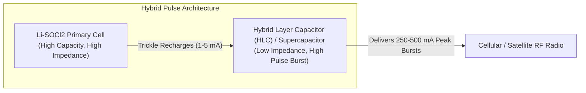
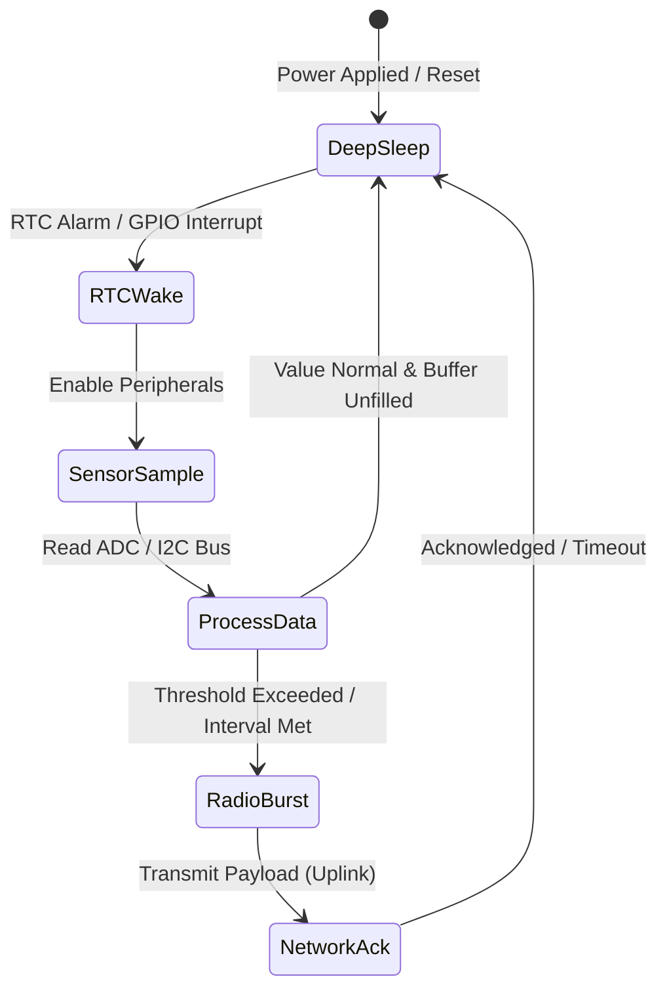
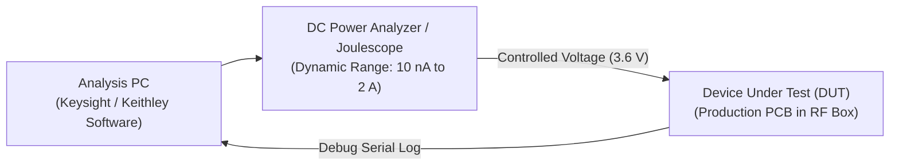

# Battery budgeting and power profiling

## 1. Executive Summary & Purpose

Connected devices in remote, industrial, commercial and outdoor settings often run on non-rechargeable primary batteries or energy-harvesting hybrids. They are expected to last from 5 to 15 years. Premature battery exhaustion in the field causes severe economic loss, necessitates emergency physical truck rolls, and degrades service-level agreements.

This standard sets the engineering practices for battery energy budgets, deterministic low-power state machines and the choice of cell chemistry. It also covers passivation, and measuring current consumption in every phase of firmware development.

[[CAPTION:Figure]] End-to-end battery budgeting and power verification workflow.

## 2. Mathematical Battery Budget Modelling

Every battery-powered IoT hardware and firmware development programme must maintain an audited, version-controlled mathematical energy budget model prior to hardware schematic sign-off.

### 2.1 The Discrete Operational Energy Formula

The device's total energy use is modelled as the sum of its operating states over an evaluation period $T_{cycle}$. It is then scaled for operating temperature and self-discharge:

$$Q_{cycle} = \sum_{k=1}^{n} \left( I_k \times t_k \right)$$

Where:

- $I_k$ is the average current draw during operational state $k$ (in milliamperes or microamperes).
- $t_k$ is the duration spent in operational state $k$ per cycle (in seconds or hours).
- $Q_{cycle}$ is the total electrical charge consumed during one complete cycle (in milliampere-hours, $\mathrm{mAh}$).

The projected device operating lifespan in years, $L_{years}$, is determined by:

$$L_{years} = \frac{C_{nom} \times \eta_{temp} \times \eta_{voltage} \times (1 - S_{annual})^{L_{years}}}{I_{avg\_annual} \times 8760}$$

Where:

- $C_{nom}$ is the manufacturer nominal battery capacity at +20°C (in $\mathrm{mAh}$).
- $\eta_{temp}$ is the environmental temperature de-rating efficiency factor (ranging from $0.60$ at -20°C to $1.0$ at +20°C).
- $\eta_{voltage}$ is the usable capacity factor dictated by the minimum operating cutoff voltage of the microcontroller and radio.
- $S_{annual}$ is the annual self-discharge rate of the cell chemistry (typically 1% to 2% per year for lithium chemistries).
- $I_{avg\_annual}$ is the time-weighted average continuous current consumption across all operational modes.

### 2.2 Peukert's Effect and High-Pulse Current Derating

Batteries exhibit non-linear capacity reduction when subjected to high-current discharge pulses. While an MCU in sleep consumes $3\,\mu\mathrm{A}$, a cellular radio transmitter burst draws between $150\,\mathrm{mA}$ and $400\,\mathrm{mA}$. Drawing high peak currents increases internal $I^2R$ resistive heating inside the cell and causes instantaneous voltage drop:

$$V_{terminal} = V_{OCV} - I_{pulse} \times R_{internal}$$

If $V_{terminal}$ drops below the brownout reset (BOR) threshold of the microcontroller or radio module (typically 2.2 V to 2.8 V), the system resets uncontrollably, resulting in a reboot loop and catastrophic battery depletion.

## 3. Battery Chemistry Selection Matrix

Selecting the appropriate primary battery chemistry requires balancing energy density, operating temperature ranges, peak pulse capability, and chemical shelf-life:

| Chemistry | Nominal Voltage | Energy Density | Pulse Capability | Temperature Range | Self-Discharge / yr | Typical Applications |
| :--- | :--- | :--- | :--- | :--- | :--- | :--- |
| **$Li-SOCl_2$ (Lithium Thionyl Chloride)** | 3.6 V | Very High (up to 650 Wh/kg) | Low (Needs HLC / Supercap) | -60°C to +85°C | < 1.0% | 10+ year outdoor environmental sensors |
| **$Li-MnO_2$ (Lithium Manganese Dioxide)** | 3.0 V | High (up to 300 Wh/kg) | High (Continuous pulses) | -40°C to +70°C | < 1.5% | Asset trackers, smart home devices |
| **$LiFePO_4$ (Lithium Iron Phosphate)** | 3.2 V | Medium (Rechargeable) | Very High (10C discharge) | -20°C to +60°C | ~2.0% | Solar-harvested edge gateways |
| **Alkaline ($Zn-MnO_2$)** | 1.5 V | Low (up to 140 Wh/kg) | Moderate (Drops rapidly) | -10°C to +50°C | ~2.0% to 5.0% | Low-cost consumer indoor sensors |

[[CAPTION:Table]] Primary battery chemistry comparison for autonomous IoT devices.

### 3.1 Mitigating Passivation in Lithium Thionyl Chloride ($Li-SOCl_2$) Cells

$Li-SOCl_2$ cells achieve decade-long shelf lives because an internal insulating passivating film of lithium chloride ($LiCl$) forms across the lithium anode, halting chemical self-discharge. However, this passivation layer dramatically increases internal cell impedance. When the radio attempts an RF transmission burst after months of sleep, the instantaneous voltage drops sharply until the layer is mechanically and electrochemically broken down.

[[CAPTION:Figure]] Hybrid layer capacitor parallel topology buffering high-current radio pulses.

Engineering requirements for $Li-SOCl_2$ systems:

1. **Parallel Pulse Buffer**: Hardware designs must incorporate a Hybrid Layer Capacitor (HLC) or pulse capacitor in parallel with the primary cell to supply peak transmission bursts without stressing the chemical cell.
1. **Firmware Depassivation Routine**: Devices waking from prolonged storage must execute an active depassivation cycle by turning on a controlled resistive load (or MCU core at full clock frequency) for 10 to 30 seconds before asserting radio power rails.

## 4. Firmware Low-Power State Machine Architecture

Firmware must be architected as an event-driven state machine that enforces aggressive duty-cycling. The system must spend greater than 99.5% of its operating life in the lowest achievable sleep state.

[[CAPTION:Figure]] Firmware power-state lifecycle transitioning between sleep, acquisition, and transmission.

### 4.1 Power State Characteristics

| State | Nominal Current | Typical Duration | Peripherals Enabled | Actions Executed |
| :--- | :--- | :--- | :--- | :--- |
| **1. Deep Sleep (PSM)** | 2.5 $\mu\mathrm{A}$ to 5 $\mu\mathrm{A}$ | 300 s to 86400 s | Low-frequency RTC (32.768 kHz), Backup RAM | Retain RAM state; core logic unpowered |
| **2. Sensor Sample** | 1.5 mA to 4.0 mA | 15 ms to 50 ms | High-speed internal RC clock, I2C/SPI bus, ADC | Read environmental transducers; power down sensors |
| **3. Processing & Flash** | 8.0 mA to 15.0 mA | 5 ms to 20 ms | Flash memory controller, crypto engine | Filter readings; write to wear-leveled storage |
| **4. Radio Sync / TX** | 120 mA to 350 mA | 1.5 s to 8.0 s | Cellular / Satellite / Sub-GHz PA transceiver | Modulate RF carrier; transmit encrypted telemetry |
| **5. Network RX Window** | 15 mA to 45 mA | 500 ms to 2000 ms | Baseband receiver, LNA | Listen for cloud downlinks and acknowledgments |

[[CAPTION:Table]] Electrical parameters across operational firmware states.

### 4.2 Critical Low-Power Firmware Design Rules

1. **Eliminate Floating GPIO Lines**: Unconnected or floating microcontroller pins oscillate randomly due to ambient electrical noise, consuming tens of microamperes per pin through CMOS input buffers. All unused pins must be configured in firmware as Analog Input mode or pulled to a deterministic rail (Pull-up or Pull-down).
1. **Disable Internal Brownout Detectors in Deep Sleep**: While brownout protection is mandatory during active execution, standard BOR circuits consume continuous quiescent current. Use ultra-low-power pulsed BOR or switch BOR off during deep sleep where hardware sequencing is safe.
1. **Employ Tickless RTOS Scheduling**: In standard RTOS configurations, a system timer interrupt fires every millisecond (1 kHz sys-tick), preventing the processor from remaining in deep sleep. The firmware must implement tickless idle, calculating the exact sleep interval until the next scheduled software timer and reprogramming the low-power hardware timer accordingly.
1. **Cut Off Peripheral Power Rails via P-Channel MOSFETs**: External sensors, operational amplifiers, and flash chips frequently leak current in standby. The hardware must place high-side load switches on peripheral power rails, allowing firmware to isolate external circuits completely during sleep.

## 5. Empirical Power Profiling Methodology

Calculated energy models must be validated against real hardware silicon across all operating temperatures (-20°C, +25°C, +60°C) using precision laboratory instrumentation.

[[CAPTION:Figure]] Instrumentation topology for empirical dynamic power profiling.

### 5.1 Required Instrumentation

1. **Dynamic Current Measurement**: Instruments must feature seamless auto-ranging across 6 decades of dynamic current range (from 10 nA to 2 A) with sampling rates of at least 100 kSa/s (such as the Keysight N6705C DC Power Analyzer or Joulescope JS220). Standard multimeters cannot capture microsecond transmission current spikes and will corrupt measurements through burden voltage drops.
1. **RF Isolation**: Radio profiling must take place inside a sealed RF shielding enclosure to ensure reproducible cellular link conditions and prevent the radio from ramping up transmission power unpredictably.

### 5.2 Verification Checklist & Acceptance Criteria

Every firmware release candidate must pass the following empirical power gates:

1. **Quiescent Deep Sleep Gate**: The physical current draw in deep sleep must not exceed 110% of the calculated component quiescent limit ($I_{sleep} \le 5.5\,\mu\mathrm{A}$).
1. **Transient Peak Gate**: Maximum peak current during RF transmission must not exceed the maximum rating of the parallel capacitor / HLC ($I_{peak} < 450\,\mathrm{mA}$).
1. **Brownout Margin Gate**: Under worst-case cold temperature (-20°C) and maximum transmission pulse, the terminal voltage at the microcontroller VCC rail must remain at least $300\,\mathrm{mV}$ above the hardware BOR reset threshold.
1. **Runaway Watchdog Gate**: If an external sensor or radio module fails to respond over I2C/SPI/UART, a hardware timer must abort the transaction within 500 ms and force the device back to sleep, preventing permanent battery drain.
