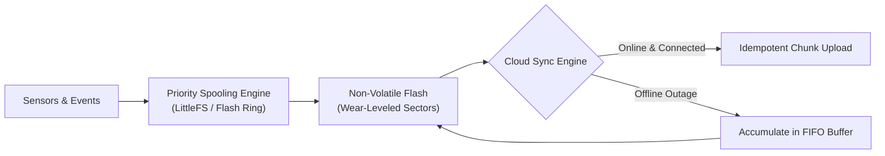
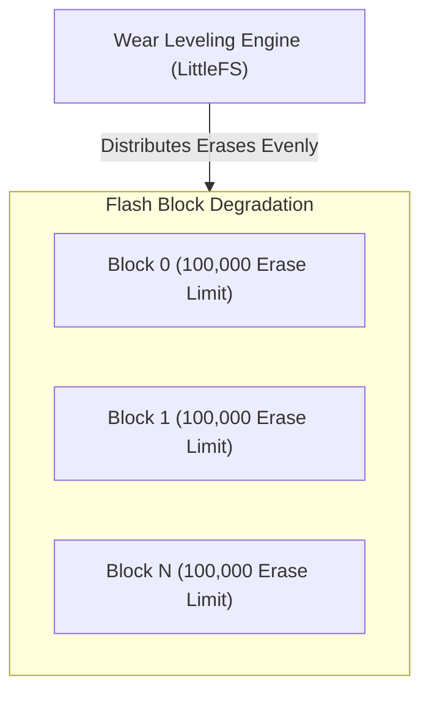
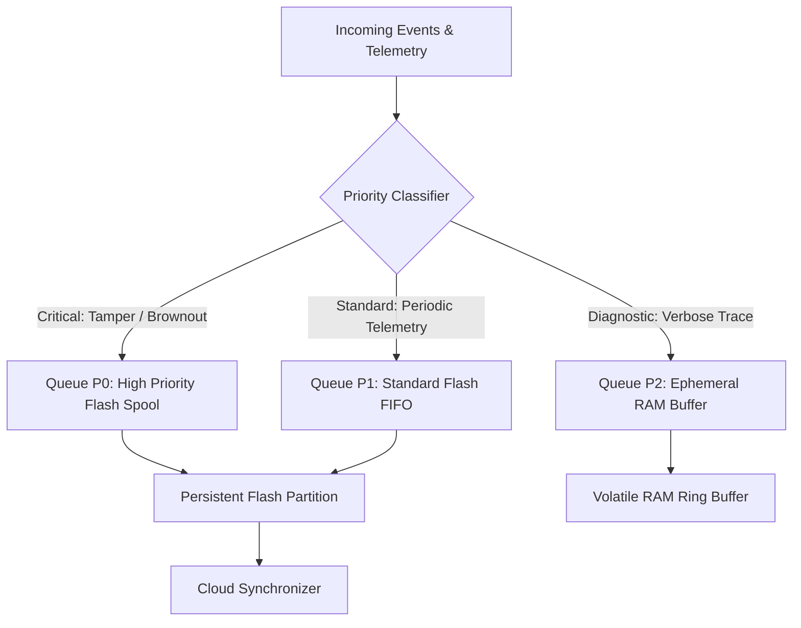
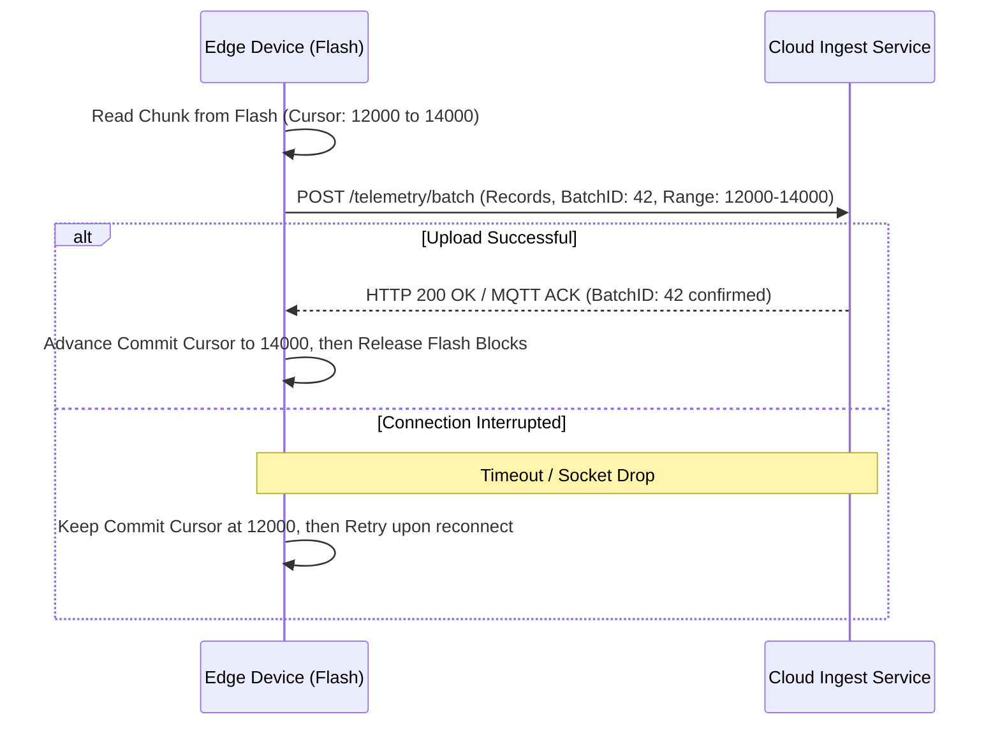

# Offline storage and synchronisation

## 1. Executive Summary & Problem Statement

Connected devices deployed in the field experience unpredictable network connectivity due to severe weather, cellular coverage dead zones, gateway reboots, and planned sleep cycles. Despite continuous or extended connectivity outages, connected devices must capture mission-critical sensor telemetry, system audit events, and tamper alarms without data loss. 

However, non-volatile solid-state storage such as NOR and NAND flash has physical limits. Flash blocks wear out with repeated write-erase cycles, and writing needs a block erase first. A sudden power loss during a write can corrupt the storage structures.

This guideline establishes mandatory architectures for embedded storage hierarchy selection, wear-leveling filesystem implementation, offline FIFO priority queuing, and reliable cloud synchronization.

[[CAPTION:Figure]] Edge offline storage and synchronization lifecycle.

## 2. Embedded Non-Volatile Storage Hierarchy

Selecting the appropriate storage technology depends on write frequency, endurance requirements, and system cost:

| Memory Technology | Erase Granularity | Write Endurance | Write Speed | Standby Power | Typical Use Case |
| :--- | :--- | :--- | :--- | :--- | :--- |
| **SPI NOR Flash** | Sector (4 KB / 64 KB) | 100,000 cycles / block | Moderate (~1 MB/s) | Ultra-low (< 1 $\mu\mathrm{A}$) | Firmware images, telemetry queues, LittleFS |
| **SPI NAND Flash** | Block (128 KB - 256 KB) | 10,000 - 100,000 cycles | High (~10-50 MB/s) | Low (~10 $\mu\mathrm{A}$) | Edge gateways, multi-megabyte logging |
| **I2C/SPI EEPROM** | Byte or Page (32-64 B) | 1,000,000+ cycles | Slow (~100 KB/s) | Ultra-low (< 1 $\mu\mathrm{A}$) | Device calibration, serial numbers, boot counters |
| **FRAM (Ferroelectric)**| Byte | $10^{14}$ (Virtually unlimited) | High (Bus speed) | Ultra-low (< 1 $\mu\mathrm{A}$) | High-frequency telemetry write buffers |
| **eMMC / SD Card** | Internal controller | Variable (Managed) | Fast (50+ MB/s) | Medium (~100 $\mu\mathrm{A}$) | Linux edge gateways, video/audio caching |

[[CAPTION:Table]] Non-volatile memory technology comparison for IoT devices.

## 3. Flash Memory Physics and Wear Leveling

Unlike volatile RAM, solid-state flash memory cannot overwrite existing data in place. Storage must be erased in large blocks (typically 4 KB sectors or 64 KB blocks) before individual pages (256 bytes) can be programmed from `1`s to `0`s.

[[CAPTION:Figure]] Wear leveling engine distributing write-erase cycles across physical flash blocks.

### 3.1 Flash Wear-Out Calculations

Repeated oxide breakdown during high-voltage erase cycles eventually causes flash cells to leak charge, leading to unrecoverable bit-flips.

Consider a device recording a 64-byte telemetry record every 60 seconds directly to a fixed 4 KB flash sector:
- Writes per day: $1,440$ records.
- Erases required per day: $\frac{1440 \times 64\,\mathrm{B}}{4096\,\mathrm{B}} = 22.5\mathrm{erases/day}$.
- Total sector lifespan without wear leveling: $\frac{100,000\mathrm{cycles}}{22.5\mathrm{erases/day}} \approx 4,444\mathrm{days} \approx 12.1\mathrm{years}$.

However, if firmware updates a single 4-byte counter in place by erasing the entire 4 KB sector each minute:
- Lifespan: $\frac{100,000}{1440} \approx 69.4\mathrm{days}$. The flash chip is physically destroyed in under ten weeks.

### 3.2 Filesystem Standard: LittleFS Mandate

For microcontroller firmware with external or internal SPI NOR flash, **LittleFS** is the mandatory embedded filesystem:

1. **Power-Loss Resilience**: LittleFS uses a copy-on-write architecture with atomic pointer updates. If power is interrupted mid-write, the filesystem rolls back cleanly to the last consistent state without sector corruption.
1. **Dynamic and Static Wear Leveling**: LittleFS tracks erase counts per block and redistributes active and static files to ensure all physical flash blocks degrade uniformly.
1. **Bounded RAM Footprint**: LittleFS does not cache full filesystem trees in RAM, operating with fixed buffer pools (< 4 KB RAM).

> [!NOTE]
> Legacy filesystems such as FAT12/FAT16/FAT32 or raw SPIFFS are strictly prohibited on raw SPI NOR flash: FAT relies on fixed-location File Allocation Tables that wear out rapidly, and SPIFFS suffers from non-deterministic garbage collection latency.

## 4. Edge Buffer Architecture & Backpressure Management

Devices must separate volatile memory logging from persistent flash spooling through a multi-tiered priority queue:

[[CAPTION:Figure]] Multi-tier priority queue segregating critical alarms from periodic telemetry.

### 4.1 Backpressure Policies During Extended Outages

When connectivity is lost for days or weeks, the persistent flash storage buffer will eventually approach capacity. The firmware must execute deterministic backpressure strategies:

1. **Priority Eviction**: Diagnostic traces (Queue P2) are dropped immediately. 
1. **Telemetry Downsampling**: Standard periodic telemetry (Queue P1) is downsampled or aggregated (for example, converting 1-minute samples into hourly minimum, maximum, and average records).
1. **Oldest-Record Dropping**: If flash utilization exceeds 95%, the oldest unacknowledged routine telemetry records must be discarded first (FIFO drop-head). High-priority alarms (Queue P0) must never be evicted.

## 5. Reliable Cloud Synchronization Protocol

Reconnecting after a multi-day network outage can cause a flood of buffered data that overwhelms cellular bandwidth or cloud ingestion endpoints. The synchronization subsystem must adhere to the following protocol rules:

### 5.1 Cursor-Based Checkpointing

Data must be retrieved and uploaded using monotonic cursor offsets rather than deleting files immediately upon sending:

[[CAPTION:Figure]] Cursor-based transaction checkpointing ensuring zero data loss during sync failures.

### 5.2 Idempotency and Deduplication

Because network connections may drop immediately after the server receives a batch but before the device receives the acknowledgment, duplicate deliveries will occur.

1. Every telemetry record must contain a unique device-scoped monotonic sequence number and UTC epoch timestamp.
1. The cloud ingestion pipeline must implement an idempotent deduplication window (using Redis or DynamoDB keys) to suppress retransmitted batches without failing the upload pipeline.
1. Uplink batch sizes must be capped to fit within standard transport MTUs (for example, 512 bytes to 1024 bytes per cellular transmission burst) to prevent fragmented packet retransmissions.
