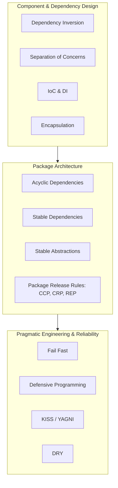
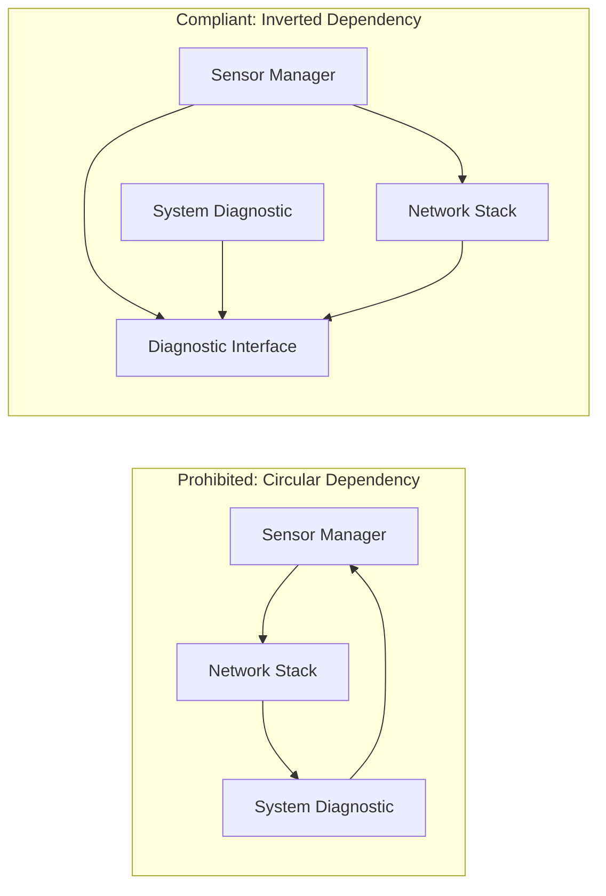

# Software architecture principles

This guideline defines the 23 foundational software architecture principles that govern system design across embedded firmware, edge appliances, and cloud services. Adhering to these principles ensures that software systems remain maintainable, testable, scalable, and resilient over multi-year operational lifecycles.

## Overview and Categorisation

> [!NOTE] Relationship to IoT Device Architecture Principles ([IoT device architecture principles](iot-device-architecture-principles.md))
> [Software architecture principles](software-architecture-principles.md) defines foundational, domain-agnostic software architecture principles (SOLID, package coupling, dependency inversion, defensiveness) applicable to all software components. When designing firmware or physical hardware devices operating in constrained, hostile, or regulated environments, these software principles are specialised and extended by [IoT device architecture principles](iot-device-architecture-principles.md), which governs whole-device concerns including functional safety, hardware isolation, power budgets, secure boot, and cryptographic roots of trust.

Architectural principles operate at a higher level of abstraction than individual coding idioms. They establish governing boundaries for subsystem decomposition, dependency management, package cohesion, and run-time failure handling.

The 23 principles are organised into four architectural categories:

| Category | Principles Included | Focus Area |
| :--- | :--- | :--- |
| **Component & Dependency Design** | DIP, SoC, IoC, DI, LoD, Encapsulation | Decoupling abstractions from concrete implementations and isolating volatile logic. |
| **SOLID & Class Design** | SRP, OCP, LSP, ISP | Ensuring cohesion, extensibility, and substitutability across object and interface boundaries. |
| **Package & Modular Architecture** | ADP, SDP, SAP, CCP, CRP, REP | Governing package composition, versioning stability, and release boundaries. |
| **Pragmatic Engineering & Reliability** | DRY, KISS, YAGNI, POLA, CQS/CQRS, Fail Fast, Defensive Programming | Preventing premature complexity, ensuring predictable behaviour, and trapping faults early. |

[[CAPTION:Table]] Categorisation of the 23 fundamental software architecture principles.


[[CAPTION:Figure]] Interplay between architectural principle categories.

## 1. Component and Dependency Design Principles

### 1.1 Dependency Inversion Principle (DIP)

High-level policy modules MUST NOT depend upon low-level detail modules; both MUST depend upon abstractions. Abstractions MUST NOT depend upon details; details MUST depend upon abstractions.

In embedded firmware and IoT architectures, concrete hardware drivers (for example, a specific I2C temperature sensor or SPI flash chip) frequently change across board revisions. The core application logic must depend solely on an abstract sensor or storage interface.

```c
/* Low-level sensor abstraction */
typedef struct {
    int (*read_temperature)(void *context, float *temp_celsius);
    int (*reset)(void *context);
} sensor_interface_t;

/* High-level telemetry service depends on the abstraction, not concrete hardware */
typedef struct {
    const sensor_interface_t *sensor_api;
    void *sensor_context;
} telemetry_service_t;

int telemetry_service_sample(telemetry_service_t *svc, float *result) {
    if (svc == NULL || svc->sensor_api == NULL) {
        return -1;
    }
    return svc->sensor_api->read_temperature(svc->sensor_context, result);
}
```
[[CAPTION:Figure]] Dependency Inversion in C via function pointer interface structures.

### 1.2 Separation of Concerns (SoC)

A software system MUST be separated into distinct sections such that each section addresses a separate concern. Common partitions separate business logic, user interface, network transport protocols, and persistent data storage.

Separation of Concerns is the foundational driver behind Layered Architecture, Clean Architecture, and Hexagonal Architecture (Ports and Adapters). Modifying the underlying persistence mechanism (for example, swapping SQLite for Flash Data Storage) must never require modifying business calculation logic.

### 1.3 Inversion of Control (IoC)

Inversion of Control shifts the responsibility of execution flow, component lifecycle management, and control dispatch from custom application code to an underlying framework or event loop.

In traditional procedural code, application logic directly creates and calls helper routines. Under IoC, the framework executes the overall lifecycle and invokes registered application callbacks when specific lifecycle events occur (for example, RTOS task schedulers, GUI event dispatchers, or asynchronous event loops).

### 1.4 Dependency Injection (DI)

Dependencies MUST be supplied (injected) into a component at instantiation or configuration time rather than instantiated internally by the component itself.

Dependency injection facilitates unit testing through mock or stub implementations without requiring conditional `#ifdef` compilation or runtime global state manipulation.

```python
from typing import Protocol

class TelemetryPublisher(Protocol):
    def publish(self, topic: str, payload: bytes) -> bool: ...

class DeviceMonitor:
    def __init__(self, publisher: TelemetryPublisher) -> None:
        self._publisher = publisher  # Injected dependency

    def report_status(self, device_id: str, battery_mv: int) -> bool:
        message = f'{{"device": "{device_id}", "battery": {battery_mv}}}'.encode('utf-8')
        return self._publisher.publish(f"devices/{device_id}/status", message)
```
[[CAPTION:Figure]] Dependency Injection in Python using Protocol structural typing.

### 1.5 Law of Demeter (LoD / Principle of Least Knowledge)

A unit or method SHOULD only have knowledge of its immediate collaborators and MUST NOT traverse structural navigation chains (`a.getB().getC().doAction()`).

Violating the Law of Demeter tightly couples calling code to internal structural layouts. A change in intermediate object hierarchies ripples across distant callers. Components must expose direct intent-revealing operations rather than exposing nested data structures.

### 1.6 Encapsulation and Information Hiding

Modules MUST hide their internal data representations and implementation algorithms behind stable, public functional interfaces.

Exposing raw internal structs or state variables forces client code to manage invariance and concurrency. In C firmware, opaque pointer idioms (`typedef struct sensor_context sensor_context_t;` declared in header, defined only in `.c`) ensure internal state cannot be manipulated directly by external modules.

## 2. SOLID Class and Interface Design Principles

### 2.1 Single Responsibility Principle (SRP)

A class, module, or component MUST have one, and only one, reason to change.

Every software component must encapsulate a single cohesive aspect of system functionality. If a module formats telemetry payloads, manages flash writing, and establishes LTE connections, it possesses three reasons to change. It must be refactored into three independent modules.

### 2.2 Open-Closed Principle (OCP)

Software entities (classes, modules, functions) MUST be open for extension, but closed for modification.

System capabilities should be extensible by adding new code (such as new plugin implementations, protocol codecs, or strategy objects) without modifying tested, existing source code.

### 2.3 Liskov Substitution Principle (LSP)

Subtypes MUST be substitutable for their base types without altering the correctness or behavioural expectations of the programme.

If an interface promises that `read()` is non-blocking, a derived implementation must not execute a blocking network request. Preconditions must not be strengthened in a subtype, and postconditions must not be weakened.

### 2.4 Interface Segregation Principle (ISP)

Clients MUST NOT be forced to depend on methods or interfaces that they do not use.

Large, monolithic interfaces ("fat interfaces") must be decomposed into smaller, role-specific interfaces. For instance, splitting a combined `DeviceController` into `ReadableSensor`, `ActuatorTarget`, and `DiagnosticProbe` prevents read-only modules from depending on configuration or power-down methods.

## 3. Package and Modular Architecture Principles

When grouping classes and functions into deployable packages, libraries, or RTOS static modules, the following package design principles apply:

### 3.1 Acyclic Dependencies Principle (ADP)

The dependency graph between packages or architectural subsystems MUST NOT contain cycles.

Circular dependencies (`Package A -> Package B -> Package C -> Package A`) create tight coupling that forces all components in the cycle to be compiled, tested, and released simultaneously. Cycles must be broken by introducing an intermediate abstraction interface or extracting shared types into a new, lower-level package.


[[CAPTION:Figure]] Breaking circular package dependencies with intermediate interface modules.

### 3.2 Stable Dependencies Principle (SDP)

Dependencies MUST point in the direction of stability: a package SHOULD depend only on packages that are more stable than itself.

Stability in software architecture is defined by the effort required to make a change. A package with many incoming dependencies is highly stable because altering it requires updating all dependants. Highly volatile packages (such as UI or experimental drivers) must depend on stable packages (core protocols and mathematical models).

### 3.3 Stable Abstractions Principle (SAP)

A package SHOULD be as abstract as it is stable.

Stable packages must consist largely of interfaces and abstract definitions so that their behaviour can be extended without modifying their source code. Volatile packages should contain concrete implementations that can be modified rapidly without impacting external consumers.

### 3.4 Common Closure Principle (CCP)

Classes or files that change together for the same business or technical reason MUST be packaged together into the same component.

The Common Closure Principle is the package-level equivalent of the Single Responsibility Principle. When requirements change, the modifications should be confined to a minimal number of packages.

### 3.5 Common Reuse Principle (CRP)

Classes or modules that are not used together SHOULD NOT be packaged together.

Packages must not force dependants to take dependencies on code they do not need. If a library bundles a Bluetooth stack with an unrelated FAT32 file system, clients using only the file system are burdened with Bluetooth code, security exposure, and memory overhead.

### 3.6 Reuse/Release Equivalence Principle (REP)

The granule of reuse is the granule of release. Anything that is reused across team boundaries MUST be tracked, versioned, and released through formal version control.

Shared code cannot be managed by ad-hoc file copies or unversioned subdirectories. Shared libraries and modules must maintain explicit Semantic Versioning (`MAJOR.MINOR.PATCH`) to ensure predictable integration.

## 4. Pragmatic Engineering and Reliability Principles

### 4.1 Don't Repeat Yourself (DRY)

Every piece of knowledge or business logic MUST have a single, unambiguous, authoritative representation within a system.

Duplication of logic (such as copying packet parsing routines across microservices or firmware modules) inevitably leads to divergence, where bug fixes applied to one copy fail to reach others. DRY applies to operational knowledge, configuration schemas, and protocol definitions, not merely identical lines of syntax.

### 4.2 Keep It Simple (KISS)

Systems perform best when kept simple rather than made complex; simplicity MUST be a key design goal and unnecessary complexity avoided.

Architectures must prioritise direct, understandable solutions over elaborate abstraction layers that provide no current functional value. The simplest viable architecture is the easiest to verify, maintain, and debug.

### 4.3 You Aren't Gonna Need It (YAGNI)

Software components and capabilities MUST NOT be implemented until they are actually required by verified requirements.

Designing for speculative future requirements ("what if we switch to a distributed blockchain datastore later?") wastes development time. It inflates code size and introduces bugs into capabilities that may never be deployed.

### 4.4 Principle of Least Astonishment (POLA)

Component interfaces, function signatures, and system behaviours MUST behave in a manner that least surprises the user or consuming developer.

Functions must not produce unexpected side effects. A method named `calculate_checksum()` must not silently mutate packet headers or write to flash storage. Naming conventions, return codes, and error modes must remain strictly consistent across the entire codebase.

### 4.5 Command Query Separation (CQS) and CQRS

Methods that modify state (Commands) SHOULD NOT return data, and methods that return data (Queries) MUST NOT modify observable state.

At the micro level (CQS), separating mutations from state queries simplifies reasoning and concurrency control. At the system level (Command Query Responsibility Segregation, CQRS), reads and writes go through separate data models. Telemetry ingestion and analytical queries can then scale, and be stored, independently.

### 4.6 Fail Fast

Systems and software routines MUST detect and report operational failures as close as possible to the point of origin, terminating or rejecting the transaction immediately.

Failing fast prevents silent data corruption. When a parameter validation fails or a communication packet fails a CRC check, the routine must return an explicit error immediately rather than continuing execution with corrupted internal state.

```c
int lwm2m_codec_decode_tlv(const uint8_t *buf, size_t len, lwm2m_tlv_t *out) {
    /* Fail Fast: validate parameters immediately */
    if (buf == NULL || out == NULL || len == 0) {
        return -EINVAL;
    }
    if (len < TLV_MIN_HEADER_SIZE) {
        return -EBADMSG;
    }
    /* Proceed with decoding only when inputs are verified */
    return parse_tlv_header(buf, len, out);
}
```

[[CAPTION:Figure]] Fail Fast parameter and buffer validation in C.

### 4.7 Defensive Programming

Components MUST defend their operational integrity against unexpected inputs, network corruption, hardware faults, and downstream service failures.

Defensive programming mandates:

- Strict boundary validation of all external inputs and deserialised payloads.
- Range checking on array indices, pointers, and numeric calculations to prevent buffer overflows and integer wrap-around.
- Robust timeout handling on all inter-process and network socket communications.
- Watchdog timer refresh only after successful execution of critical task loops.

## Summary Checklist

| Principle | Core Question for Architecture Reviews |
| :--- | :--- |
| **DIP** | Do high-level business policies depend exclusively on abstract interfaces? |
| **SoC** | Are business logic, persistence, and communications partitioned into separate layers? |
| **IoC / DI** | Are dependencies injected into modules rather than hardcoded internally? |
| **LoD** | Are objects interacting only with their immediate collaborators? |
| **SRP** | Does each module or subsystem have only a single reason to change? |
| **OCP** | Can new capabilities be added by adding code rather than modifying core logic? |
| **LSP** | Can all interface implementations be substituted without breaking contracts? |
| **ISP** | Are client interfaces small, focused, and free of unused operations? |
| **ADP** | Is the package dependency graph strictly acyclic? |
| **SDP / SAP** | Do dependencies point toward stability, and are stable packages abstract? |
| **CCP / CRP** | Do packaged classes change together and are they reused together? |
| **DRY** | Is every business rule and protocol schema defined in exactly one place? |
| **KISS / YAGNI** | Is the design free of speculative complexity and unneeded abstraction? |
| **Fail Fast** | Are invalid arguments and corrupted frames rejected immediately at boundaries? |
| **Defensive** | Are buffers bounded, timeouts enforced, and error conditions handled? |

[[CAPTION:Table]] Summary verification matrix for the 23 fundamental architecture principles.

## Related Documents

- [Design Checklist Guide](../templates/design-review-checklist.md)
- [ADR Authoring Guide](../guides/decision-records.md)
- [Software Detailed Specification Standard](../guides/software-design-specification.md)
- [Architecture Review Board (ARB) Guide](../guides/architecture-review-board.md)
- [Architecture Review Checklist](../templates/architecture-review-checklist.md)
- [API Design and Error Management Standards](api-design.md)
