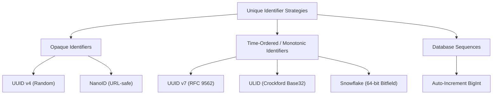
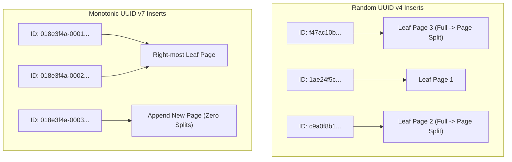

# Unique identifiers

This guideline establishes the engineering standard and architectural decision framework for generating, storing, and indexing unique identifiers across distributed systems, relational databases, event streams, and constrained IoT edge devices.

## 1. Context and Problem Space

Selecting an identifier scheme is one of the most critical structural decisions in software and data architecture. Primary keys and entity identifiers impact storage efficiency, database index performance, cache locality, horizontal scalability, and information security.



[[CAPTION:Figure]] Taxonomy of unique identifier schemes.

### 1.1 The Pitfalls of Centralised Database Sequences

Relational database autoincrementing sequences (such as PostgreSQL `BIGSERIAL` or MySQL `AUTO_INCREMENT`) provide sequential integers that are computationally cheap to index. However, they introduce severe architectural liabilities in modern distributed architectures:

- **Single Point of Failure and Contention**: A centralised database must coordinate every sequence increment, generating latch contention under high write throughput.
- **Inability to Generate Offline or at the Edge**: Constrained edge gateways and mobile clients cannot allocate IDs without an active network roundtrip to the primary database.
- **Predictability and Security Exploitation**: Sequential IDs expose business intelligence (for example, competitors can deduce daily order volume by subtracting consecutive order numbers) and invite Insecure Direct Object Reference (IDOR) traversal attacks.

## 2. Comparative Evaluation of Identifier Implementations

Architects must evaluate candidate identifier schemes across six primary architectural vectors:

- **Bit Length and Storage Footprint**: Memory overhead in RAM caches and on-disk tables.
- **Lexicographical Sortability**: Ability to insert sequentially without random disk I/O.
- **B-Tree Index Fragmentation**: Mitigating leaf page splits and random page rewrites.
- **Collision Resistance**: Mathematical entropy under high concurrent generation rates.
- **URL and Human Friendliness**: Readability in debug logs and browser query parameters.
- **Information Leakage**: Risk of exposing MAC addresses, internal IP addresses, or creation timestamps.

| Identifier Type | Size (Bits / Bytes) | String Format | Monotonic / Sortable | Collision Entropy | Primary Use Case |
| :--- | :--- | :--- | :--- | :--- | :--- |
| **Database Sequence** | 64 bits (8 B) | Integer string | Fully sequential | Zero (coordinated) | Legacy single-instance OLTP or OLAP data warehouses. |
| **UUID v1** | 128 bits (16 B) | 36-char hex hyphenated | Partially (60-bit timestamp) | Low (MAC + clock seq) | Deprecated; leaks device hardware MAC address. |
| **UUID v4** | 128 bits (16 B) | 36-char hex hyphenated | None (fully random) | High (122 bits entropy) | Cryptographic nonces, ephemeral tokens, low-write tables. |
| **UUID v7 (RFC 9562)** | 128 bits (16 B) | 36-char hex hyphenated | Millisecond sortable | High (74 bits entropy) | **Standard recommended default** for modern RDBMS/NoSQL primary keys. |
| **ULID** | 128 bits (16 B) | 26-char Crockford Base32 | Millisecond sortable | High (80 bits entropy) | Distributed systems desiring compact, case-insensitive string encoding. |
| **Snowflake (Twitter)** | 64 bits (8 B) | Integer or hex string | Millisecond sortable | Moderate (12-bit sequence) | Ultra-high throughput microservices requiring compact 64-bit integer storage. |
| **NanoID** | 168 bits (21 chars) | 21-char base64 URL-safe | None (random) | High (configurable) | Client-facing public resource URLs and frontend application IDs. |

[[CAPTION:Table]] Comprehensive identifier evaluation matrix across architectural dimensions.

## 3. Database B-Tree Index Fragmentation and Storage Impact

The interaction between identifier randomness and database indexing structures dictates write scalability.

### 3.1 The Random UUID v4 Write Amplification Hazard

Relational databases (PostgreSQL, MySQL InnoDB, SQLite) store primary keys within B+Tree index structures. When rows are inserted with random keys such as UUID v4:

- Inserts hit random leaf pages across the tree.
- When an index page fills, the database engine must execute an expensive **page split**, allocating a new disk block and rewriting adjacent nodes.
- Over time, table and index fragmentation climbs above $40\%$, dramatically enlarging the database working set and degrading buffer pool cache hit rates from $99\%$ down to under $60\%$.



[[CAPTION:Figure]] Comparison of B+Tree insertion dynamics: random UUID v4 page fragmentation versus monotonic UUID v7 append behaviour.

### 3.2 Monotonic UUID v7: The Optimal Modern Architecture

Standardised under IETF RFC 9562, **UUID v7** resolves the tension between distributed uniqueness and index efficiency:

- **48-bit Unix timestamp**: Encodes milliseconds since epoch in big-endian order at the most significant bits.
- **4-bit Version**: Fixed to `0111` (binary 7).
- **12-bit Sub-millisecond or Counter**: Supports high-resolution ordering.
- **2-bit Variant**: Fixed to `10` (RFC 4122 / 9562 compliant).
- **62-bit Cryptographic Randomness**: Guarantees global collision avoidance across independent nodes.

The most significant bits increase with time, so database inserts behave like sequential appends at the right-hand edge of the B+Tree. This keeps index density above $90\%$ and prevents premature page splits.

## 4. Implementation Guidelines by Workload

Architects and engineering teams must adhere to the following selection rules:

### 4.1 Workload Decision Rules

- **Standard Distributed Microservices and Databases**: Implement **UUID v7**. Store in the database natively as binary `UUID` (16 bytes) rather than string `VARCHAR(36)` to save $55\%$ index storage.
- **Ultra-High Throughput Distributed Streams (Kafka / In-Memory Systems)**: Implement **Snowflake / Sonyflake** when storage footprint must remain within 64-bit integer boundaries ($8\mathrm{bytes}$).
- **Constrained Edge IoT Devices**: Constrained microcontrollers (FreeRTOS, Zephyr) should generate UUID v7 using hardware true random number generators (TRNG) paired with RTC millisecond timestamps. If RTC is unavailable, devices must transmit ephemeral local sequence IDs that edge gateways promote to UUID v7 upon ingestion.
- **Public-Facing Web URLs and Customer References**: Use **NanoID** or **UUID v7** with Base62 encoding to generate short, URL-safe, non-enumerable slugs.

### 4.2 Reference Generation Examples

#### Python 3 Reference (UUID v7 via standard / fast library)

```python
import uuid
import time

def generate_uuid7() -> uuid.UUID:
    """Generate RFC 9562 UUIDv7 with millisecond timestamp and random entropy."""
    # Obtain current millisecond timestamp
    millis = int(time.time() * 1000)
    
    # 48 bits of timestamp
    time_high = (millis >> 16) & 0xFFFFFFFF
    time_mid = millis & 0xFFFF
    
    # Generate cryptographic random bytes for remaining entropy
    import secrets
    rand_bytes = secrets.token_bytes(10)
    
    # Construct 16-byte raw UUID with version 7 (0x70) and variant 1 (0x80)
    raw = bytearray(16)
    raw[0:4] = time_high.to_bytes(4, byteorder="big")
    raw[4:6] = time_mid.to_bytes(2, byteorder="big")
    raw[6] = 0x70 | (rand_bytes[0] & 0x0F)
    raw[7] = rand_bytes[1]
    raw[8] = 0x80 | (rand_bytes[2] & 0x3F)
    raw[9:16] = rand_bytes[3:10]
    
    return uuid.UUID(bytes=bytes(raw))
```

[[CAPTION:Figure]] Python reference implementation for RFC 9562 UUID v7 generation.

#### C Reference for Constrained Embedded Systems (FreeRTOS / POSIX)

```c
#include <stdint.h>
#include <string.h>

typedef struct {
    uint8_t bytes[16];
} uuid7_t;

/**
 * Generates an RFC 9562 UUIDv7 in place on an embedded microcontroller.
 * Requires a millisecond tick source and hardware TRNG.
 */
int generate_uuid7_embedded(uuid7_t *out_uuid, uint64_t epoch_ms, int (*get_trng)(uint8_t *buf, size_t len)) {
    if (!out_uuid || !get_trng) {
        return -1;
    }

    /* Step 1: Write 48-bit big-endian millisecond timestamp */
    out_uuid->bytes[0] = (uint8_t)((epoch_ms >> 40) & 0xFF);
    out_uuid->bytes[1] = (uint8_t)((epoch_ms >> 32) & 0xFF);
    out_uuid->bytes[2] = (uint8_t)((epoch_ms >> 24) & 0xFF);
    out_uuid->bytes[3] = (uint8_t)((epoch_ms >> 16) & 0xFF);
    out_uuid->bytes[4] = (uint8_t)((epoch_ms >> 8) & 0xFF);
    out_uuid->bytes[5] = (uint8_t)(epoch_ms & 0xFF);

    /* Step 2: Fill remaining 10 bytes with hardware randomness */
    if (get_trng(&out_uuid->bytes[6], 10) != 0) {
        return -2; /* TRNG fault */
    }

    /* Step 3: Set RFC 9562 Version 7 and Variant 1 bits */
    out_uuid->bytes[6] = 0x70 | (out_uuid->bytes[6] & 0x0F);
    out_uuid->bytes[8] = 0x80 | (out_uuid->bytes[8] & 0x3F);

    return 0;
}
```

[[CAPTION:Figure]] MISRA C compliant embedded UUID v7 generator for microcontrollers.
