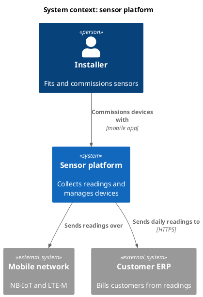
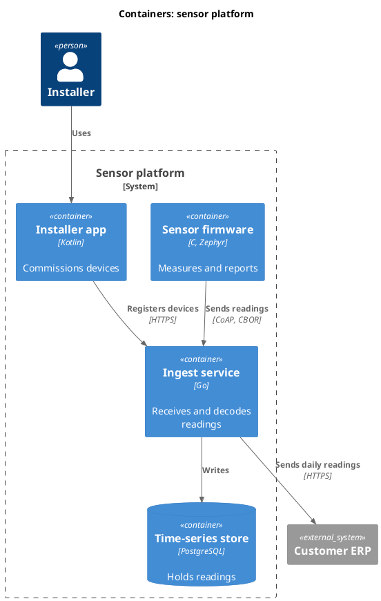

# Architecture document

An architecture document explains how a system is built and why. It is for the people who will build, test, operate and change the system, so it should answer their questions and stop. Start small: a context diagram, the quality goals and the main decisions are worth more than a hundred pages nobody reads.

## Outline

The outline below follows [arc42](https://arc42.org/), a free template for architecture documentation by Gernot Starke and Peter Hruschka. Its twelve sections are a checklist of what a reader might need. Leave out a section that has nothing to say, but keep the numbering, so readers always know where to look. The [arc42 documentation](https://docs.arc42.org/) explains each section, with examples. The official templates, in many formats and languages, are on the arc42 site.

[[CAPTION:Table]] The twelve sections of an architecture document.

| Section | What it answers |
|---------|-----------------|
| 1 Introduction and goals | What the system is for, its main features, the top three to five quality goals, and who the stakeholders are |
| 2 Constraints | What the team must work within: technical, organisational, regulatory and conventions |
| 3 Context and scope | What is inside the system and what is outside, and every external interface, both in business terms and in technical terms |
| 4 Solution strategy | The handful of fundamental decisions that shape everything else, and how they meet the quality goals |
| 5 Building block view | How the system is split into parts, level by level, and what each part is responsible for |
| 6 Runtime view | How the parts work together in the important scenarios, including start-up and failure |
| 7 Deployment view | Which hardware, networks and environments the parts run on |
| 8 Cross-cutting concepts | Rules that apply across many parts: security, logging, error handling, persistence, configuration |
| 9 Architecture decisions | The significant decisions, usually as links to [architecture decision records](adr.md) |
| 10 Quality requirements | The quality goals made measurable, as [quality scenarios](requirements.md#quality-scenario) |
| 11 Risks and technical debt | What could go wrong, and what we already know needs fixing |
| 12 Glossary | The domain and technical terms, so everyone uses the same words |

Review the document with the [architecture review checklist](architecture-review-checklist.md).

## C4 diagrams

The [C4 model](https://c4model.com/), by Simon Brown, draws a system at four levels of zoom: system context, containers, components and code. Sections 3, 5 and 7 of the outline map onto its context, container and deployment diagrams. Most systems need only the first two levels.

### C4 in PlantUML

[C4-PlantUML](https://github.com/plantuml-stdlib/C4-PlantUML) adds C4 shapes to PlantUML. Its standard library ships with PlantUML, so `!include <C4/C4_Context>` needs no download. Copy this starter and replace the names.

[[CAPTION:Figure]]


[[CAPTION:Figure]]


The other levels use `<C4/C4_Component>`, `<C4/C4_Deployment>` and `<C4/C4_Dynamic>` in the same way.

### C4 in Structurizr

For anything bigger than a few diagrams, keep one model and draw every view from it. Then a name changed in the model changes in every diagram. [Structurizr](https://structurizr.com/) does this with a model written in its own domain-specific language (DSL), and py-doc can turn a Structurizr workspace into chapters and pictures. This starter describes the same system as the diagrams above. Download [`c4-workspace.dsl`](https://github.com/markbac/markbac.github.io/raw/main/content/templates/files/c4-workspace.dsl).

[[CAPTION:Figure]] A starter Structurizr workspace.

```text
workspace "Sensor platform" "Starter C4 model" {

    model {
        installer = person "Installer" "Fits and commissions sensors."
        erp = softwareSystem "Customer ERP" "Bills customers from readings." "External"

        platform = softwareSystem "Sensor platform" "Collects readings and manages devices." {
            device = container "Sensor firmware" "Measures and reports." "C, Zephyr"
            ingest = container "Ingest service" "Receives and decodes readings." "Go"
            store = container "Time-series store" "Holds readings." "PostgreSQL" "Database"
            app = container "Installer app" "Commissions devices." "Kotlin"
        }

        installer -> app "Uses"
        app -> ingest "Registers devices with" "HTTPS"
        device -> ingest "Sends readings to" "CoAP, CBOR"
        ingest -> store "Writes readings to"
        ingest -> erp "Sends daily readings to" "HTTPS"
    }

    views {
        systemContext platform "Context" {
            include *
            autoLayout
        }
        container platform "Containers" {
            include *
            autoLayout
        }
        styles {
            element "Person" {
                shape Person
            }
            element "Database" {
                shape Cylinder
            }
            element "External" {
                background #999999
            }
        }
    }
}
```
