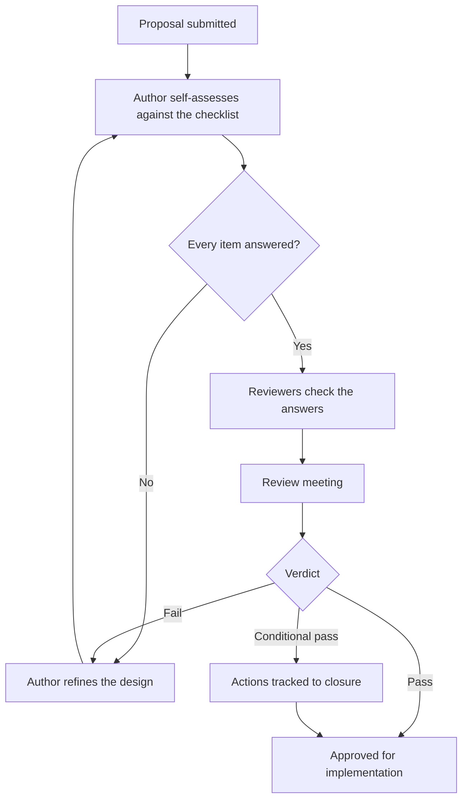

# Architecture review checklist

Use this checklist to review a system architecture or high-level design before anyone builds it. A flaw found at this stage costs a meeting and a redraft. The same flaw found in the field can cost a recall.

It applies to:

- high-level designs and system architecture documents going to an architecture review board;
- major changes to an existing system or platform;
- spikes and proofs of concept, before the approach goes into a product;
- third-party platforms and components you are thinking of adopting.

For the detailed design of a single component or firmware module, use the [design review checklist](design-review-checklist.md) instead.

## How the review runs

[[CAPTION:Figure]]


1. **Self-assessment.** The author works through the checklist and, for each item, points to the part of the design that answers it.
2. **Expert review.** Reviewers with the right specialisms (security, embedded, cloud, test) check those answers on their own before the meeting.
3. **Review meeting.** The panel discusses the findings, agrees a verdict and assigns actions.

## Rating each item

[[CAPTION:Table]] Ratings for architecture review items.

| Rating | Meaning | What happens next |
|--------|---------|-------------------|
| Satisfactory | The design answers the item fully, with evidence | Nothing. Record it in the minutes |
| Needs improvement | The design answers the item in part, or without enough justification | Conditional approval, with an action, an owner and a due date |
| Unsatisfactory | The design does not answer the item, contradicts itself or carries an unacceptable risk | Blocks approval. The author reworks the design and resubmits it |

An architecture passes when no item is unsatisfactory and every item that needs improvement has an owner and a target date.

## Checklist

### Vision and organisation

- [ ] **ARC-1 It gives a clear vision of the system.** The purpose, main capabilities, deployment context and guiding principles are stated well enough to steer the detailed design.
- [ ] **ARC-2 It is well organised.** It has a short overview, the background, the constraints and a structure that downstream designers can follow without guessing. Names are consistent throughout.
- [ ] **ARC-3 It allows for likely change.** The likely changes are named (a protocol, a cloud provider, a part that may go end of life), and stable interfaces keep each one contained.
- [ ] **ARC-4 It stays at the right level.** It defines boundaries, responsibilities and interface contracts, and leaves algorithms and screen layouts to the detailed design.
- [ ] **ARC-5 The views agree with each other.** Context, container, component and deployment views use the same names and the same message meanings across every interface.

### Structure and decomposition

- [ ] **ARC-6 Data flow, control flow, the main elements and their interfaces are all shown.** It is clear which calls are synchronous and which are asynchronous, and where data is held.
- [ ] **ARC-7 Fine detail is left out.** Internal class structures and local state machines belong in the detailed design.
- [ ] **ARC-8 The top-level split is clean.** Each subsystem has one clear responsibility and few dependencies on the others.
- [ ] **ARC-9 It is as independent of technology as it can be.** Core logic does not depend on a framework, library or transport. Adapters or interfaces keep those at the edges.
- [ ] **ARC-10 It respects the constraints it cannot avoid.** It fits the flash, RAM, battery, bandwidth, message size and latency that the target has.
- [ ] **ARC-11 Alternatives were considered.** Each major choice records the options and why the others were rejected, usually as an [architecture decision record](adr.md).
- [ ] **ARC-12 Concerns are kept apart.** Domain logic, user interface, task scheduling and data management live in separate parts. If they do not, the design explains why.

### Interfaces and quality attributes

- [ ] **ARC-13 External interfaces are defined and justified.** Machine and human interfaces have a formal description, such as OpenAPI, AsyncAPI, Protocol Buffers or a header file. Each states authentication, versioning and rate limits.
- [ ] **ARC-14 Robustness is specified.** Availability targets, recovery time, failover, watchdogs and degraded modes are stated and justified.
- [ ] **ARC-15 It is sensibly layered.** There are no circular dependencies between layers, and dependencies point towards the more stable, higher-level parts.
- [ ] **ARC-16 Coupling is low and cohesion is high.** Parts talk through narrow interfaces, and a change inside one part does not ripple into unrelated ones.
- [ ] **ARC-17 Every element has a resource budget.** Stack, heap, flash, CPU, energy per day, data per month and cloud cost all have a budget, as relevant.

### Strategies

- [ ] **ARC-18 There is an input and output strategy.** It covers blocking and non-blocking I/O, buffering, direct memory access (DMA) where relevant, and what happens under back-pressure.
- [ ] **ARC-19 There is one error-handling strategy.** It defines error formats, retries with back-off and jitter, circuit breakers, and where failed messages go.

### Project and lifecycle

- [ ] **ARC-20 It suits the delivery lifecycle.** It allows incremental delivery, automated builds and tests, independent deployment where needed, and safe roll-out of updates.
- [ ] **ARC-21 The system and business goals are stated,** and the architecture traces back to them.
- [ ] **ARC-22 The environment is defined.** It names the processor, operating system or real-time operating system (RTOS) and version, toolchain, runtime dependencies and external services.
- [ ] **ARC-23 Buy, build and open-source choices are justified.** Each records the licence, supplier health, total cost of ownership and how long it will be supported.

## Review record

Record the outcome of each review in a short, plain-text record kept with the design.

[[CAPTION:Figure]] Architecture review record.

```text
ARCHITECTURE REVIEW RECORD                      ARB-REC-YYYY-NNN

System or component:    <name>
Design document:        <document ID and version>
Lead architect:         <name>
Review chair:           <name>
Reviewers:              <name (security)>, <name (embedded)>, <name (cloud)>
Review date:            YYYY-MM-DD

Findings
  Items reviewed:       23
  Satisfactory:         <count>
  Needs improvement:    <count>
  Unsatisfactory:       <count>

Verdict: PASS | CONDITIONAL PASS | FAIL (rework and resubmit)

Actions (conditional pass)
  1. [ARC-nn] <action>. Owner: <name>. Due: YYYY-MM-DD. Ticket: <key>
  2. [ARC-nn] <action>. Owner: <name>. Due: YYYY-MM-DD. Ticket: <key>

Sign-off
  Lead architect:  ____________________   Date: __________
  Review chair:    ____________________   Date: __________
```

## Further reading

The structure of this checklist follows the architecture checklist in Steve McConnell's *Code Complete* (second edition, Microsoft Press, 2004), extended for embedded and connected systems.
