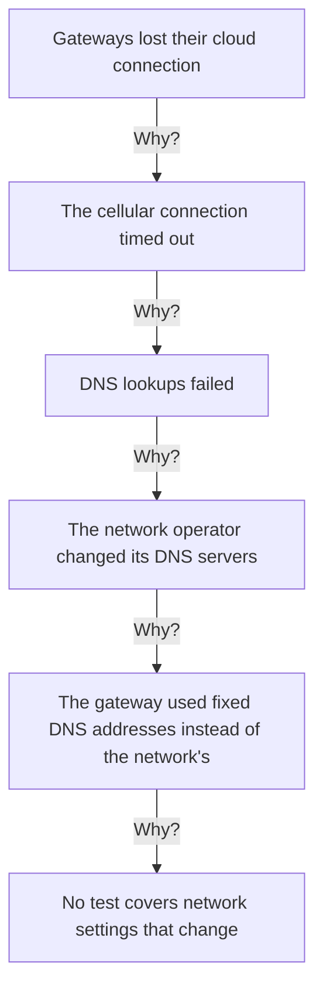
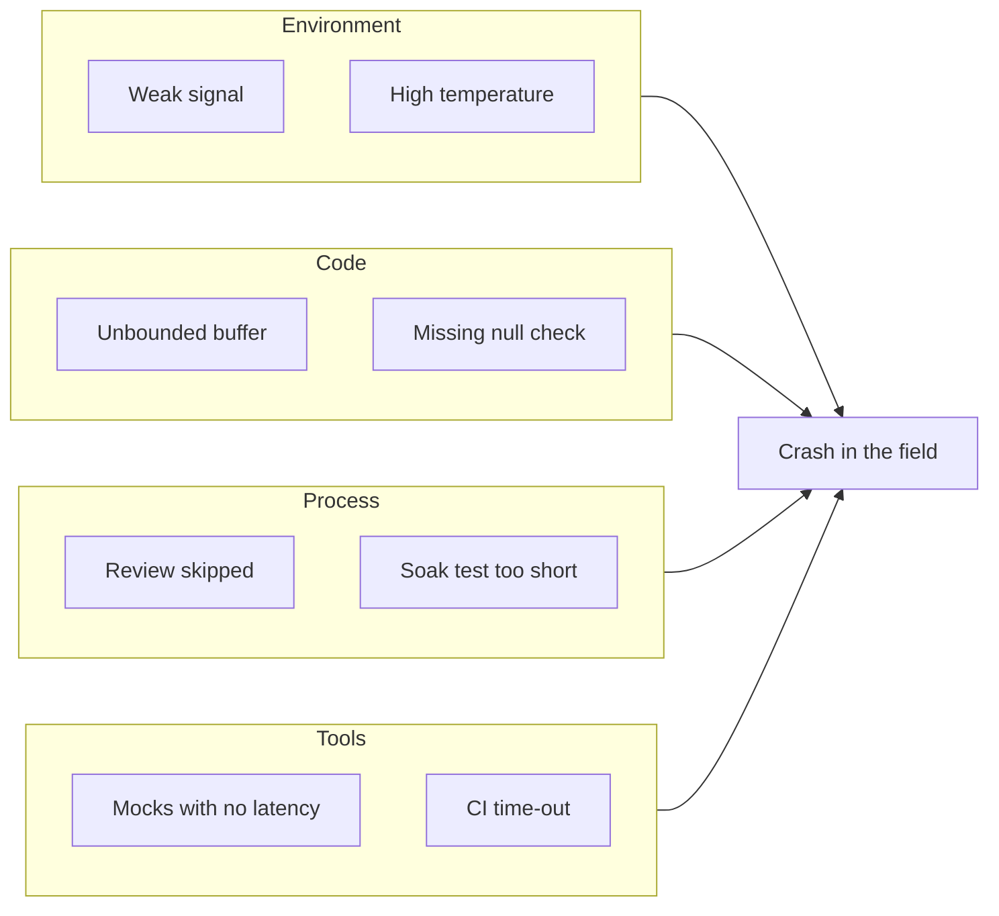

# Postmortem

Write a postmortem after any incident that hurt customers, and after every critical (S1) or major (S2) defect found in the field. Publish it within five working days of the fix, while people still remember the details.

A postmortem is blameless. It asks how the system and the process let the problem happen, not who made the mistake. People make mistakes all the time, and a good process catches them. If the answer is "someone should have been more careful", keep asking.

## Finding the root cause

Two simple techniques help get past the first, technical answer.

**Five whys.** Ask why the failure happened, then why that happened, and keep going until you reach something the team can change in its process or design.

[[CAPTION:Figure]]


**Fishbone diagram.** When there are several causes, group them by area, such as environment, code, process and tools, and look for the ones that combined.

[[CAPTION:Figure]]


## Template

```markdown
# Postmortem: INC-0000, short title

## Summary

- Date:
- Duration: from first impact to full recovery
- Severity: S1 | S2
- Affected: products, firmware versions, services, customers
- Lead investigator:

Two or three sentences on what happened and what fixed it.

## Impact

Who was affected and how: devices offline, data lost, customers
contacted, money spent.

## Timeline (UTC)

- 14:02 Over-the-air update v2.4.1 starts on the first 500 devices.
- 14:15 Alert: disconnection rate above 20 %.
- 14:22 On-call engineer stops the roll-out.
- ...
- 17:15 Fixed version v2.4.2 reaches the affected devices, and they reconnect.

## Root cause

What failed, and why the system and process allowed it.

## Contributing factors

Everything else that made it happen or made it worse. Focus on
systems and processes, not people.

## What went well

- Things to keep doing, for example: the staged roll-out contained
  the fault to 1 % of the fleet.

## What went badly

- Things to change, for example: soak tests ran only with a strong signal.

## Actions

| ID | Action | Owner | Due | Ticket |
|----|--------|-------|-----|--------|
| A1 | Add a weak-signal sweep to the hardware-in-the-loop tests | | YYYY-MM-DD | |
| A2 | Add a time-out and a retry limit to the modem driver | | YYYY-MM-DD | |
```

Every action has an owner and a date, and the team reviews them until they are closed. A postmortem whose actions never close was just a story.
