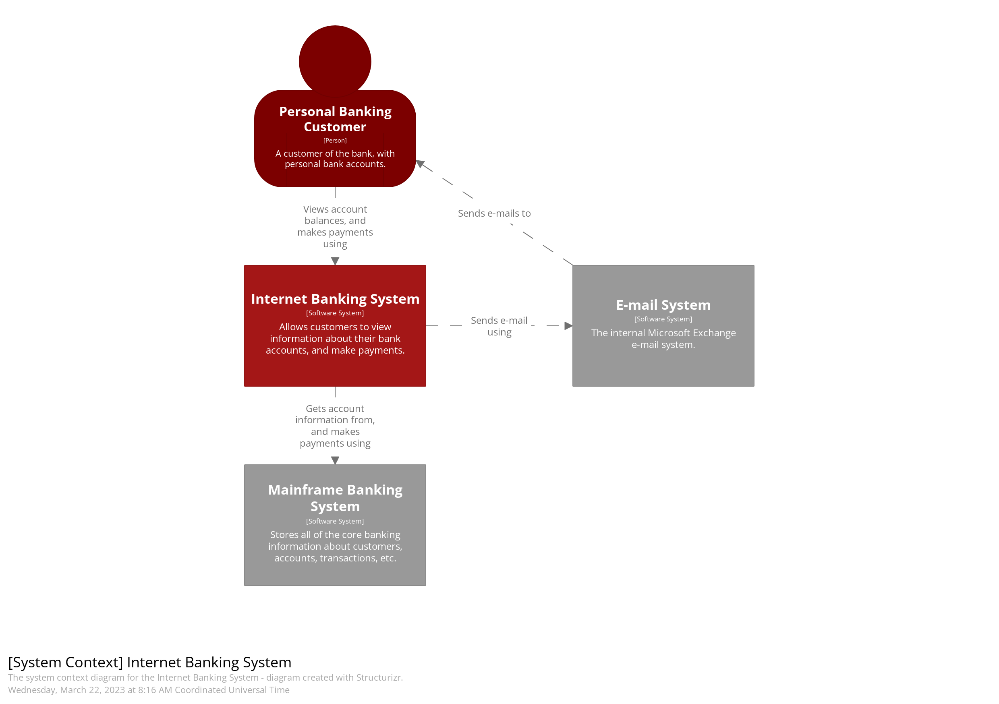
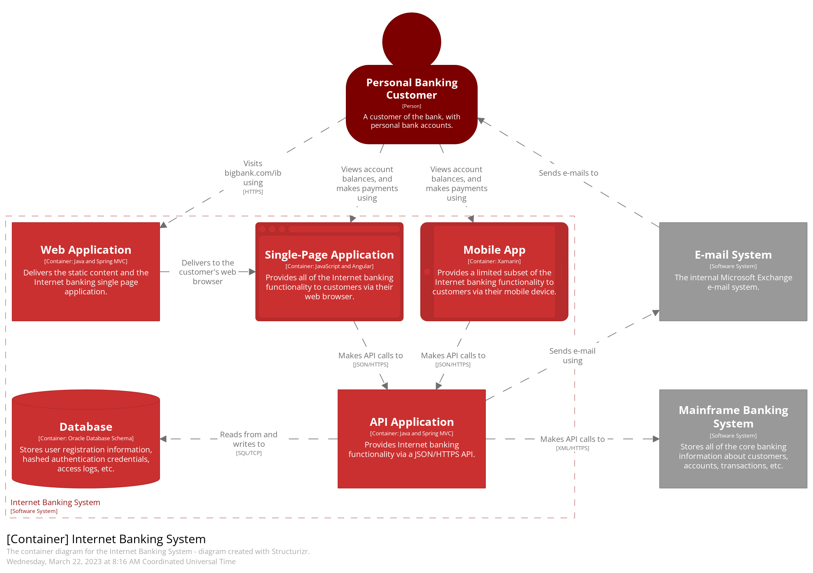
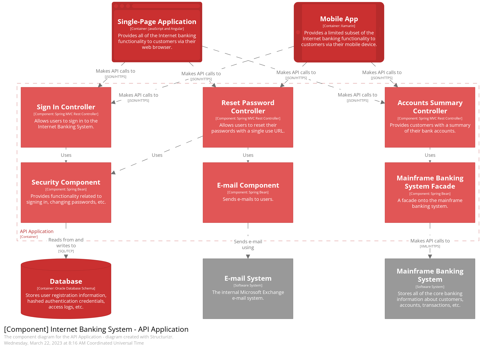
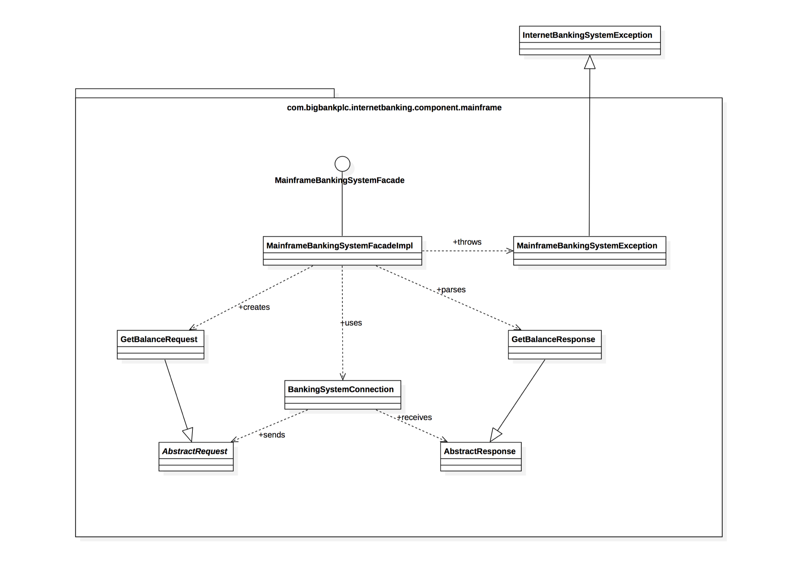

# The C4 Model Visualising Software Architecture

In this post, we’ll explore the C4 model—a simple yet powerful way to describe your software architecture using a set of hierarchical diagrams. As a solution architect, I’ve found that C4 brings clarity to both developers and non-technical stakeholders, making it easier to understand and communicate architectural decisions. We’ll walk through the model’s key components and how it can integrate seamlessly into your architecture as code approach.

<!-- more -->

## What is the C4 Model?

The **C4 model** is a framework for visualising the architecture of software systems. It was created by Simon Brown, and it stands for **Context, Containers, Components, and Code**. Unlike traditional monolithic diagrams that try to capture everything in a single view, the C4 model breaks down the architecture into a series of hierarchical diagrams. Each one focuses on a different level of abstraction. This makes it easier to communicate complex systems while maintaining a level of detail that’s appropriate for the audience.

The C4 model is organised into four levels:

1. **Level 1: Context Diagram**
2. **Level 2: Container Diagram**
3. **Level 3: Component Diagram**
4. **Level 4: Code Diagram**

Each of these diagrams provides a specific viewpoint of the system, focusing on different layers of abstraction. Let's explore these in detail.

### Level 1: System Context Diagram

The **System Context Diagram** is the highest-level diagram in the C4 model. It shows the system as a whole, placing it in the context of its environment and illustrating how it interacts with external systems, users, and other stakeholders. This diagram is designed to be simple, with a focus on the system’s boundaries and its relationships with external entities.

The goal of the context diagram is to provide a big-picture view, answering the question: "What is the system, and who does it interact with?"

For example, in a cloud-based SaaS application, the context diagram might show the system interacting with users through a web application. It might also show integrations with external services like payment providers, identity management systems, or third-party APIs.

*Diagram from [c4model.com](https://c4model.com/) by Simon Brown, [CC BY 4.0](https://creativecommons.org/licenses/by/4.0/).*

### Level 2: Container Diagram

The **Container Diagram** takes the context diagram a step further, breaking the system down into high-level containers. Containers are applications or services that execute code, store data, or interact with other systems. This diagram shows how the system is split into containers and how they communicate with one another.

In this diagram, each container represents a major component of the system, such as a web application, mobile app, database, or microservices. The aim here is to demonstrate how the system is structured and how data flows between containers.

For instance, an e-commerce platform’s containers might include the user interface (a web front-end), the back-end API service, and the database of users and orders. The diagram will show the interactions between these containers. Examples are HTTP requests between the front-end and back-end, or reads and writes to the database.

### Level 3: Component Diagram

At the **Component Diagram** level, the focus narrows to show the internal structure of individual containers. This diagram highlights the components within each container and how they interact with each other.

Take a container that represents a web application. The component diagram might break it down into components like the authentication service, the product catalogue, the order processing service, and so on. The aim is to give enough detail to show how the container is organised, without overwhelming the viewer with too much complexity.

This diagram answers the question: "How is the functionality of this container structured and organised?"

### Level 4: Code Diagram

The **Code Diagram** is the most granular level of the C4 model, diving into the implementation details of the components shown in the previous diagram. This level is optional and not always necessary, but it provides the level of detail that developers need to understand the internal workings of specific components. It typically involves class or sequence diagrams, showing the classes, methods, or functions within a given component, and how they collaborate to provide the container’s functionality.

This level might not be necessary for all stakeholders. It can be invaluable to developers, though, especially when the system’s components are complex or require deep understanding to maintain or extend.

## Benefits of the C4 Model

The C4 model provides several advantages over traditional architectural diagrams:

1. **Clarity and Focus**: Each level of the C4 model is designed to communicate a specific aspect of the system, keeping the diagrams clear and focused. By breaking down the system into layers of abstraction, it’s easier for different stakeholders to view the system at the appropriate level of detail.
    
2. **Scalability**: The C4 model scales well for both small and large systems. Whether you're working on a simple application or a complex, distributed system, the model allows you to maintain clarity without overwhelming the viewer.
    
3. **Consistency**: With a consistent approach to structuring diagrams, the C4 model makes it easier to document systems over time. Teams can create diagrams that follow the same conventions and terminology, ensuring consistency and reducing the likelihood of miscommunication.
    
4. **Integration with Architecture as Code**: The C4 model works exceptionally well with the **Architecture as Code** (AAC) approach. Since C4 diagrams are built from code, they can be automated and continuously updated, ensuring that your architecture documentation is always in sync with the system’s actual state.
    

For example, by using tools like **Structurizr**, you can define your C4 model diagrams in code and then generate and visualise the diagrams automatically. This fits perfectly with the AAC philosophy, enabling you to keep your architecture aligned with the codebase and automate documentation updates.

## How to Implement the C4 Model

Implementing the C4 model is straightforward, but it requires some thought and planning:

1. **Start with the Context Diagram**: Begin by sketching out the System Context Diagram. Identify your system’s boundaries and the key external actors that interact with it.
    
2. **Break the System into Containers**: Once the context diagram is in place, identify the containers that make up the system. This step will help you define the architecture’s high-level structure and interactions.
    
3. **Drill Down into Components**: After containers are identified, break them down into components. This step will give you a better understanding of how the system is internally organised.
    
4. **Add Code-Level Detail (Optional)**: If required, create code diagrams to document the internal implementation of each component.
    
5. **Automate the Process**: Tools like Structurizr allow you to generate your C4 diagrams from code. Consider integrating this process into your CI/CD pipeline so that the architecture stays up-to-date as the code evolves.
    

## Conclusion

The C4 model provides a structured, scalable, and highly effective way to document and communicate software architecture. By breaking the system down into clear, hierarchical levels, it makes complex systems easier to understand for all stakeholders, from developers to business leaders. Coupled with **Architecture as Code**, it becomes a powerful tool for keeping your architectural documentation in sync with your codebase, ensuring accuracy and alignment throughout the development process.

In the next post, we’ll dive into **Structurizr**, a tool that makes the C4 model even more powerful by allowing you to define and visualise your architecture in code. Stay tuned for an in-depth look at how to bring your C4 diagrams to life!
