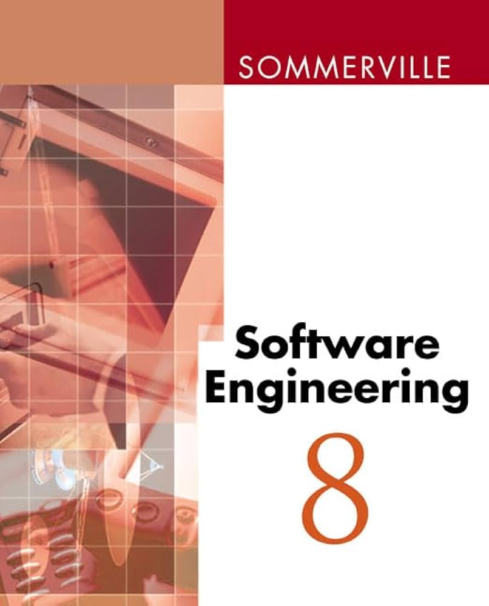

# Reviewing *Software Engineering* (8th Edition) by Ian Sommerville

If you’ve spent any time in software development or academia, you’ve probably come across *Software Engineering* by Ian Sommerville. Now in its 8th edition (at the time of writing), this book remains one of the most comprehensive resources on software engineering principles. Whether you're a student, a professional, or an architect looking for a solid reference, Sommerville's work provides an excellent foundation.

<!-- more -->

## What *Software Engineering* Covers

The book takes a structured approach to software engineering, breaking it down into core concepts that are as relevant today as they were when it was first published. Here’s an overview of some key topics covered:

* **Software Processes** – Covers various software development methodologies, including waterfall, incremental, and agile models.
* **Requirements Engineering** – Explains how to gather, document, and manage software requirements.
* **System Modelling** – Introduces key techniques like UML diagrams and architectural views.
* **Software Design** – Discusses architectural styles, design patterns, and modularity.
* **Software Development & Implementation** – Covers programming best practices, including verification and validation.
* **Software Testing** – Provides insights into unit, integration, system, and acceptance testing.
* **Software Evolution & Maintenance** – Highlights the challenges and strategies for maintaining and evolving systems over time.
* **Project Management** – Explores risk management, planning, and estimation techniques.
* **Security & Dependability** – Covers essential topics such as fault tolerance, reliability, and secure software design.
* **Ethics & Professionalism** – Discusses the responsibilities of software engineers beyond just writing code.

## Why *Software Engineering* is a Must-Read

1. **Comprehensive Coverage** – Unlike many books that focus only on coding, Sommerville provides a well-rounded view of the entire software engineering lifecycle.
2. **Academic & Industry Relevance** – It strikes a balance between theory and practical applications, making it useful for both students and professionals.
3. **Well-Structured & Readable** – Concepts are explained clearly, with real-world examples and case studies.
4. **Reference Material** – Even for experienced engineers, it serves as a great reference when dealing with software process improvements or architectural decisions.
5. **Timeless Principles** – While tools and technologies change, the fundamental principles of software engineering remain relevant. This book reinforces those enduring best practices.

## Final Thoughts

*Software Engineering (8th Edition)* by Ian Sommerville is an essential read for anyone serious about software development. Whether you're learning the ropes or refining your approach, this book provides the necessary grounding in software engineering principles that stand the test of time. If you haven’t read it yet, it’s well worth adding to your collection.
