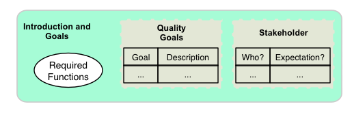
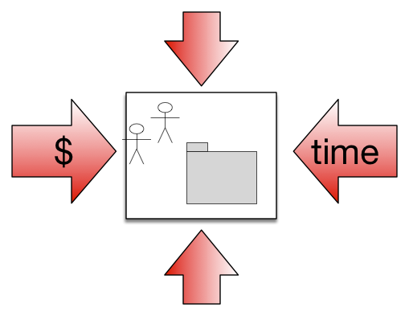
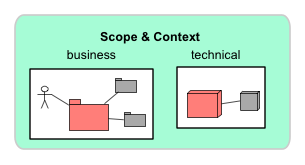
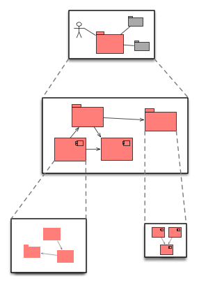
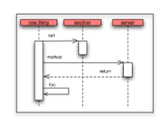
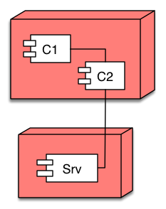
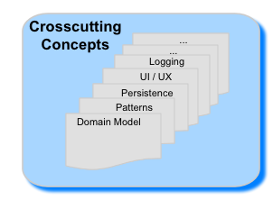
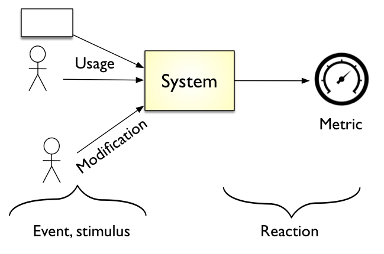
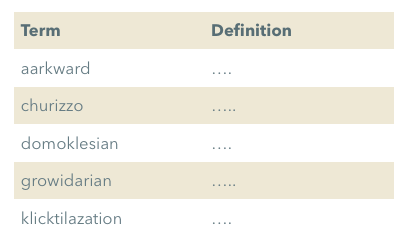

# arc42: A Pragmatic Approach to Software Architecture Documentation

Software architecture documentation is often a **double-edged sword**. Get it wrong, and you’re either drowning in unnecessary details that no one updates or left with vague, high-level notes that don’t actually help anyone.

<!-- more -->

Finding the **right balance** is tricky. You need documentation that is:

* **Comprehensive but concise** – Enough detail to be useful, but not so much that it’s overwhelming.
* **Structured but flexible** – A consistent approach that works across different projects and teams.
* **Living and evolving** – Not a static document that gathers dust in Confluence.

That’s where **arc42** comes in.

***

## What is arc42?

arc42 is a **structured template** for documenting software architecture. It provides a consistent way to capture and communicate architectural decisions without **overcomplicating things**. Originally developed by **Dr Peter Hruschka and Dr Gernot Starke**, it has been widely adopted because it’s:

* **Concise** – Encourages a “just enough” mindset, avoiding documentation bloat.
* **Technology-agnostic** – Useful for everything from embedded systems to cloud-native platforms.
* **Well-structured** – Helps teams document architecture in a way that’s easy to understand and maintain.

arc42 structures documentation into **12 key sections**, covering everything from business goals and architectural decisions to runtime behaviour and deployment strategies. These sections ensure that documentation remains relevant, structured, and maintainable over time.

***

## Breaking Down the arc42 Template

arc42 is split into **12 sections**, each covering a key aspect of the architecture. Not every project needs all 12 sections, but together they provide a **holistic view** of a system’s architecture.

***

### 1. Introduction and Goals

*Icons from the [arc42 template](https://arc42.org/), [CC BY-SA 4.0](https://creativecommons.org/licenses/by-sa/4.0/).*

Every system exists for a reason. This section clarifies the **business and technical objectives** behind the system. It sets expectations and ensures alignment across stakeholders, from product owners to developers.

* Defines the **core purpose** of the system.
* Outlines key **functional and non-functional goals**.
* Ensures all stakeholders have a **shared understanding**.

Without clear goals, architecture can drift over time, leading to misalignment between what was intended and what is actually built.

***

### 2. Constraints

Constraints define the **boundaries** within which the architecture must operate. These might come from legal, technical, or organisational factors, and they significantly shape the design choices available.

* **Regulatory and compliance requirements** that the system must adhere to.
* **Technology constraints** such as mandated programming languages, frameworks, or infrastructure.
* **Operational limitations** like budgetary restrictions or available team expertise.

Understanding constraints early prevents wasted effort and ensures architectural decisions remain **feasible and sustainable**.

***

### 3. Context and Scope

This section defines the **system’s role** within a larger ecosystem. It clarifies **what’s inside the system’s boundaries and what’s external**.

* Identifies **external actors** interacting with the system.
* Defines **key dependencies** and how they impact architecture.
* Sets clear **in-scope and out-of-scope boundaries** to avoid scope creep.

A well-defined system boundary helps manage complexity and ensures integration points are well understood.

***

### 4. Solution Strategy

This section captures the **fundamental design and architectural decisions** that shape the solution. It provides high-level insights into **why** certain choices were made and the trade-offs involved.

* Outlines the **high-level architecture approach** (e.g., monolith vs. microservices).
* Highlights **key trade-offs and alternatives** considered.
* Justifies **technology and framework selections**.

A strong solution strategy prevents arbitrary decision-making and ensures architectural consistency.

***

### 5. Building Blocks View

This is the **structural breakdown** of the system, describing its main components and their responsibilities. It provides an **overview of the internal composition** of the software.

* Defines **core modules, services, and components**.
* Explains **how they interact** with one another.
* Uses a **hierarchical approach** to break down complexity.

By visualising the structure, teams can quickly understand the system’s **organisation and separation of concerns**.

***

### 6. Runtime View

A system’s behaviour isn’t just about static structure; it’s also about **how it operates in real-world scenarios**. This section describes the **dynamic interactions** that occur during execution.

* Shows **how components interact** at runtime.
* Describes **data flow, event handling, and request processing**.
* Includes **failure scenarios** and their impact on system stability.

Capturing runtime behaviour is essential for debugging, performance optimisation, and ensuring the system behaves as expected under different conditions.

***

### 7. Deployment View

This section describes **how and where** the system is deployed. It provides a clear picture of the infrastructure and runtime environments.

* Defines **deployment environments** (e.g., cloud, on-prem, hybrid).
* Describes **scalability strategies** and failover mechanisms.
* Outlines **infrastructure dependencies** like databases, message queues, and load balancers.

A well-documented deployment view helps DevOps teams manage, scale, and troubleshoot the system effectively.

***

### 8. Crosscutting Concepts

Certain **architectural concerns** span multiple components. This section ensures they are **documented consistently** across the system.

* Covers **security policies, authentication mechanisms, and authorisation models**.
* Defines **logging, monitoring, and observability** best practices.
* Documents **error handling, resilience patterns, and disaster recovery**.

Crosscutting concerns often **define the system’s reliability, security, and maintainability**, making them crucial to document properly.

***

### 9. Architecture Decisions (ADRs)

Documenting **why** decisions were made is just as important as the decisions themselves. This section captures **key architectural decisions** and their rationale.

* Records **major architectural choices** and alternatives considered.
* Documents the **reasoning and trade-offs** behind decisions.
* Helps future teams understand **why things were done a certain way**.

A well-maintained set of ADRs prevents future rework and helps teams make **informed, consistent architectural choices** over time.

***

### 10. Quality Requirements

Architecture is shaped by more than just functional features—**non-functional requirements (NFRs)** often dictate major design choices.

* Defines **performance, scalability, and reliability** expectations.
* Documents **security, maintainability, and usability** requirements.
* Helps teams prioritise **what matters most** when making trade-offs.

Ignoring quality requirements early can lead to systems that work functionally but fail under real-world conditions.

***

### 11. Risks and Technical Debt

Every system has **risks and trade-offs**. This section captures potential challenges and areas of **technical debt** that could impact the system.

* Identifies **known risks** and potential failure points.
* Documents **mitigation strategies** or workarounds.
* Highlights **areas of technical debt** that may need addressing later.

By proactively identifying risks, teams can **plan ahead** rather than dealing with surprises.

***

### 12. Glossary

Terminology can vary between teams, industries, and stakeholders. The glossary ensures **everyone speaks the same language**.

* Defines **key terms and abbreviations**.
* Standardises **naming conventions** across teams.
* Reduces **misunderstandings and ambiguity**.

A simple glossary can prevent **confusion and miscommunication**, especially in complex domains.

***

## Final Thoughts

arc42 provides a **structured yet pragmatic** approach to documenting software architecture. It **bridges the gap** between no documentation and over-documentation, making it **easier to communicate architecture effectively**.

If you’ve ever struggled with keeping architecture documentation useful and maintainable, arc42 is worth exploring. **Give it a go**—you might find it’s the **right balance of structure and flexibility** your team needs.
