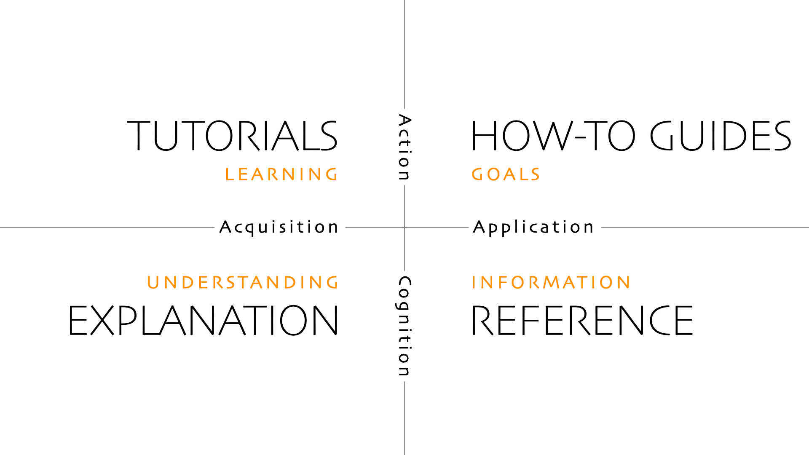

# Making Sense of Documentation: A Pragmatic Look at the Diátaxis Framework

Good documentation isn’t just an afterthought—it’s a **core part of a successful project**. Well-structured documentation reduces friction for users, lowers support overhead, and helps developers work more effectively. But too often, documentation is a **confusing mess**, where tutorials, technical references, and explanations are thrown together with no clear structure.

<!-- more -->

The **Diátaxis framework** provides a simple yet powerful approach to solving this problem. By dividing documentation into **four distinct types**, it ensures that users always know where to find the information they need.

***

## The Four Pillars of Diátaxis

Diátaxis organises documentation into four key types, each with a **specific purpose**:

### 1. Tutorials – Learning-Oriented

* Helps users **acquire** knowledge through step-by-step guidance.
* Assumes **no prior experience** and walks through practical examples.

### 2. How-To Guides – Task-Oriented

* Shows users how to **apply** their knowledge to solve a **specific problem**.
* Assumes the user has some **prior understanding**.

### 3. Reference – Information-Oriented

* A structured, **fact-based** resource for looking up details.
* Typically includes **API documentation, command-line options, and configuration schemas**.

### 4. Explanation – Understanding-Oriented

* Helps users **acquire deeper knowledge** about the concepts behind a system.
* Provides **rationale, context, and trade-offs** to support informed decisions.

Each of these documentation types has a **specific role** in helping users move from learning to mastery.

***

## The Four Dimensions of Documentation

Diátaxis isn’t just about categorising documents—it’s about structuring documentation in a way that **supports how people think and learn**.

The four documentation types align along **two key axes**:

### 1. Acquisition vs. Application

* **Acquisition** (learning) is about **gaining new knowledge**. It includes **Tutorials and Explanations**.
* **Application** (doing) is about **applying knowledge to achieve a goal**. It includes **How-To Guides and References**.

### 2. Action vs. Cognition

* **Action** (practical use) covers **Tutorials and How-To Guides**—things you follow step-by-step.
* **Cognition** (understanding) covers **Explanations and References**, helping users think deeply and make informed decisions.

This structured approach ensures that **every type of documentation serves a distinct purpose while supporting the user’s journey from beginner to expert**.

***

## Why Diátaxis Works

One of the biggest issues with documentation is **mixing these types together**. When a tutorial starts explaining deep architectural decisions, or a how-to guide is cluttered with background theory, **users get lost**.

Diátaxis fixes this by ensuring that each document has **a single purpose**:

* **A tutorial** should help users **get started quickly**, not teach system design.
* **A how-to guide** should help users **solve a problem**, not introduce concepts from scratch.
* **A reference guide** should provide **facts and details**, not instructions.
* **An explanation** should **help users understand**, not give them step-by-step guidance.

By **keeping these types distinct**, documentation becomes **clearer, easier to use, and more effective**.

***

## Applying Diátaxis to Your Documentation

If your documentation feels messy or difficult to navigate, applying Diátaxis can **bring clarity and order**. Here’s how:

### 1. Audit your documentation

* Identify existing documentation and **classify** it under the four Diátaxis categories.
* Look for **overlapping** or **misplaced** content—are tutorials explaining too much theory? Are how-to guides acting as reference docs?

### 2. Restructure your content

* Separate documentation by type so that each piece serves **one** purpose.
* Group similar types together to **help users find what they need faster**.

### 3. Fill in the gaps

* Most projects lack proper **explanations**—ensuring conceptual clarity is key.
* Some teams rely too much on reference docs without enough **practical how-to guides**.

### 4. Make navigation intuitive

* Clearly label documentation types so users **know what to expect**.
* Link between different types of documentation, guiding users along their learning path.

When documentation follows this structure, it becomes **easier to write, maintain, and—most importantly—use**.

***

## Visualising Diátaxis

A helpful way to understand the framework is through a **four-quadrant diagram**:

*Diagram from [diataxis.fr](https://diataxis.fr/) by Daniele Procida, [CC BY-SA 4.0](https://creativecommons.org/licenses/by-sa/4.0/).*

This visual structure helps reinforce **why documentation should be separated** and how it supports different learning and usage needs.

***

## Final Thoughts

Diátaxis isn’t about adding more documentation—it’s about **organising it effectively**.

By following this framework, teams can create documentation that is:

- ✅ **Clear** – Every piece serves a distinct purpose.
- ✅ **Easy to navigate** – Users know exactly where to find what they need.
- ✅ **More effective** – Reduces confusion and improves user experience.

💡 **Good documentation isn’t just about writing—it’s about structure. Diátaxis provides that structure.**

***

### Next Steps

- 🔹 **Review your current documentation**—where does it fit within the framework?
- 🔹 **Reorganise and separate**—make sure each document has a clear purpose.
- 🔹 **Improve discoverability**—label documentation clearly so users can find what they need.

By taking these steps, you’ll transform your documentation from a **confusing sprawl** into a **powerful knowledge base**. 🚀
