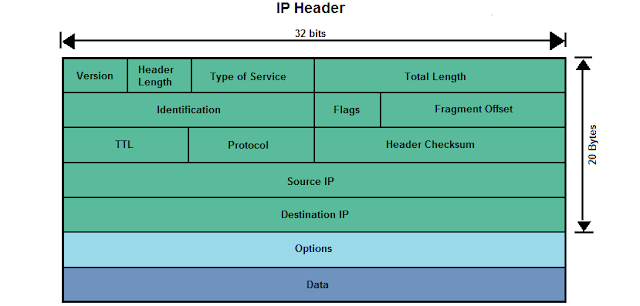
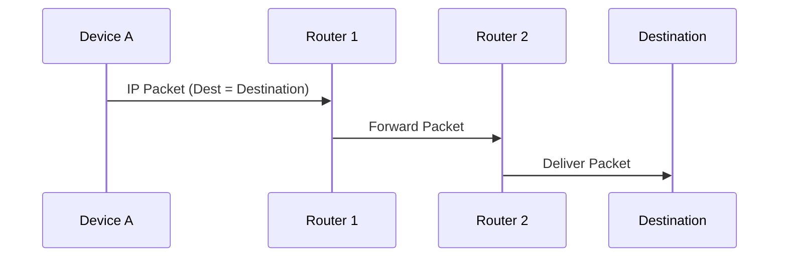
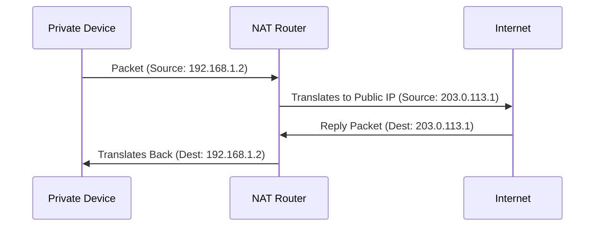
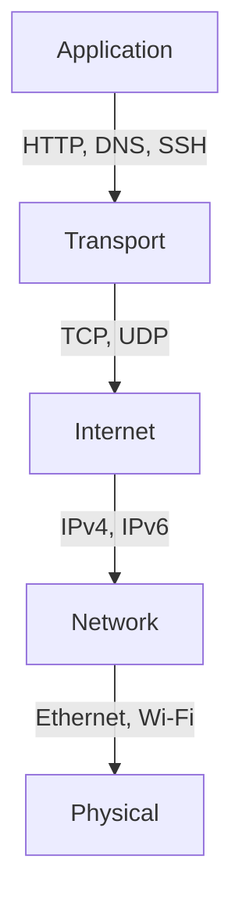

# A Deep Dive into IP: The Backbone of Internet Communication

## Introduction

The **Internet Protocol (IP)** is the foundation of modern networking. It is responsible for **addressing, routing, and delivering** data packets across the internet. Unlike **TCP (Transmission Control Protocol)**, which ensures reliability, IP follows a **best-effort** approach—meaning it delivers packets **without guarantees** of arrival, order, or integrity.

<!-- more -->

In this deep dive, we’ll explore:

* **How IP works** and its role in networking
* **IPv4 vs IPv6** and why we needed an upgrade
* **IP packet structure** (header format explained)
* **How packets are routed across networks**
* **Subnetting, CIDR, and NAT** (essential for IP efficiency)
* **Fragmentation & reassembly**
* **How IP interacts with TCP and other protocols**

Let’s dive in. 🚀

***

## 1. What is IP and Why Does It Matter?

IP is a **Layer 3 (Network Layer)** protocol in the **OSI model**, responsible for identifying devices and delivering data packets between them. Every device on a network—whether a laptop, smartphone, or server—has a unique **IP address** that enables communication.

- 🔹 **Key responsibilities of IP:**
- ✅ **Addressing** – Each device gets a unique identifier (IP address).
- ✅ **Routing** – Finds the best path for data to travel between networks.
- ✅ **Packetization** – Breaks data into packets for efficient transport.
- ✅ **Best-effort delivery** – Sends packets without guarantees (higher layers handle reliability).

***

## 2. IPv4 vs IPv6: Addressing the Address Crisis

The most widely used version of IP is **IPv4**, which was introduced in the early 1980s. However, due to the explosive growth of the internet, IPv4’s **32-bit addressing scheme** (≈4.3 billion addresses) has become insufficient. This led to the development of **IPv6**, which uses **128-bit addresses**, allowing for **trillions of devices** to be connected.

| Feature           | IPv4         | IPv6                   |
| ----------------- | ------------ | ---------------------- |
| Address Length    | 32-bit       | 128-bit                |
| Address Format    | 192.168.1.1  | 2001:db8::ff00:42:8329 |
| Address Space     | ≈4.3 billion | ≈340 undecillion       |
| Header Size       | 20 bytes     | 40 bytes               |
| Built-in Security | No           | Yes (IPSec required)   |
| NAT Required?     | Yes          | No                     |

💡 **Why hasn’t IPv6 fully replaced IPv4 yet?**

* Legacy systems still rely on IPv4.
* Transitioning requires major infrastructure changes.
* IPv4 + **NAT (Network Address Translation)** allows continued use.

***

## 3. The IP Packet Structure

Every IP packet consists of a **header** and a **payload** (data). The header contains crucial information for routing and delivery.

### IPv4 Packet Format

| Field               | Size (bits) | Description                                |
| ------------------- | ----------- | ------------------------------------------ |
| Version             | 4           | IPv4 or IPv6                               |
| IHL (Header Length) | 4           | Length of the header                       |
| DSCP                | 6           | Quality of Service (QoS) marking           |
| ECN                 | 2           | Congestion notification                    |
| Total Length        | 16          | Size of the entire packet (header + data)  |
| Identification      | 16          | Used for fragmentation/reassembly          |
| Flags               | 3           | Controls fragmentation                     |
| Fragment Offset     | 13          | Position of fragment in original data      |
| Time to Live (TTL)  | 8           | Prevents infinite loops                    |
| Protocol            | 8           | Defines transport protocol (TCP=6, UDP=17) |
| Header Checksum     | 16          | Ensures header integrity                   |
| Source IP           | 32          | Sender’s IP address                        |
| Destination IP      | 32          | Receiver’s IP address                      |
| Options             | Variable    | Additional settings                        |

🖼 **IPv4 Header Diagram**

💡 **IPv6 has a simpler header structure** (fixed 40 bytes), removing unnecessary fields like fragmentation and checksums.

***

## 4. How IP Routing Works

IP packets don’t travel directly from sender to receiver. Instead, they pass through **multiple routers**, each deciding the next best path.

### Key Components of IP Routing

- 🔹 **Routers** – Devices that forward packets based on their destination IP.
- 🔹 **Routing Tables** – Each router maintains a table of known IP networks.
- 🔹 **Hop-by-Hop Forwarding** – Packets travel through multiple routers before reaching their target.
- 🔹 **Time To Live (TTL)** – Limits how long a packet can exist (prevents infinite loops).

***

## 5. Subnetting & CIDR: Making Efficient Use of IP Addresses

IP addresses are structured into **subnets** to improve efficiency.

### Classless Inter-Domain Routing (CIDR)

CIDR replaces the old class-based system with flexible subnet masks:

| CIDR Notation | Subnet Mask   | IP Range               |
| ------------- | ------------- | ---------------------- |
| /8            | 255.0.0.0     | 16.7 million addresses |
| /16           | 255.255.0.0   | 65,536 addresses       |
| /24           | 255.255.255.0 | 256 addresses          |

🔹 **Example:** `192.168.1.0/24` allows 256 IPs, commonly used in home networks.

***

## 6. Network Address Translation (NAT): Extending IPv4

To deal with IPv4 address exhaustion, **NAT** allows multiple devices to share a single public IP.

🖼 **How NAT Works**

- 🔹 **Types of NAT:**
- ✅ **Static NAT** – One-to-one mapping between private and public IPs.
- ✅ **Dynamic NAT** – Assigns a public IP from a pool.
- ✅ **PAT (Port Address Translation)** – Multiple devices share a single IP using port numbers (most common).

***

## 7. IP Fragmentation & Reassembly

If a packet is **too large** for a network’s **Maximum Transmission Unit (MTU)**, it gets **fragmented**.

1️⃣ Sender breaks the packet into smaller **fragments**.\
2️⃣ Each fragment is **sent separately**.\
3️⃣ The receiver **reassembles** the fragments.

🔹 **Fragmentation overhead makes IPv6 avoid it entirely**, relying on **Path MTU Discovery** instead.

***

## 8. The Relationship Between IP and Other Protocols

IP alone isn’t enough—it works alongside other protocols:

- 🔹 **IP + TCP = Reliable Communication**
- 🔹 **IP + UDP = Fast, Unreliable Communication**
- 🔹 **IP + ICMP = Network Diagnostics (ping, traceroute)**

🖼 **Protocol Stack**

***

## Conclusion

IP is the **foundation of the internet**, handling addressing, routing, and delivery of data.

### Key Takeaways

- ✅ **IPv4 is still dominant, but IPv6 adoption is growing.**
- ✅ **Routers use IP to forward packets across networks.**
- ✅ **CIDR and NAT help optimise limited IPv4 addresses.**
- ✅ **IP fragmentation allows large packets to be transmitted.**
- ✅ **IP works closely with TCP, UDP, and ICMP for full functionality.**

Every time you send an email, stream a
