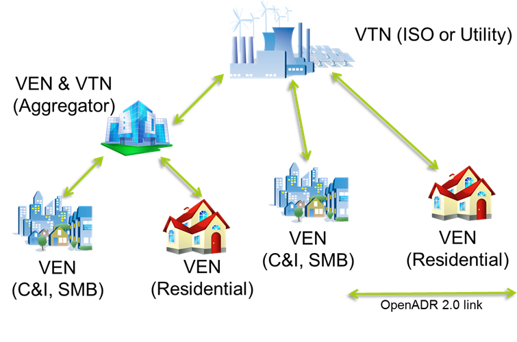

# OpenADR: Enabling Scalable, Automated Demand Response

## Introduction

With the energy transition accelerating, grid operators and utilities need **smarter, automated demand response (DR)** to balance supply and demand. **OpenADR** provides a standardized way to automate DR, integrating utilities, aggregators, and consumers into a seamless, interoperable energy ecosystem.

<!-- more -->

This post covers:

- ✅ **How OpenADR works** (VTN, VEN, and Aggregators)
- ✅ **Cloud and IoT architectures for OpenADR**
- ✅ **Security, scalability, and best practices**

***

## What is OpenADR?

**Open Automated Demand Response (OpenADR)** is an open standard that allows utilities, grid operators, and energy aggregators to automate Demand Response (DR) programmes. It does this through **secure, real-time communication** between energy providers and consumers.

### Key Participants in an OpenADR System

* **🔹 Virtual Top Node (VTN)** – Issues DR events (e.g., utility or aggregator).
* **🔹 Virtual End Node (VEN)** – Receives and responds to DR events (e.g., smart buildings, EV chargers, batteries).
* **🔹 Aggregators (VTN & VEN)** – Play a dual role, receiving DR signals from utilities (as a VEN) and distributing them to customer devices (as a VTN).

### OpenADR Communication Flow

1️⃣ **Grid operator/utility (VTN)** issues a DR event.\
2️⃣ **Aggregator (VTN & VEN)** receives the event and optimizes distribution.\
3️⃣ **Customers & devices (VENs)** adjust consumption based on pricing, signals, or direct control.

***

## OpenADR 2.0b & 3.0: The Foundation of Modern Demand Response

🔹 **OpenADR 2.0b** is the most widely deployed version, supporting:

* **Asynchronous DR event communication**
* **Price & event-based signals**
* **Telemetry & real-time energy reporting**

🔹 **OpenADR 3.0** is the API-driven evolution, built for:

* **RESTful JSON APIs** (easier integration)
* **Scalability for cloud & edge**
* **Enhanced security with OAuth2 & JWT**

Both versions support **grid-scale DR programs**, but OpenADR 3.0 enables **faster, more flexible energy automation**.

***

## How OpenADR Fits in a Cloud-Native Energy System

### OpenADR in a Cloud-Based Architecture

For large-scale **grid operators, aggregators, and energy platforms**, a **cloud-based VTN** can manage **thousands of VENs** dynamically.

- ✅ **Scalability** – Handle **millions** of DR events dynamically
- ✅ **Real-time telemetry** – Optimise energy demand based on grid conditions
- ✅ **AI-driven forecasting** – Predict DR needs and automate responses

***

### Aggregators: The Bridge Between Utilities and Customers

**Aggregators** act as both **VTNs and VENs**, optimizing energy flexibility by managing multiple customers and devices.

- 🔹 **As a VEN:** Receives DR signals from utilities.
- 🔹 **As a VTN:** Distributes DR events to **individual customers, buildings, and industrial loads**.

💡 **Example: EV Charging Aggregator**

* Receives OpenADR events from a **grid operator**.
* Optimizes charging schedules **across multiple EV fleets**.
* Ensures grid stability by **coordinating demand response at scale**.

***

## Security & Scalability Considerations

🔒 **Security Best Practices in OpenADR**

- ✅ **OAuth 2.0 + JWT authentication** – Prevents unauthorized access.
- ✅ **Granular permission models** – Restricts DR signals based on policy.
- ✅ **End-to-end encryption (TLS 1.2+)** – Ensures secure data exchange.

🌍 **Scaling OpenADR Deployments**

- ✅ **Serverless VTNs** – Auto-scale DR event handling.
- ✅ **Event-driven architectures (Kafka, Pub/Sub)** – Enables low-latency processing.
- ✅ **Hybrid cloud + edge** – Reduces latency for real-time DR.

***

## Conclusion

🚀 **OpenADR is revolutionizing demand response**, providing a **flexible, automated** approach to managing energy demand at **grid scale**.

### Key Takeaways

- ✅ **OpenADR enables seamless DR automation** for utilities, aggregators, and consumers.
- ✅ **Aggregators play a key role** in optimizing energy flexibility.
- ✅ **OpenADR 3.0 is API-driven and built for the future.**
- ✅ **Security & scalability are critical** for successful OpenADR deployments.

🔗 **Want to explore OpenADR?**

* 📖 [OpenADR Alliance](https://www.openadr.org/)
