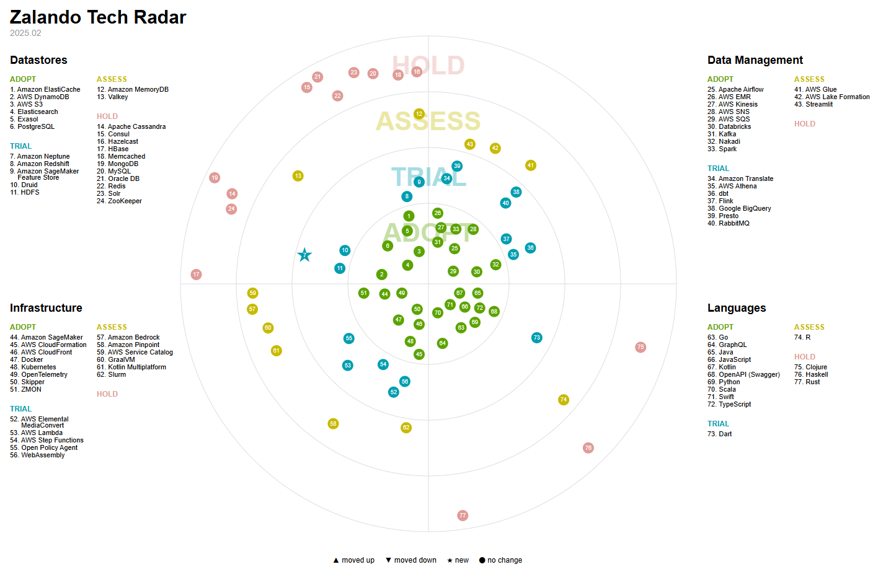

# Leveraging a Technology Radar for Strategic Decision-Making in Business

In the fast-moving world of technology, businesses often struggle to stay ahead of emerging trends while balancing technical debt, legacy systems, and innovation. A **Technology Radar** is a practical tool for tracking technologies, frameworks, platforms, and methodologies—helping businesses make informed decisions about what to **adopt, trial, assess, or hold off on**.

<!-- more -->

I maintain a personal [Technology Radar](https://tarf.co.uk/TechRadar/) to track trends and technologies relevant to my areas of interest. But the same concept can be incredibly useful for **organisations looking to align their technology strategy with their business goals**.

***

## Why Businesses Should Maintain a Technology Radar

### 1. Avoiding Hype-Driven Development

Technology trends can be noisy. One moment, a new framework is "the future," and the next, it’s abandoned. A **Technology Radar helps separate genuine innovation from passing fads**, ensuring investment in tools and techniques that provide real value.

### 2. Aligning Tech with Business Objectives

A well-maintained Radar isn’t just about cool tech—it should be **tied to business goals**. Whether improving developer efficiency, reducing cloud costs, or ensuring regulatory compliance, technologies should be assessed based on their impact on the bottom line.

### 3. Encouraging Continuous Learning & Innovation

A Radar fosters a **culture of innovation** by encouraging teams to assess new technologies in a structured way. It provides visibility into what’s being explored across the organisation, reducing silos and duplication of effort.

### 4. Managing Technical Debt Proactively

Technical debt is inevitable, but a Radar helps businesses **track legacy dependencies and make strategic decisions about modernisation**. Rather than reacting when systems become unmanageable, businesses can plan phased transitions to better technologies.

***

## How to Structure a Business Technology Radar

A Technology Radar typically consists of **four quadrants**:

1. **Languages & Frameworks** – Programming languages, libraries, and frameworks used in software development.
2. **Tools & Platforms** – DevOps tools, cloud providers, IDEs, and deployment strategies.
3. **Techniques & Practices** – Architectural approaches, coding standards, and methodologies.
4. **Infrastructure & Deployment** – Cloud-native strategies, serverless computing, edge computing, and CI/CD pipelines.

Each item falls into one of **four categories**:

* **Adopt** – Proven, recommended technologies with clear business benefits.
* **Trial** – Emerging technologies worth experimenting with in controlled environments.
* **Assess** – Promising but unproven technologies requiring further research.
* **Hold** – Technologies that should be phased out or avoided due to risks or obsolescence.

*Image of the [Zalando Tech Radar](https://opensource.zalando.com/tech-radar/).*

***

## How Often Should You Update a Technology Radar?

A Technology Radar should be a **living document**, but it shouldn’t change so frequently that it becomes noise. A **quarterly update cycle** is a good balance—frequent enough to capture new trends but structured enough to encourage meaningful discussions.

* **Every quarter**, review the Radar with key stakeholders (engineering leadership, architects, tech leads).
* **Annually**, do a larger strategic review: Are we seeing patterns? Are there tech trends we need to rethink?
* **Ad-hoc updates** can happen when a major tech shift occurs—such as a key vendor ending support for a product or a new security risk emerging.

***

## What Influences the Decision to Add or Remove Technologies?

Adding or removing technologies from the Radar shouldn't be arbitrary—it should be driven by **data, experience, and alignment with business needs**. Here are some key factors:

### Adding a Technology

* **Industry Trends** – New frameworks, tools, and best practices emerging in the wider ecosystem.
* **Business Needs** – Does this technology solve a problem the business is facing (scalability, security, cost, etc.)?
* **Developer Experience** – Will it improve productivity, maintainability, or reduce complexity?
* **Technical Experiments** – Have internal trials or prototypes demonstrated value?
* **Competitive Advantage** – Will adopting this technology help differentiate the company’s products or services?

### Removing a Technology

* **Becomes Business-as-Usual (BAU)** – Once a technology is widely used and no longer a strategic decision, it **can be removed from the Radar**. The Radar should focus on **emerging decisions, not everyday tools**.
* **Obsolescence** – If a framework, tool, or practice is no longer maintained, has security risks, or is being deprecated, it should be flagged for removal.
* **No Longer Fits Business Strategy** – Technologies that were promising but don't align with long-term goals should be phased out.
* **Poor Adoption or Negative Feedback** – If a technology was trialled but didn’t provide the expected benefits, it should be removed.

***

## What Happens When You Stop Using a Technology?

Deciding to **stop using** a technology is just as important as choosing to adopt one. Businesses need a structured approach to deprecating technologies to avoid chaos.

1. **Document the Reason for Stopping**

   * Was it technical debt?
   * Poor performance?
   * Security vulnerabilities?
   * Industry shifts?

2. **Plan a Transition Strategy**

   * If the tech is core to systems, identify a replacement and create a migration plan.
   * If it’s a minor tool, ensure teams know what to use instead.

3. **Communicate the Change**

   * Developers and teams need to know what’s changing and why.
   * Provide timelines for removal and offer guidance on alternatives.

4. **Archive for Historical Context**

   * Keep a record of technologies that were removed and why—this prevents teams from revisiting past mistakes.

***

## Implementing a Technology Radar in a Business

### 1. Define Ownership & Update Cadence

Decide who maintains the Radar—typically a **Tech Leadership Group, Architecture Guild, or Engineering Council**. A **quarterly review cycle** works well to keep it relevant without becoming a burden.

### 2. Encourage Team Contributions

Make it a **collaborative effort**. Encourage engineers, architects, and product teams to propose additions based on real-world experience. Crowdsourcing insights leads to better decision-making.

### 3. Make It Visual & Accessible

Use **tools like ThoughtWorks Radar, Zalando’s Tech Radar generator, or custom dashboards** to make the Radar easy to consume. Avoid static documents that get lost in Confluence or SharePoint.

### 4. Integrate with Decision-Making

A Radar is **useless if it’s not referenced in architectural decisions**. It should feed into tech strategy discussions, RFCs, and architectural decision records (ADRs).

### 5. Tie It to Business Outcomes

Don't track tech for the sake of it. Regularly ask:

* **Does this help us scale?**
* **Does this reduce costs or improve developer experience?**
* **Does this align with regulatory and security needs?**

***

## Final Thoughts

A Technology Radar isn't just a nice-to-have—it’s a **strategic asset**. By systematically tracking technological trends and aligning them with business goals, organisations can **stay ahead of disruption, reduce risks, and drive innovation with confidence**.

If your company doesn’t have a Radar yet, now’s the time to start. Keep it **lightweight, collaborative, and actionable**, and it will become an invaluable tool in your technology strategy.
