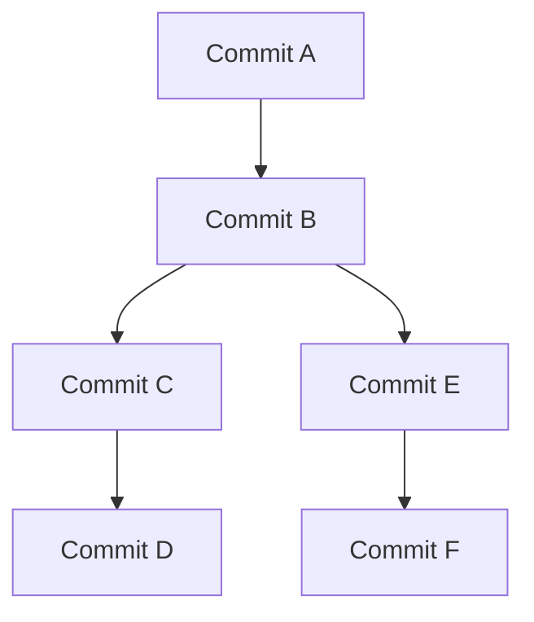
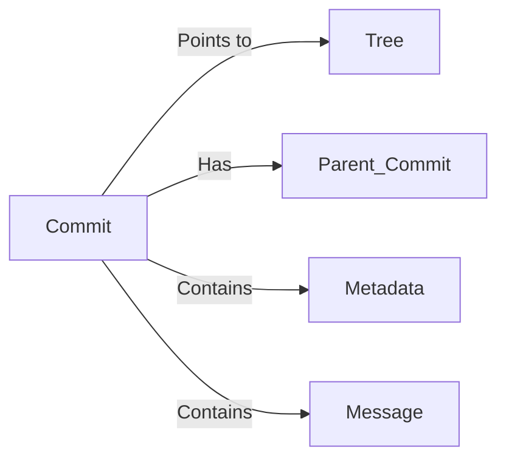
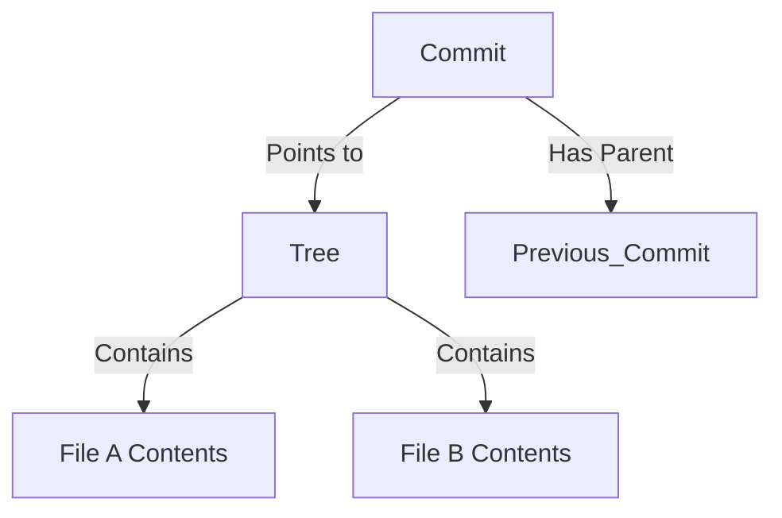
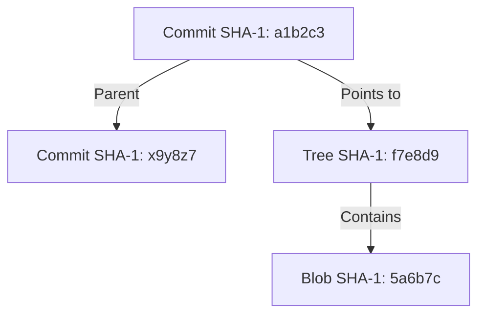

# Understanding Git: How It Works Under the Hood

Git is often treated as a black box—you commit, push, merge, and somehow everything works. But to really *understand* Git, you need to go beyond the commands and explore **how it actually stores data** and **why it works the way it does**.

<!-- more -->

At its core, Git is **a content-addressable filesystem** that uses a **directed acyclic graph (DAG)** to track changes. Everything is identified using **SHA-1 hashes**, making history immutable and efficient.

This post explains:

* What **Git’s fundamental building blocks** are.
* What **the SHA-1 hashes** represent.
* How Git **stores files and tracks changes**.
* Why **binary files** don’t work well with Git and how to handle them.
* Why **Git works in specific ways**—so you can use it more effectively.

***

## 1. Git as a Directed Acyclic Graph (DAG)

A Git repository is not just a list of file versions—it’s a **graph of commits**. Specifically, a **directed acyclic graph (DAG)**, which means:

* **Directed** → Every commit has one or more parents, forming a directional link.
* **Acyclic** → Commits never loop back; history always moves forward.

Each commit is a **node** in this graph, and the links between commits define how the history is structured.

### Example DAG structure of a Git repository



Here:

* `D` is the latest commit on the `main` branch.
* `E` and `F` are part of another branch that diverged from `B`.

### Why does Git use a DAG?

* **Fast history traversal** → Commands like `git log` are efficient.
* **Immutable commits** → Once created, commits never change.
* **Merging and branching are natural** → Because commits reference parents, different branches can be merged easily.

***

## 2. What is a Commit?

A **commit** in Git is not just a list of file changes—it is a **snapshot of the entire repository at a point in time**.

### What data does a commit store?

Each commit object contains:

* A **reference to a tree** (which represents the state of the repository).
* A **parent commit hash** (or multiple parents in the case of a merge).
* The **author's name, email, and timestamp**.
* The **commit message**.

Example of a commit object:

```bash
$ git cat-file -p <commit-hash>
tree 827b8a...
parent f1c3a2...
author John Doe <john@example.com> 1700000000 +0000
committer John Doe <john@example.com> 1700000000 +0000

Initial commit
```

### Diagram of a commit structure



***

## 3. The Four Key Object Types in Git

Git internally stores **four types of objects**:

| Object Type | Purpose                                                                    |
| ----------- | -------------------------------------------------------------------------- |
| **Blobs**   | Store **file contents** (but NOT filenames or metadata).                   |
| **Trees**   | Store **directory structures**, linking filenames to blobs or other trees. |
| **Commits** | Store **snapshots of trees**, with parent references.                      |
| **Tags**    | Store human-readable labels for commits.                                   |

### How Git links objects together



***

## 4. Are File Changes Stored as Deltas or Full Copies?

A common misunderstanding is that Git stores **only differences (deltas)** when you change a file.\
**This is not true.**

* **Each new file version is stored as a completely new blob**.
* **Git does NOT store deltas** between versions in its object database.

However, Git **compresses objects** using **delta compression** during garbage collection (`git gc`).

### Example: How Git stores versions of a file

1. You create `file.txt` with "Hello World".
2. Git stores the full contents as a **blob**.
3. You modify `file.txt` to say "Hello Git".
4. Git creates a completely new **blob**.
5. The new commit references the new tree and blob.

This is why **binary files** (which change frequently) are problematic—Git stores every full version, leading to massive repository sizes.

***

## 5. Why Git is Bad for Binary Files & How to Handle Them

Since Git **stores a full copy** of a file when it changes, **binary files** (e.g., images, videos, PDFs) can **quickly bloat a repository**.

### Why is this a problem?

* **Large files bloat history** → Every change creates a new **full copy**.
* **Delta compression is less effective** on binary files.
* **Cloning becomes slow** → Large repositories take longer to fetch.

### How to handle binary files in Git

1. **Use `.gitignore`** to exclude large files from Git:
   ```markdown
   *.mp4
   *.zip
   ```
2. **Use Git LFS (Large File Storage)** → Stores binaries **outside** Git:
   ```bash
   git lfs track "*.psd"
   git add .gitattributes
   git commit -m "Track large files"
   ```
3. **Use external storage** → Host large files in **cloud storage** and reference them instead.

***

## 6. What Do Git Hashes Represent?

Every object in Git (blobs, trees, commits) is **identified by a SHA-1 hash**.\
This ensures:

* **Content integrity** → You can’t modify history without changing the hash.
* **Efficient storage** → Same content = same hash (no duplicates).

### How are SHA-1 hashes generated?

Git hashes are created by:

```scss
SHA1("type + size + content")
```

For example, a commit’s hash is based on:

* The **tree (snapshot of files)**.
* The **parent commit hash**.
* The **commit message** and metadata.

If anything changes (e.g., modifying a commit message), the **commit hash changes**.

### Example of a commit’s hash reference



***

## 7. How This Affects Git Commands

Now that you understand Git’s structure, common commands make more sense.

| Command        | What It Actually Does                                                 |
| -------------- | --------------------------------------------------------------------- |
| `git add`      | Creates **blob objects** for file contents and updates the **index**. |
| `git commit`   | Creates a **commit object** pointing to the new tree.                 |
| `git branch`   | Creates a **new reference** (pointer) to a commit.                    |
| `git checkout` | Moves HEAD to a different commit/branch.                              |
| `git merge`    | Creates a **new commit with multiple parents**.                       |
| `git rebase`   | Rewrites history by **recreating commits with new parents**.          |

***

## 8. Conclusion

Git is **not just a tool—it’s a graph-based database** that stores immutable snapshots of your project.

🔹 **Key Takeaways:**

* Git is a **directed acyclic graph (DAG)** of commits.
* **Commits are snapshots**, not diffs.
* **Files are stored as blobs**, and **each change creates a new blob**.
* **Git is inefficient for binary files**—use Git LFS.
* **Branches are just pointers** to commits.

With this knowledge, Git stops feeling like magic—and starts feeling like a powerful, logical system that you can use effectively. 🚀
