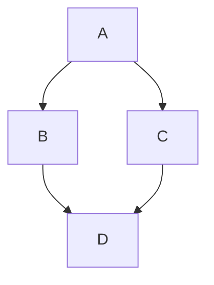
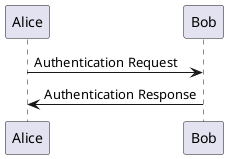

# The Ultimate Markdown Guide: Formatting, Diagrams, Code Blocks, and More

## Introduction to Markdown

**Markdown** is a **lightweight markup language** that makes formatting text simple, readable, and easy to write. It was created by [John Gruber]() in 2004 as a cleaner alternative to HTML.

<!-- more -->

Unlike traditional word processors, Markdown allows you to **write formatted text using plain-text syntax**, making it ideal for:

- ✅ **Documentation** (README files, software manuals, API docs)
- ✅ **Technical blogging** (Static site generators like MkDocs, Hugo, Jekyll)
- ✅ **Writing content for the web** (GitHub, Stack Overflow, GitLab)
- ✅ **Note-taking** (Obsidian, Notion, Jupyter Notebooks)
- ✅ **Docs-as-Code workflows** (version-controlled documentation with Git)

***

# **Why Use Markdown?**

### Simple & Readable

* Uses an **intuitive, plain-text syntax** that’s easy to learn.
* You can **read it without needing conversion**—unlike Word or HTML.

### Portable & Compatible

* Works across **GitHub, GitLab, MkDocs, Jupyter, and many other platforms**.
* Can be **converted** to HTML, PDF, DOCX, LaTeX, and more.

### Docs-as-Code Ready

* Perfect for **version-controlled documentation** in Git.
* Can be used in **static site generators** like MkDocs, Hugo, and Docusaurus.

### Extensible

* Supports **tables, images, code blocks, callouts, UML diagrams, and formulas**.
* Works with plugins like **Mermaid for flowcharts** and **PlantUML for UML diagrams**.

***

# **Markdown Syntax Cheat Sheet**

This section covers **everything Markdown can do**, including **basic formatting, advanced features, and hidden tricks**.

***

## 1⃣ Headers (Titles & Subtitles)

Use `#` for headers (up to six levels).

```markdown
# Heading 1
## Heading 2
### Heading 3
#### Heading 4
##### Heading 5
###### Heading 6
```

🔹 **Rendered Output:**

# Heading 1

## Heading 2

### Heading 3

#### Heading 4

##### Heading 5

###### Heading 6

***

## 2⃣ Text Formatting (Bold, Italics, Strikethrough, Highlights)

```markdown
*Italic text* or _Italic text_
**Bold text** or __Bold text__
~~Strikethrough~~
```

🔹 **Rendered Output:**\
*Italic text*\
**Bold text**\
~~Strikethrough~~\

***

## 3⃣ Lists (Ordered & Unordered)

```markdown
- Item 1
- Item 2
  - Sub-item 2.1
  - Sub-item 2.2
- Item 3

1. First item
2. Second item
3. Third item
```

🔹 **Rendered Output:**

* Item 1

* Item 2

  * Sub-item 2.1
  * Sub-item 2.2

* Item 3

1. First item
2. Second item
3. Third item

***

## 4⃣ Code Blocks & Syntax Highlighting

````markdown
`Inline code example`

```python
# Python code block
def hello():
    print("Hello, Markdown!")
```
````

🔹 **Rendered Output:**

`Inline code example`

```python
# Python code block
def hello():
    print("Hello, Markdown!")
```

***

## 5⃣ Blockquotes (Quotes & Nested Quotes)

```markdown
> This is a blockquote.
>> This is a nested blockquote.
```

🔹 **Rendered Output:**

> This is a blockquote.
>
> > This is a nested blockquote.

***

## 6⃣ Admonitions (Notes, Warnings, etc.)

Many Markdown renderers (especially MkDocs) support **admonitions** for important notes.

```markdown
!!! note
    This is an important note.

!!! warning
    Be careful with this setting.
```

🔹 **Rendered Output:**

> 📌 **Note:** This is an important note.\
> ⚠️ **Warning:** Be careful with this setting.

***

## 7⃣ Links & Images (Fixed Sizes, Clickable Links)

#### Hyperlinks

```markdown
[Visit Google](https://www.google.com)
```

🔹 **Rendered Output:**\
[Visit Google](https://www.google.com)

#### Images (with Fixed Sizes)

```markdown

```

🔹 **Rendered Output:**\
{ width="150" }

***

## 8⃣ Tables

```markdown
| Name    | Age | Country  |
|---------|----:|---------|
| Alice   |  25 | UK      |
| Bob     |  30 | USA     |
| Charlie |  35 | Canada  |
```

🔹 **Rendered Output:**

| Name    | Age | Country |
| ------- | --- | ------- |
| Alice   | 25  | UK      |
| Bob     | 30  | USA     |
| Charlie | 35  | Canada  |

***

## 9⃣ Mermaid Diagrams (Flowcharts, Sequence Diagrams, etc.)

````markdown

````

---

## PlantUML for UML Diagrams

````markdown

````

---

## Task Lists (Checklists)

```markdown
- [x] Task 1 (Completed)
- [ ] Task 2 (Incomplete)
- [ ] Another task to do
```

***

## Mathematical Notation (LaTeX & KaTeX)

```markdown
Inline equation: $E = mc^2$  

Block equation:  
$$  
\sum_{i=1}^{n} i = \frac{n(n+1)}{2}  
$$
```

***

## Footnotes

```markdown
Here is a sentence with a footnote[^1].

[^1]: This is the footnote explanation.
```

***

## Final Thoughts: Why Markdown is the Best Choice

- ✅ **Simple & Readable** – No complex syntax, just plain text.
- ✅ **Docs-as-Code Ready** – Works seamlessly with Git, CI/CD, and static site generators.
- ✅ **Portable & Extensible** – Supports tables, code, diagrams, and formulas.
- ✅ **Future-Proof** – Plain text will never go out of style!
