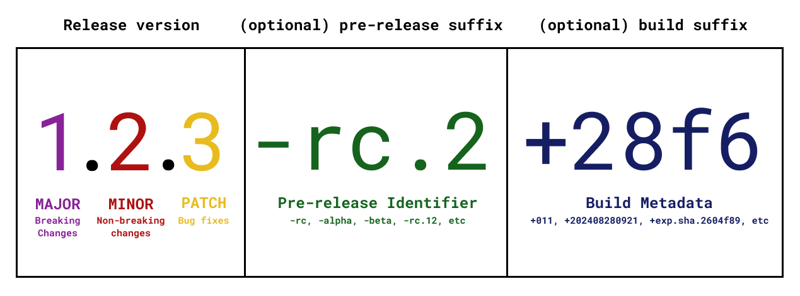

# A Pragmatic Approach to Semantic Versioning

Semantic Versioning (SemVer) is one of those things that looks simple on paper but gets complicated when applied in the real world. At its core, it provides a structured way to version software in a meaningful way, helping teams, APIs, and libraries manage dependencies and avoid breaking changes without warning. But, as with most best practices, the devil is in the details.

<!-- more -->

This post covers the essentials of SemVer, common pitfalls, and a pragmatic approach to making it work in the real world. I'll also cover some of the lesser-known but useful aspects of SemVer, like pre-release versions and metadata.

***

## What is Semantic Versioning?

SemVer follows a structured version format:




* **MAJOR** – Breaking changes. If something in the public API changes in a way that will break existing users, bump this.
* **MINOR** – New features, but backwards compatible. If you add something new without breaking anything, increase this.
* **PATCH** – Bug fixes or small improvements that don’t change the API.

So `1.2.3` means:

* **1** → First major stable version
* **2** → Second minor update (added new functionality)
* **3** → Third patch-level fix (probably bug fixes)

***

## Pre-release Versions (Alpha, Beta, RC) – When and How to Use Them

Pre-release versions are useful when you want to release a work-in-progress version before it’s fully stable. This is especially important when making significant changes that need testing before becoming the next official release.

SemVer supports pre-releases using **hyphen notation**:

```matlab
1.2.3-alpha.1
1.2.3-beta.2
1.2.3-rc.3
```

### Common Pre-release Identifiers

* `alpha` – Early, unstable versions; features may change.
* `beta` – More stable but still subject to change.
* `rc` (Release Candidate) – Final testing phase before stable release.

**How they work in dependency management:**

* If you specify `^1.2.3`, package managers **won’t** pull in `1.2.3-alpha.1`.
* If you explicitly specify `1.2.3-alpha.*`, it will accept any alpha version of `1.2.3`.
* If you specify `1.2.3-beta.2`, it will only match exactly that pre-release.

### Why Use Pre-releases?

* Allows users to test without committing to a full release.
* Helps catch issues before they reach production.
* Encourages feedback from early adopters.
* Avoids versioning mess (instead of publishing `1.2.3` and quickly realising it’s broken and jumping to `1.2.4`).

***

## Build Metadata – What Is It and When to Use It?

SemVer also supports optional **metadata** using a **plus (`+`) notation**:

```matlab
1.2.3+build20250305
1.2.3-beta.1+exp.sha.5114f85
```

### What Metadata is For

* **Build numbers** → `1.2.3+20250305` (to track when a build was made).
* **Git commit hashes** → `1.2.3+exp.sha.5114f85` (useful for CI/CD).
* **Environment-specific versions** → `1.2.3+staging` or `1.2.3+prod`.

### How Metadata Works in Dependency Resolution

* Metadata **does not** affect precedence.
* `1.2.3+build20250305` is **considered the same version** as `1.2.3`.
* Package managers ignore metadata when resolving dependencies.

Use metadata for internal tracking but **don’t rely on it for compatibility or version ordering**.

***

## Why Bother with SemVer?

You might think, *"I just need version numbers to go up. Why does it matter?"*

Well, in the real world:

* **APIs and libraries depend on predictable behaviour.**
* **Package managers (npm, pip, Cargo, etc.) rely on SemVer to avoid breaking dependencies.**
* **It builds trust with your users.**

If you don’t follow SemVer properly, you’ll end up with confused users, broken dependencies, and a versioning mess.

***

## Common Mistakes with SemVer

### 1. Major Version Overuse (Version Inflation)

Some projects jump major versions constantly (*cough* JavaScript frameworks *cough*), which devalues the meaning of a major release. If everything is a major release, nothing is.

### 2. Not Bumping Major Version When Breaking Things

The opposite problem—shoving breaking changes into minor versions because "it’s a small change." If it breaks users' code, it’s a **major** change.

### 3. Misunderstanding Pre-release Versions

People sometimes publish a `1.2.3-alpha` and expect it to be picked up automatically by dependency managers—it won’t unless explicitly requested.

### 4. Staying in Pre-1.0 Forever

SemVer states that *anything goes* before `1.0.0`, meaning breaking changes can happen at any time. Some projects abuse this by staying in `0.x.x` forever to avoid versioning commitments.

### 5. Not Considering Dependencies

If you upgrade a dependency and it introduces breaking changes, your project might need a **major version bump**—even if your own API stays the same.

***

## A Pragmatic Approach to SemVer

Rather than being dogmatic, I prefer a balanced approach:

1. **Stick to the rules, but don’t fear major versions.** If you break something, bump the major version—don’t hide it in a minor update.
2. **Think about your users.** If a change requires someone to refactor their code, treat it as breaking.
3. **Use pre-releases properly.** If you're making big changes, use `alpha`, `beta`, and `rc` releases before shipping `2.0.0`.
4. **Document versioning decisions.** A simple `CHANGELOG.md` helps explain why something is `2.0.0` instead of `1.3.5`.
5. **Don’t abuse "pre-1.0.0" to avoid commitment.** If people are using your software, version it properly.
6. **Use metadata wisely.** Great for tracking builds, but don’t rely on it for dependency resolution.

***

## Final Thoughts

Semantic Versioning isn’t perfect, but it’s the best system we have. If used correctly, it removes ambiguity, improves dependency management, and keeps your users happy.

So the next time you're about to publish a new version, ask yourself:

* *Is this truly a patch, a minor change, or a breaking update?*
* *Should this be a pre-release before going live?*
* *Would adding metadata help track this build?*

Get that right, and you’ll save yourself (and everyone else) a lot of headaches.
