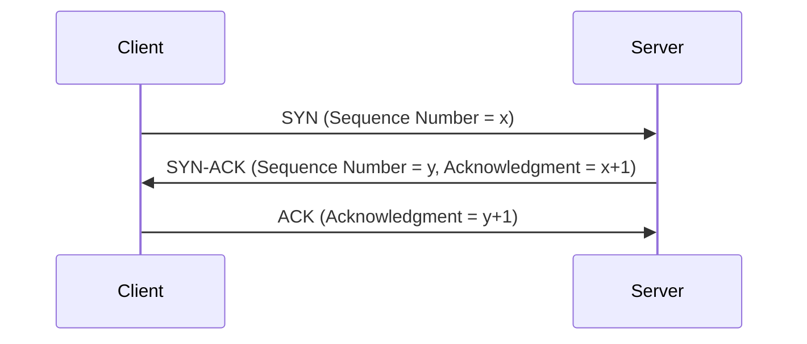
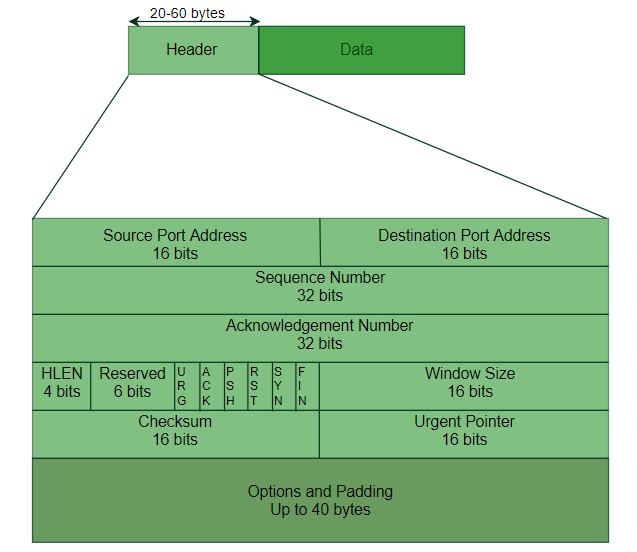
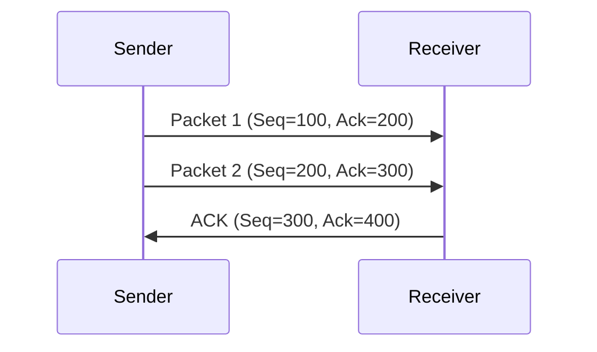
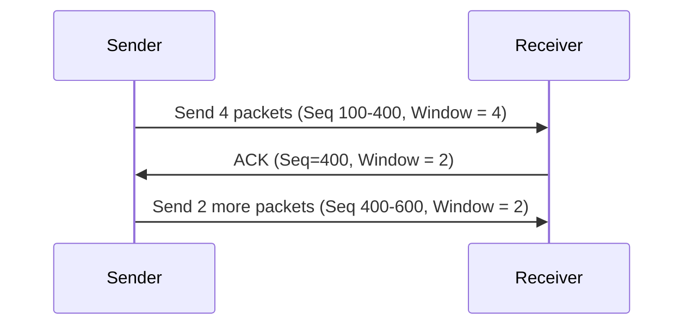
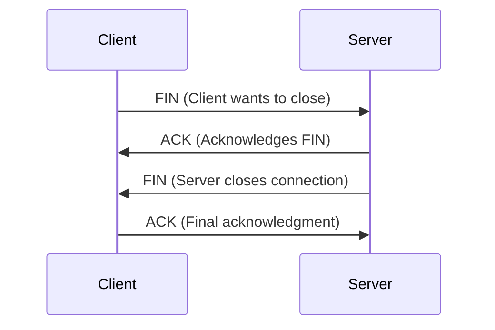

# A Deep Dive into TCP: How It Powers Reliable Communication

## Introduction

The **Transmission Control Protocol (TCP)** is one of the fundamental building blocks of the internet. It ensures that data is delivered **accurately** and **in order**, even when networks are congested or unreliable. Whether you're streaming a video, sending an email, or making an online payment, TCP is working behind the scenes to make sure your data reaches its destination intact.

<!-- more -->

In this deep dive, we’ll explore:

* How TCP establishes and tears down connections
* How data flows reliably between devices
* The **TCP packet format**
* Congestion control mechanisms
* **Sliding windows** and how TCP optimises performance
* A **step-by-step breakdown with diagrams**

Let’s get started. 🚀

***

## 1. TCP: A Reliable Transport Protocol

TCP operates at **Layer 4 (Transport Layer)** of the OSI model. It is a **connection-oriented** and **reliable** protocol, meaning it ensures:

- ✅ **Order** – Packets arrive in the correct sequence.
- ✅ **Reliability** – Lost packets are retransmitted.
- ✅ **Error Detection** – Corrupted data is discarded and re-sent.
- ✅ **Flow Control** – Prevents overwhelming the receiver.
- ✅ **Congestion Control** – Helps manage network congestion.

Unlike **UDP (User Datagram Protocol)**, which sends data without guarantees, TCP **establishes a connection** between two devices before exchanging data. This process is known as the **three-way handshake**.

***

## 2. TCP Connection Setup: The Three-Way Handshake

Before data transfer can begin, TCP must establish a connection. This is done using the **three-way handshake**:

### Step-by-step explanation

1️⃣ **SYN (Synchronise)**: The client sends a TCP packet with the **SYN flag** set, indicating it wants to establish a connection. It also includes an **Initial Sequence Number (ISN)**.\
2️⃣ **SYN-ACK (Synchronise-Acknowledge)**: The server responds with **SYN-ACK**, acknowledging the client's sequence number and sending its own ISN.\
3️⃣ **ACK (Acknowledge)**: The client sends an **ACK** to confirm the connection is established.

After this exchange, the connection is established, and data transfer can begin.

***

## 3. TCP Packet Format: Understanding the Header

A TCP packet consists of a **header** and a **data section**. The header contains important metadata that ensures proper transmission and reassembly.

### TCP Header Structure

| Field                 | Size (bits) | Description                                |
| --------------------- | ----------- | ------------------------------------------ |
| Source Port           | 16          | Port of the sender                         |
| Destination Port      | 16          | Port of the receiver                       |
| Sequence Number       | 32          | Position of the first byte in the segment  |
| Acknowledgment Number | 32          | The next expected byte from the other side |
| Data Offset           | 4           | TCP header length                          |
| Reserved              | 3           | Reserved for future use                    |
| Flags                 | 9           | Control flags (SYN, ACK, FIN, etc.)        |
| Window Size           | 16          | Flow control mechanism                     |
| Checksum              | 16          | Ensures data integrity                     |
| Urgent Pointer        | 16          | Marks urgent data                          |
| Options               | Variable    | Used for additional settings               |

🖼 **Diagram of a TCP Header**

***

## 4. Data Transmission & Flow Control

Once the connection is established, TCP ensures **reliable** and **efficient** data transmission.

Each TCP segment includes:

* A **Sequence Number** (to order packets)
* An **Acknowledgment Number** (confirming received packets)
* A **Window Size** (for flow control)

TCP ensures reliability by **retransmitting lost packets** and handling **out-of-order segments**.

***

## 5. Sliding Window Protocol: Managing Flow Control

TCP uses a **sliding window** mechanism to control how much data can be in transit before needing an acknowledgment.

### How it works

* The **window size** determines how many bytes can be sent before an acknowledgment is required.
* If the receiver has limited buffer space, it advertises a **smaller window size**.
* As data is acknowledged, the window slides forward, allowing more data to be sent.

🖼 **Visual Representation of Sliding Window**

This mechanism prevents overwhelming the receiver while keeping the pipeline full for **efficient throughput**.

***

## 6. TCP Congestion Control: Avoiding Network Overload

TCP dynamically adjusts its sending rate based on network conditions using:

### 1⃣ Slow Start

* Starts with a small **Congestion Window (cwnd)**.
* Doubles **cwnd** every round-trip time (RTT) to avoid overloading the network.

### 2⃣ Congestion Avoidance

* Once the threshold is reached, TCP increases **cwnd linearly** instead of exponentially.

### 3⃣ Fast Retransmit & Fast Recovery

* If a packet is lost (detected via duplicate ACKs), TCP **immediately retransmits** instead of waiting for timeout.

***

## 7. Connection Termination: The Four-Way Handshake

Closing a TCP connection is a **graceful** process that ensures all data is delivered before termination.

### Step-by-step explanation

1️⃣ **FIN** – The client sends a **FIN (Finish)** packet.\
2️⃣ **ACK** – The server acknowledges the FIN.\
3️⃣ **FIN** – The server sends its own FIN packet.\
4️⃣ **ACK** – The client acknowledges and the connection closes.

After termination, TCP enters a **TIME\_WAIT** state to ensure all packets have been properly handled before releasing resources.

***

## Conclusion

TCP is the backbone of reliable communication on the internet. From establishing a connection via the **three-way handshake** to managing **congestion and flow control**, it ensures that data reaches its destination **accurately** and **efficiently**.

### Key Takeaways

- 🔹 **TCP guarantees reliability, order, and error-checking.**
- 🔹 **It uses acknowledgments and retransmissions to handle lost packets.**
- 🔹 **Sliding windows optimise flow control and prevent congestion.**
- 🔹 **Congestion control mechanisms like Slow Start and Fast Retransmit keep the network stable.**

Next time you browse the web or send a message, remember: **TCP is quietly making sure your data gets where it needs to go.** 🚀
