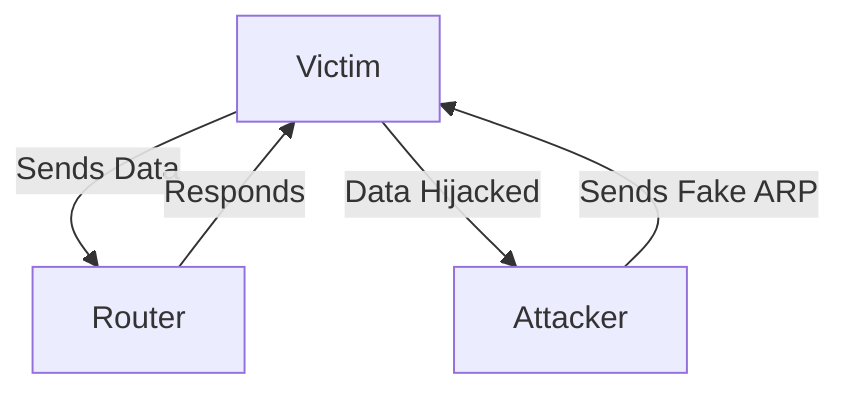

# ARP Spoofing, MAC Filtering and Network Fingerprinting

*Part 22 of the [networking and home lab series](2025-04-25-networking-and-home-lab-series.md).*

Ah, Layer 2—the unsung hero of networking. It’s like the midfield in a football team—often overlooked but absolutely critical for passing the ball securely from one player to another. In networking terms, we're talking about the data link layer, where frames are transferred over physical mediums. Yet, just like a match can be compromised by a sneaky opponent, your network can be vulnerable to various Layer 2 threats if you're not careful.

<!-- more -->

## Importance of Understanding These Risks

While most folks pay attention to higher-level attacks like SQL injections or DDoS attacks, ignoring Layer 2 vulnerabilities is a bit like locking your front door but leaving your windows wide open. So today, let's dive into some advanced Layer 2 attacks such as ARP spoofing and network fingerprinting and explore how MAC address filtering can be both a help and a hindrance.

## ARP Spoofing (Detailed)

First up on our agenda is ARP spoofing—a bit like someone pretending to be your mate down the pub to get free drinks on your tab.

### How ARP Spoofing Works

Here's how it works:

- **ARP Basics**: The Address Resolution Protocol (ARP) is used to map IP addresses to MAC addresses.
- **Spoofing Attack**: An attacker sends fake ARP messages over a local network, linking their MAC address with the IP address of a legitimate device.
- **Man-in-the-Middle**: Once successful, the attacker can intercept data meant for that IP address or alter communications.

### Consequences of ARP Spoofing

The fallouts are rather grim:

- **Data Interception**: Sensitive information (think passwords) can be captured.
- **Network Disruption**: Legitimate communication gets diverted or blocked.
- **Impersonation**: The attacker can impersonate devices on the network.

### Detection and Prevention Techniques

So how do we combat this villainy?

- **Static ARP Entries**: Hardcode MAC-IP mappings to prevent learning new entries dynamically.
- **ARP Inspection**: Use features like Dynamic ARP Inspection (DAI) in managed switches.
- **Detection Tools**: Employ tools like `arpwatch` or `XArp` for monitoring unusual changes.

> **Tip:** Implementing VLAN segmentation can also limit the scope of an attack within the network.

## MAC Address Filtering

Next on the docket is MAC address filtering—a bit like using a VIP list at a club. Only certain devices are allowed in.

### How MAC Filtering Works

In essence:

- Network devices have lists of approved MAC addresses.
- Only traffic from these addresses is allowed through.

### Limitations and Bypasses

However, it's not foolproof:

- **MAC Spoofing**: An attacker can easily change their device's MAC address to match an authorised one.
- **Device Limitations**: Keeping lists updated in large networks can be cumbersome.

### When MAC Filtering Might Be Useful

Still, it has its place:

- Useful in small networks where you know all devices.
- Acts as a basic barrier against casual snoopers.

> **Caution:** Don’t solely rely on MAC filtering; it should be just one layer of your security strategy.

## Network Fingerprinting

Moving on, let’s talk about network fingerprinting. It’s akin to someone knowing which brand of tea you drink by looking at your shopping habits.

### Passive vs Active Fingerprinting

Two approaches here:

- **Passive Fingerprinting**: Observes traffic patterns without injecting packets—stealthy but slower.
- **Active Fingerprinting**: Sends packets to elicit responses—faster but more detectable.

### Information That Can Be Gathered

Both methods aim to collect data such as:

- Operating systems and versions
- Open ports and running services
- Devices' roles within the network

### Countermeasures

To obscure your fingerprints:

- Use firewalls to control outbound information.
- Employ IDS/IPS systems for anomaly detection.
- Regularly update software to close known vulnerabilities.

## Real-World Scenarios

Let's bring all this theory into the real world.

### Attacks on Local Networks

Think of a university campus where students might try to sniff each other's traffic—naughty but not unheard of. Implementing VLANs and using network monitoring tools can mitigate such risks effectively.

### Security Audits

During audits, ethical hackers might use fingerprinting techniques to assess vulnerabilities. Here, layers of security measures will showcase your defensive robustness.

## Conclusion: Proactive Layer 2 Security Measures

In summary, while Layer 2 might not always steal the spotlight, ignoring it is akin to ignoring rust on scaffolding—it'll bite you eventually. Adopt multiple defensive strategies:

- Be vigilant about ARP spoofing with static entries and inspections.
- Use MAC filtering wisely and as part of a broader security plan.
- Obscure your network's fingerprint through good practices and up-to-date defences.

> **Takeaway:** Layer 2 security isn't just nice-to-have; it's essential. Like keeping a good brew at hand during winter—a necessity for survival!

That wraps up our look into these fascinating aspects of network security. Now go forth and lock down those low-level layers!
