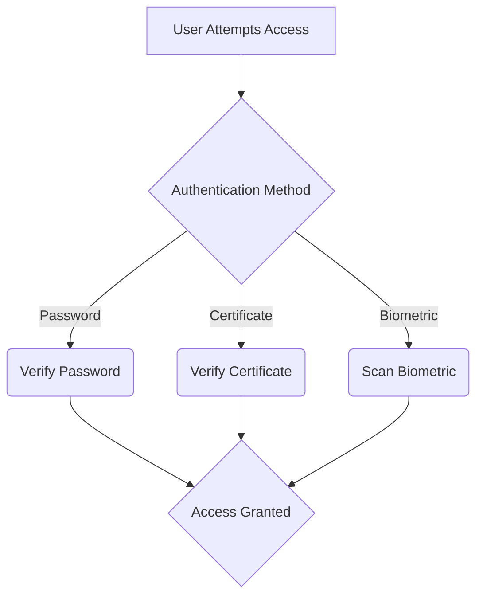

# Authentication, Authorisation, Accounting (AAA)

*Part 13 of the [networking and home lab series](2025-04-25-networking-and-home-lab-series.md).*

In the world of network security, AAA doesn't stand for "Amateur Athletes Association" or anything to do with batteries, but rather, it represents a foundational concept: Authentication, Authorisation, and Accounting. These three pillars are essential in ensuring secure access to networks and data, whether you're managing an enterprise network or setting up a secure home environment.

<!-- more -->

Understanding AAA is like understanding the rules of a football match; you need to know who’s allowed on the pitch, what they’re allowed to do, and how to keep track of their actions. This post will delve into each component of AAA, showing you how they apply in real-world scenarios such as Wi-Fi networks, VPNs, and logging systems.

## Importance of AAA in Network Security

Imagine your network as a castle. You wouldn't want just anyone waltzing in through the front gate, would you? AAA helps you:

- **Authenticate**: Verify identities to ensure only legitimate users enter.
  
- **Authorise**: Decide what these users can access once they're inside.

- **Account**: Keep track of user activities for auditing and troubleshooting.

AAA is critical because it helps maintain the integrity, confidentiality, and availability of your network resources. Now, let's explore each component in detail.

## Authentication

### Verifying User Identity

Authentication is like checking IDs at a club entrance. It's all about verifying that users are who they claim to be before granting them access.

### Methods of Authentication

- **Passwords**: The traditional method. Simple but prone to being compromised if not managed well (think of weak passwords as leaving the back door open).

- **Certificates**: Digital certificates act like electronic passports, providing stronger security by encrypting communications.

- **Biometrics**: Fingerprints or facial recognition offer high-security levels but raise privacy concerns.

### Note
Always use multi-factor authentication (MFA) where possible. It's like having multiple locks on your door—extra layers make it much harder for intruders.

## Authorisation

### Determining User Privileges

Once authenticated, authorisation determines what a user can and cannot do. Think of this as assigning roles on a football team—everyone has specific duties based on their skills.

### Access Control Lists (ACLs)

ACLs list permissions attached to an object (like files or directories), specifying who can access them and what operations they can perform.

- **Example**: An ACL may allow users to read a file but not write or delete it.

### Role-Based Access Control (RBAC)

RBAC assigns permissions based on roles within an organisation—like midfielders and defenders have different responsibilities on the pitch.

- **Example**: A manager may have more access rights than a regular employee.

## Accounting

### Tracking User Activity

Accounting is about keeping score—tracking what users do in your network. This helps with:

- Auditing
- Troubleshooting
- Compliance with regulations

### Logging and Auditing

Logs are records of user activities and system events. Regularly reviewing logs can help detect anomalies early—like spotting unusual movements in a football match indicating foul play.

### Tip
Implement automated log analysis tools to sift through large volumes of data efficiently. Think of them as your assistant referees watching every angle for potential fouls.

## AAA Protocols

Now that we understand what AAA does, let's look at some protocols that implement these concepts:

### RADIUS (Remote Authentication Dial-In User Service)

RADIUS is widely used for network access control—especially effective for Wi-Fi authentication and VPN connections. It's like having a central referee making decisions across various games simultaneously.

### TACACS+ (Terminal Access Controller Access-Control System Plus)

TACACS+ offers greater granularity than RADIUS by separating authentication, authorisation, and accounting processes. It's akin to having specialised officials managing different aspects of the game—one for offside calls, another for penalties.

## AAA in Different Environments

AAA isn't just for big corporate networks; it applies to various environments:

### Enterprise Wi-Fi (802.1X)

IEEE 802.1X is an authentication standard used in enterprise Wi-Fi networks. It uses RADIUS servers to authenticate users before granting them network access—similar to ticket checks before entering a stadium.

### VPN Authentication

VPNs use AAA protocols to ensure secure remote access. Authentication confirms user identity while authorisation controls accessible resources within the private network—much like ensuring team members have the right passes during an away game.

### Network Device Access

Network devices often require secure access controls. Implementing AAA ensures only authorised personnel configure routers or switches—like allowing only qualified mechanics under the hood of your car.

## Conclusion

The importance of AAA cannot be overstated when it comes to secure access control. It ensures:

- Only legitimate users gain entry (Authentication)
- Users have appropriate privileges (Authorisation)
- Activities are monitored and recorded (Accounting)

Whether securing an enterprise network or setting up advanced home systems, understanding and implementing AAA is crucial. It’s like having reliable referees overseeing every aspect of your game plan—keeping matches fair and square while ensuring smooth operations.

---

## Key Takeaway

AAA forms the bedrock of any robust security strategy. By effectively authenticating users, authorising their access levels, and accounting for their actions, you create a comprehensive shield against unauthorised intrusion—whether you're defending your business empire or fortifying your smart home setup against cyber threats.
