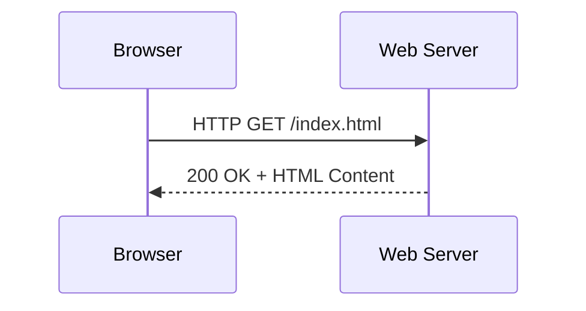
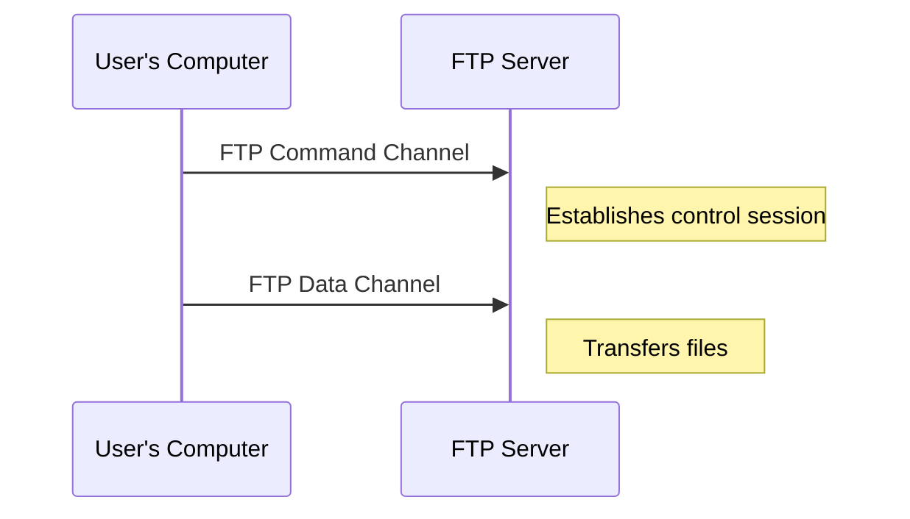

# Common Application Protocols: HTTP, HTTPS, FTP, SMTP, IMAP

*Part 11 of the [networking and home lab series](2025-04-25-networking-and-home-lab-series.md).*

## Introduction

Imagine the Internet as a sprawling city. There are roads (networks) and buildings (servers), but what really matters to us are the services—shops, offices, and homes—that we access using these roads. Application-layer protocols are like the signposts and rules that guide us through this city to get what we need. They dictate how our data is packaged, sent, received, and interpreted across networks. Today, we'll take a tour of some popular ones: HTTP, HTTPS, FTP, SMTP, and IMAP. We’ll explore how they interact with users and why they're important.

<!-- more -->

## HTTP (Hypertext Transfer Protocol)

### Web Browsing

HTTP is like the postal service for web pages. It’s the protocol used by the World Wide Web to transfer HTML pages from a server to a client (your browser). When you type a URL into your browser or click a link, you're effectively sending an "HTTP request" to a server asking for a page.

### Client-Server Model

HTTP operates on a client-server model:

- **Client**: Your browser
- **Server**: The web server hosting the pages

The client sends an HTTP request and the server responds with an HTTP response containing the requested content.

### Stateless Nature

HTTP is stateless, meaning each request from a client to server is independent. There’s no memory of past interactions. This simplicity makes it fast but requires additional mechanisms (like cookies) for maintaining sessions.

### Port Usage

- **Port**: 80 (default)

## HTTPS (HTTP Secure)

### Encryption and Security

HTTPS wraps HTTP in a secure layer using SSL/TLS encryption. It's like putting your sensitive letter in a tamper-proof envelope before posting it—ensuring privacy and integrity between your browser and the website.

### SSL/TLS

- **SSL/TLS**: Protocols used to encrypt data
- **Purpose**: Ensure data confidentiality and integrity

### Importance for Sensitive Data

Using HTTPS is crucial when handling sensitive information like login credentials or payment details. Browsers often warn users about non-HTTPS sites because unencrypted data can be intercepted by malicious actors.

### Port Usage

- **Port**: 443 (default)

## FTP (File Transfer Protocol)

### File Transfer Between Systems

FTP is akin to loading up a lorry with goods (files) from one warehouse (system) and delivering them to another. It’s used for transferring files between computers on a network.

### Separate Control and Data Connections

FTP uses two connections:

1. **Control Connection**: Manages session commands (like logging in)
2. **Data Connection**: Transfers file data

The separation allows commands and data transfer to occur independently.

### Port Usage

- **Ports**: 21 (control), 20 (data)

## SMTP (Simple Mail Transfer Protocol)

### Sending Email Messages

SMTP is like the traditional postman for emails—responsible for sending messages from client to mail server or between servers until it reaches its destination.

### Mail Servers and Relaying

SMTP works by relaying emails between mail servers:

- **Sending Client**: Connects to an SMTP server to send emails.
- **Mail Servers**: Relay emails towards the recipient's mail server.

SMTP doesn’t handle email retrieval—that's where IMAP comes in.

### Port Usage

- **Port**: 25 (default), 587 or 465 for secure transport with TLS/SSL 

## IMAP (Internet Message Access Protocol)

### Retrieving Email Messages

IMAP is like visiting your mailbox at the local post office—it allows you to view and manage your email stored on the mail server without downloading them permanently.

### Folder Management and Synchronization

With IMAP:

- Emails are stored on the server.
- You can organise emails into folders.
- Changes sync automatically across devices.

This protocol suits users who want access to their email from multiple devices without losing track of organisation.

### Port Usage

- **Port**: 143 (default), 993 for secure connections with TLS/SSL 

## Protocol Summary Table

| Protocol | Description                                    | Port  | Use Case                     |
|----------|------------------------------------------------|-------|------------------------------|
| HTTP     | Web browsing                                   | 80    | Accessing websites           |
| HTTPS    | Secure web browsing                            | 443   | Secure access to websites    |
| FTP      | File transfer                                  | 21/20 | Transferring files           |
| SMTP     | Sending emails                                 | 25/587/465 | Email sending                |
| IMAP     | Retrieving/managing emails                     | 143/993 | Email retrieval              |

## Conclusion

Application-layer protocols are essential tools in our digital toolbox. Whether you're browsing websites with HTTP/HTTPS, transferring files via FTP, or managing emails through SMTP/IMAP, understanding these protocols helps you navigate and secure your online activities more effectively.

---

### Key Takeaways

- **HTTP/HTTPS** provide the backbone for web browsing; always prefer HTTPS for security.
- **FTP** is vital for moving larger files between systems but consider secure variants like FTPS or SFTP.
- **SMTP/IMAP** work together to handle email communication; use secure ports whenever possible.

Understanding these protocols not only aids in troubleshooting but also equips you with knowledge to make informed decisions about online security and efficiency.
