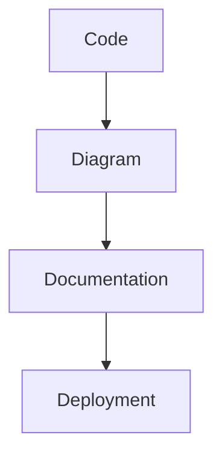

# Development and Documentation Tools in Containers

*Part 28 of the [networking and home lab series](2025-04-25-networking-and-home-lab-series.md).*

In today's fast-paced development world, having a robust and flexible environment is crucial. There's no need for a fancy office setup or a massive server farm to get started. With Docker containers, you can self-host your development tools right at home, even on a modest NAS setup. This post will explore how to run developer productivity tools in Docker, transforming your NAS into a powerful dev environment.

<!-- more -->

## Self-hosting Development Tools

Self-hosting your tools offers control and privacy. Whether it's about editing code remotely, sketching diagrams, or hosting a knowledge wiki, doing it all within your own network means you can customise the setup to your heart's content without worrying about third-party changes or outages.

## Benefits of Docker for Development

Docker is like the Swiss Army knife of the software world:

- **Consistency**: "Works on my machine" isn't an issue; it works everywhere.
- **Isolation**: Each container is its own entity, preventing messy dependency conflicts.
- **Portability**: Move your containers between machines or scale with ease.
- **Efficiency**: Containers are lightweight and start up quickly.

It's akin to having a player who can perform consistently regardless of the pitch conditions—a manager's dream!

## Development Tools

Let's dive into some specific tools that can transform your development workflow.

### code-server (VS Code in the Browser)

Visual Studio Code has become a staple for many developers. With `code-server`, you can run VS Code in your browser:

- **Remote Accessibility**: Access your IDE from any device with internet access.
- **Extensions Support**: All the familiar extensions are available.
- **Customisability**: Tailor the environment to fit your needs.

Imagine being able to tweak your code from anywhere—like adjusting tactics from the sideline during a match.

### Gitpod (Brief Mention)

If you're after something more managed but still want remote access, Gitpod provides cloud-based workspaces. However, it might not fully align with the self-hosted ethos if you're keen on keeping everything under one roof.

## Documentation Tools

Proper documentation is as vital as the development itself—it's like having clear game plans before each match.

### Wiki.js or MediaWiki (for a Wiki)

These tools allow you to maintain comprehensive documentation:

- **Wiki.js**: Modern interface, supports Markdown, and easy to set up.
- **MediaWiki**: The backbone of Wikipedia; robust but requires more setup effort.

Both options turn your documentation into an accessible resource for anyone who needs it—think of them as your tactical playbook.

### Excalidraw (for Diagrams)

Excalidraw offers a straightforward way to sketch diagrams:

- **Intuitive Interface**: Drag-and-drop elements make diagramming simple.
- **Collaboration Ready**: Share and edit with colleagues in real-time.

It's like drawing up plays on a whiteboard during half-time—a quick and effective way to convey ideas.

### Draw.io (Brief Mention)

For those needing more detailed technical diagrams, Draw.io offers more features. However, it can be overkill for simpler tasks where Excalidraw excels.

## Setup and Configuration

Now onto setting these tools up using Docker Compose—a tool that simplifies managing multi-container applications. Here's how you can do it:

### Docker Compose Deployment

A typical `docker-compose.yml` might look like this:

```yaml
version: '3'
services:
  code-server:
    image: codercom/code-server
    ports:
      - "8443:8443"
    volumes:
      - /path/to/data:/home/coder/project
  wiki-js:
    image: requarks/wiki
    ports:
      - "3000:3000"
    volumes:
      - /path/to/wiki:/wiki/data
  excalidraw:
    image: excalidraw/excalidraw
    ports:
      - "5000:5000"
```

### Persistence and Data Management

It's crucial to manage data persistence properly:

- **Volumes** ensure data isn't lost when containers are recreated.
- Regular backups prevent unexpected data losses—akin to ensuring there's always another ball on standby during training.

## Workflow Integration

Let's look at how all these tools fit together:



This flow illustrates how code changes lead to updated diagrams and documentation before culminating in deployment—a seamless pipeline like moving the ball fluidly from defence to attack.

### Connecting to Your NAS

Integrating these tools with your NAS makes them accessible across your home network. Most modern NAS systems support Docker natively—turning them into versatile platforms beyond just storage.

## Use Cases

Here's where rubber meets road—how can these setups be used?

### Remote Development

Develop from anywhere without needing your main machine—it's like having home advantage even when playing away.

### Collaborative Documentation

Teams spread across locations can contribute and access shared resources anytime—like having scouts feeding live updates during matches.

### Knowledge Sharing

Host internal wikis for sharing expertise across teams—ensuring everyone understands their roles and responsibilities on the field.

## Best Practices

A few tips for maintaining a healthy self-hosted ecosystem:

### Security

Ensure only authorised users have access by setting strong passwords and enabling HTTPS—like securing the dressing room so only players and staff enter.

### Backups

Regularly back up both data volumes and configuration files using scheduled tasks—remember Murphy's Law!

### Updates

Keep images updated to protect against vulnerabilities while benefiting from new features—it’s akin to keeping players fit for peak performance.

## Conclusion

Empowering developers with self-hosted tools enables flexibility and control over their environment. By leveraging Docker on your NAS or similar hardware, you create an adaptable workspace tailored precisely for your needs. It's less about having flashy stadiums but ensuring fundamentals are spot-on—the foundation of any championship-winning side!

---

> **Takeaway**  
> Embrace self-hosting with Docker not just as cost-saving but enhancing productivity through customisation whilst maintaining full control over security aspects—turning every project into potential silverware!
