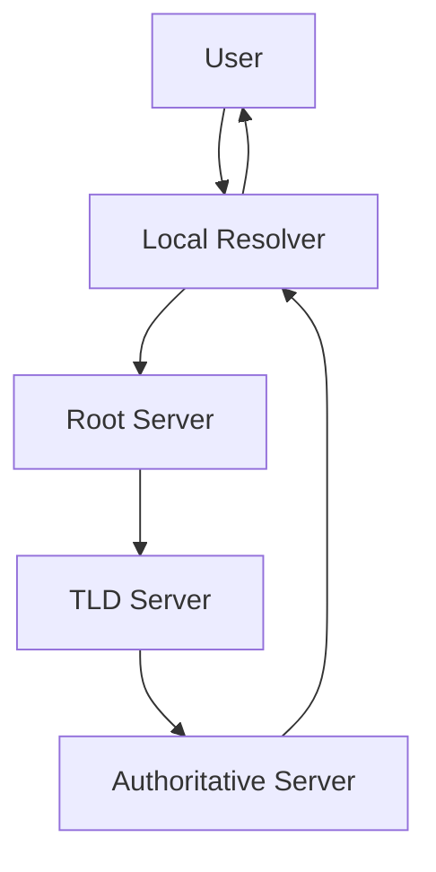

# DNS: The Internet's Directory Service

*Part 10 of the [networking and home lab series](2025-04-25-networking-and-home-lab-series.md).*

## Introduction - What is DNS? (Domain Name System)

Imagine needing to call someone but only having their phone number. You'd have to remember every single one, which would make your brain ache more than listening to a manager who just discovered Agile! Luckily, we have phonebooks (or contact lists on mobiles these days), so we can use names instead of numbers.

<!-- more -->

The Domain Name System (DNS) works similarly for the internet. It translates human-friendly domain names like `www.example.com` into IP addresses like `192.0.2.1`, which computers use to communicate with each other. Without DNS, navigating the web would be as pleasant as a soggy match day at Old Trafford.

## DNS Query Process

### Recursive vs. Iterative Queries

When you type a web address into your browser, a DNS query kicks off to find the corresponding IP address. Think of it like sending your mate to the pub to find out if it's open; they might ask several people along the way.

- **Recursive Query**: Your DNS resolver takes responsibility for fetching the answer, like your mate asking everyone until they get an answer.
- **Iterative Query**: You get redirected from person to person (or server to server) until you finally reach the right bloke who knows when the pub opens.

### DNS Resolvers and Servers

There are different types of DNS servers involved in this process:

- **Root Servers**: The starting point for all queries. They don't know much themselves but will point you in the right direction.
- **TLD Servers**: Responsible for top-level domains like `.com`, `.uk`, etc.
- **Authoritative Servers**: These hold the actual records you're looking for, akin to asking the barman directly.

Here's a diagram that illustrates this process:

## DNS Caching

Caching in DNS is like jotting down your mate's answer about the pub's open hours, so you don't need to ask again.

- **Benefits**:
  - **Speed**: Faster response times as you don't need to traverse multiple steps.
  - **Reduced Load**: Less traffic for upstream servers, saving them from a digital sweat.

- **TTL (Time to Live)**: This defines how long a cached query stays valid before you need to check again—like remembering that pubs don't stay open forever and sometimes things change!

## DNS Security

As with most things online, security is an issue. DNS wasn't initially designed with security in mind, so additional measures are needed.

### DNSSEC (DNS Security Extensions)

DNSSEC adds a layer of authentication using cryptographic signatures, ensuring that the data hasn't been tampered with—much like checking the seal on your pint glass isn't broken.

### DoH (DNS over HTTPS)

Encrypts DNS queries via HTTPS, similar to whispering secrets in someone's ear rather than shouting across a crowded room. This helps prevent eavesdropping by third parties.

### DoT (DNS over TLS)

Another encryption method that secures queries using TLS—think of it as another whispering technique but through a different method. Both improve privacy and security significantly.

## Practical Applications

### Home Network DNS Settings

Configuring your home network's DNS can improve speed and reliability. Consider using public resolvers like Google or Cloudflare for better performance and privacy compared to default ISP settings.

### Pi-hole for Ad-blocking

Pi-hole acts as a network-wide ad blocker by refusing requests for known ad-serving domains—a bit like putting up a "No Junk Mail" sign on your virtual letterbox. It's straightforward to set up on a Raspberry Pi:

1. Install Raspbian on your Raspberry Pi.
2. Run `curl -sSL https://install.pi-hole.net | bash`.
3. Configure your router or devices to use Pi-hole as their primary DNS server.

This setup can significantly cut down on ads and trackers across all devices connected to your network.

## Conclusion - Importance of DNS for Internet Functionality

DNS is crucial for the internet's smooth operation, much like referees in football—they often go unnoticed until something goes wrong! It helps translate memorable domain names into IP addresses computers understand while offering security measures like DNSSEC and encrypted protocols like DoH and DoT for privacy protection.

### TL;DR

- **DNS**: Translates domain names into IP addresses.
- **Query Process**: Involves recursive and iterative methods with root, TLD, and authoritative servers.
- **Caching**: Speeds up responses and reduces load.
- **Security Enhancements**: Includes DNSSEC, DoH, and DoT.
- **Practical Uses**: Configure home networks efficiently and use Pi-hole for ad-blocking.

With this knowledge under your belt, you're better equipped to understand and manage how your devices connect online—ensuring faster, safer, and more reliable internet browsing experiences.
