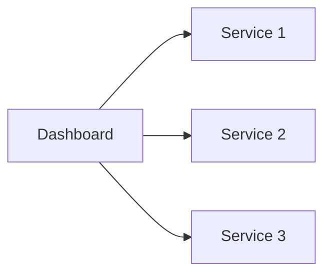

# Essential Dashboards for Home Labs: Heimdall, Homarr, Flame

*Part 27 of the [networking and home lab series](2025-04-25-networking-and-home-lab-series.md).*

## The Need for a Central Dashboard

If you're anything like me, juggling multiple services in your home lab can feel like herding cats. Each service is running in its container, doing its bit to make your smart home or DIY server setup tick. But keeping track of all these services? That's another story. You need a central dashboard—a place where you can see everything at a glance, just like the control room at Old Trafford (without the football drama).

<!-- more -->

## Organising Home Lab Services

When you've got containers scattered across machines and networks, organising them effectively becomes crucial. A good dashboard tool acts as a launchpad, giving you quick access to manage and monitor each service without having to SSH into every device or scroll through endless bookmarks.

## Dashboard Tools

Let's dive into three popular dashboard tools: Heimdall, Homarr, and Flame. Each has its quirks and strengths, much like choosing between a trusty Land Rover, a sleek Jaguar, or an eco-friendly Nissan Leaf.

### Heimdall

Heimdall is my go-to—simple yet powerful. It's like the Swiss Army knife of dashboards: compact but incredibly versatile. It doesn’t try to do too much. Instead, it focuses on being an efficient application dashboard with a focus on user-friendliness.

### Homarr

Homarr offers a slightly different approach, focusing on aesthetics and ease of use. Think of it as the Apple of dashboards—sleek design with intuitive usability. It's ideal if you want something that looks good on your big screen display in the living room.

### Flame

Flame is another solid option. It's open-source and very community-driven, offering flexibility to tinkerers who love customisation—like those modding their cars or setting up hi-fi systems from scratch.

## Key Features

Each dashboard tool comes with features that make managing your home lab services easier:

- **Service Listing**: View all your services in one place.
- **Icon Support**: Use icons for quick identification—like road signs for your digital motorway.
- **Search Functionality**: Quickly find services without scrolling endlessly.
- **Customisation**: Tailor the appearance to suit your personal taste or match your home decor.
- **Integration with Docker**: Easily connect to your Docker containers and update automatically.



## Setup and Configuration

### Docker Compose Deployment

Most of these dashboards can be easily deployed using Docker Compose, making setup a breeze:

```yaml
version: '3'
services:
  heimdall:
    image: linuxserver/heimdall
    container_name: heimdall
    ports:
      - "80:80"
    volumes:
      - /path/to/config:/config
    restart: unless-stopped
```

### Adding Services

Adding services involves pointing the dashboard to your existing services. Think of it as adding new fixtures to your team sheet before kick-off.

### Customizing Appearance

Whether you prefer dark mode for late-night tinkering or bright colours to match your garden shed's vibrant paint job, customisation options are plentiful.

## Comparison

### Strengths and Weaknesses

Here's how they stack up:

- **Heimdall**: Simple and effective; lacks some advanced features.
- **Homarr**: Beautiful UI; might lack deeper integrations some users need.
- **Flame**: Highly customisable; requires more setup effort.

### Choosing the Right Tool for Your Needs

It boils down to what you're looking for:

- Want simplicity? Go Heimdall.
- After aesthetics? Homarr's your mate.
- Love tweaking? Flame will keep you busy.

## Use Cases

These dashboards serve various purposes beyond just being pretty faces:

- **Quick Access to Services**: Instantly jump into any service without fumbling around.
- **Monitoring Service Status**: Keep an eye on what's running smoothly or needs attention.
- **Sharing Access with Family Members**: Give others in the household access without overwhelming them with complexity.

## Conclusion

Enhancing your home lab experience with a centralised dashboard is akin to equipping your workshop with power tools instead of relying on elbow grease alone. Whether it's Heimdall's straightforwardness, Homarr's polished look, or Flame's flexibility, there's something here for every tech enthusiast.

Takeaway? Choose the tool that fits your style and needs best—your digital workshop will thank you for it.

Happy tinkering! 🍻
