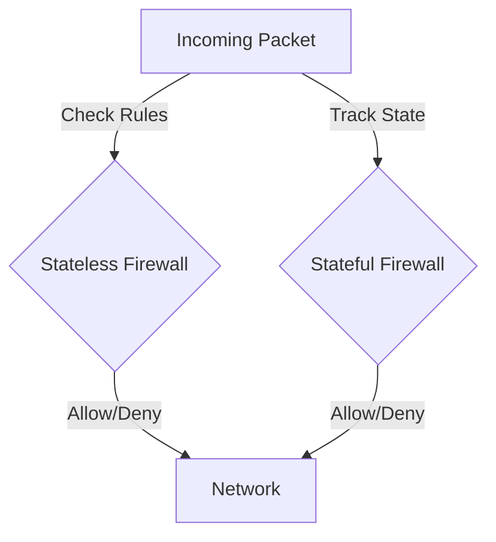

# Firewalls: What They Are and Why You Need One

*Part 12 of the [networking and home lab series](2025-04-25-networking-and-home-lab-series.md).*

Picture this: your network is like a bustling football stadium. You’ve got fans coming in and out, each with their own agenda. Some just want to enjoy the match (your regular traffic), while others might be up to no good (malicious actors). The firewall is your security team, checking tickets and ensuring only the right people get through. Without it, chaos reigns supreme.

<!-- more -->

In this post, we'll dive into the nitty-gritty of firewalls—what they are, how they work, and why they’re not just important, but essential for securing your network.

## Introduction

### What is a Firewall?

A firewall acts as a barrier between your internal network and potential threats from the outside world. It filters traffic based on pre-established security rules, much like a bouncer at a club deciding who gets in and who stays out.

### Importance of Firewalls in Network Security

- **Protects against cyber threats**: Shields your network from malicious attacks and unauthorised access.
- **Ensures data privacy**: Keeps sensitive information safe from prying eyes.
- **Regulates traffic**: Manages incoming and outgoing network traffic efficiently.
  
In essence, without a firewall, your data is as vulnerable as leaving your front door wide open.

## Basic Firewall Concepts

### Packet Filtering

At its core, packet filtering involves analysing small chunks of data (packets) against a set of filters. It's like checking each fan's ticket before entering the stadium. If the ticket doesn’t match the criteria, they’re not getting in.

### Stateful vs. Stateless Firewalls

- **Stateless Firewalls**: These operate purely on rules. They don’t remember previous packets—each one is judged on its own merits.
- **Stateful Firewalls**: A bit like having a memory. They track active connections and make decisions based on the state of these connections.

### Firewall Rules and Policies

Rules are essentially "if-then" statements that dictate what happens when certain types of traffic are encountered. Policies are collections of these rules that govern overall network behaviour.

## Firewall Types

### Network Firewalls

These protect entire networks by filtering traffic between different network segments. Think of them as the main gates to your stadium.

### Host-Based Firewalls

Installed on individual devices, these act like personal bodyguards for each computer or server, adding an extra layer of protection.

### Hardware vs. Software Firewalls

- **Hardware Firewalls**: Physical devices placed between your network and the gateway to the internet.
- **Software Firewalls**: Applications installed on devices within your network.

*Tip*: For home users, a software firewall on each device plus a router with built-in firewall capabilities can provide robust protection.

## Advanced Firewall Features

### Application-Layer Firewalls

These delve deeper than traditional firewalls by inspecting data at the application level. Imagine checking not just tickets but also IDs to ensure legitimacy.

### Intrusion Prevention Systems (IPS)

An IPS works alongside firewalls to detect and prevent known threats in real-time—like having sniffer dogs at the gate to catch anything suspicious.

### Network Address Translation (NAT) and Firewalls

NAT hides internal IP addresses from the outside world, adding another layer of security by making your network less visible to potential attackers.

## Home and Enterprise Use Cases

### Home Network Firewall Setup

Most modern routers come with built-in firewall features. For example, an Asus router can be configured with simple steps:

1. Log in to router admin panel.
2. Navigate to firewall settings.
3. Enable packet filtering and set up basic rules—block all except essential services like HTTP/HTTPS.

### Enterprise Firewall Deployment

In an enterprise setting, firewalls are critical for maintaining secure operations across multiple offices or branches:

- Deploy hardware firewalls at key points within the corporate network.
- Use advanced firewalls with IPS capabilities for sensitive departments handling critical data.

## Best Practices

### Rule Management

Regularly review and update firewall rules to adapt to new threats and changes within your network environment.

### Logging and Monitoring

Keep an eye on logs for any unusual activity—this helps in spotting potential breaches early on.

### Regular Updates

Ensure firmware and software updates are applied promptly to close off vulnerabilities as they’re discovered.

*Note*: An outdated firewall is akin to using last season's playbook—it leaves you exposed!

## Conclusion

Firewalls are indispensable players in your cybersecurity lineup. They offer the first line of defence against malicious intrusions while also managing network traffic efficiently. Whether it's for a home setup or an enterprise deployment, understanding their role ensures you're well-equipped to keep your data safe from harm.

So next time you connect to the internet, think of your firewall as not just a guardian but an ever-watchful coach guiding you towards victory in the digital arena.

---

**Takeaway Summary**

- Firewalls are essential for protecting networks from unauthorised access.
- Understanding basic concepts like packet filtering and stateful inspection is key.
- Choose the right type of firewall based on specific needs—network vs host-based, hardware vs software.
- Advanced features like IPS add layers of security.
- Regular rule updates and monitoring are crucial for effective defence.
