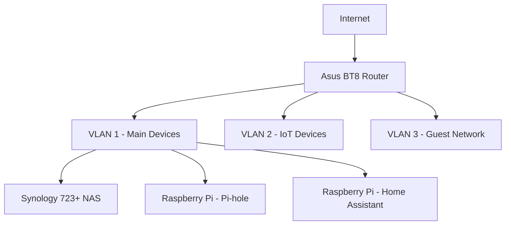

# Home Network Design: Tips from a Real Setup

*Part 19 of the [networking and home lab series](2025-04-25-networking-and-home-lab-series.md).*

## Importance of a Well-Designed Home Network

Imagine your home network as the plumbing in a house. If it's well-designed, everything flows smoothly, and you hardly notice it. But if it's poorly planned, you'll constantly be dealing with blockages and leaks. In today's connected world, where everything from your fridge to your light bulbs might be online, having a robust and efficient home network is as important as having good electrics or central heating.

<!-- more -->

## Overview of My Home Network Setup

In this post, I'll give you a peek into my own home network setup. It's not just a bunch of cables and blinking lights; it's a carefully planned architecture that supports advanced features like VLANs, ad-blocking, and local DNS. I'll walk you through my choices and share some nuggets of wisdom I’ve picked up along the way.

## Network Components

Let's start by looking at the key players in my network lineup:

### Asus BT8 Router

- **Role:** This is the backbone of my network. It handles routing, DHCP, and basic firewall duties.
- **Why I Chose It:** Solid performance and reliability. Plus, it supports advanced features like VLANs out of the box.

### Synology 723+ NAS

- **Role:** Storage and service hub.
- **Why I Chose It:** Versatile with great software support for Docker, making it ideal for running various services.

### Raspberry Pi Devices

- **Pi-hole:** This acts as my network-wide ad blocker.
- **Home Assistant:** Manages all my home automation tasks.
  
These little Pis are like Swiss Army knives — small but incredibly handy.

## Network Architecture

Now, let’s dive into the architecture — the blueprint that ensures everything works seamlessly together.

### VLANs for Segmentation

Think of VLANs (Virtual LANs) as invisible fences within your network. They keep different types of traffic separate:

- **Guest Network:** Isolated from your main devices for security.
- **IoT Devices:** Kept on their own VLAN to prevent any dodgy fridge from snooping on your PC.

### Wired and Wireless Setup

A mix of wired connections for speed-critical devices (e.g., PCs, NAS) and wireless for convenience (e.g., phones, tablets).

## Key Services

Let’s talk about the services that make my network tick.

### Pi-hole for Ad-blocking

- **Function:** Blocks ads network-wide.
- **Benefit:** Cleaner browsing experience without needing browser plugins.

### Home Assistant for Home Automation

This is like having a butler who never sleeps:

- **Capabilities:** Controls smart lights, thermostats, even the coffee maker.
- **Integration:** Works with almost any smart device out there.

### Synology NAS for Storage and Services

Not just a storage box:

- **Docker & Portainer:** Run various containers for different services. Portainer makes managing them easy.
- **Heimdall Dashboard:** Acts as a homepage for all services — think of it as a digital control panel.

## Setup and Configuration

Here’s where we get our hands dirty configuring things.

### Router Configuration

Set up basic networking rules:

- Assign static IPs to key devices.
- Configure port forwarding for external access to selected services.

### VLAN Setup

Involves setting up different networks within your router:

1. Define VLAN IDs in the router settings.
2. Assign devices to appropriate VLANs based on their role.

### Service Integration

Ensure all services can communicate where necessary:

- Connect Home Assistant with other devices using MQTT or similar protocols.
- Use Pi-hole's DNS capabilities to streamline service discovery.

## Tips and Best Practices

Let's touch on some practical advice that can save you headaches down the line.

### Security Considerations

Just like locking your doors at night:

- Use strong passwords everywhere.
- Enable firewall rules to block unwanted traffic.

> **Tip**: Regularly update firmware/software to patch vulnerabilities.

### Performance Optimisation

Make sure your network runs like a well-oiled machine:

- Prioritise bandwidth for critical devices using QoS (Quality of Service).
- Monitor network performance regularly to spot bottlenecks early.

### Expansion and Future-Proofing

Plan ahead like you're building an extension on your house:

- Leave room in your IP address range for new devices.
- Consider future technologies like Wi-Fi 6 or mesh networks.

## Conclusion

Having a customised home network isn't just about bragging rights; it brings real benefits:

- Enhanced security by isolating devices with VLANs.
- Improved user experience through ad-blocking and streamlined device management.
- Flexibility to add new technology without overhauling everything.

Setting up an advanced home network might seem daunting at first, but breaking it down into manageable steps makes it achievable. With careful planning and consideration, you can create a setup that not only meets current needs but also adapts to whatever the future throws at it. Now put the kettle on – you've earned it!

---

**Takeaway Summary**

A well-planned home network is crucial for seamless connectivity in today's tech-driven homes. By strategically using components like routers, NAS systems, and Raspberry Pi devices, along with implementing VLANs for segmentation, you can achieve both high performance and robust security. Always plan with an eye towards future expansion and keep security practices up-to-date.
