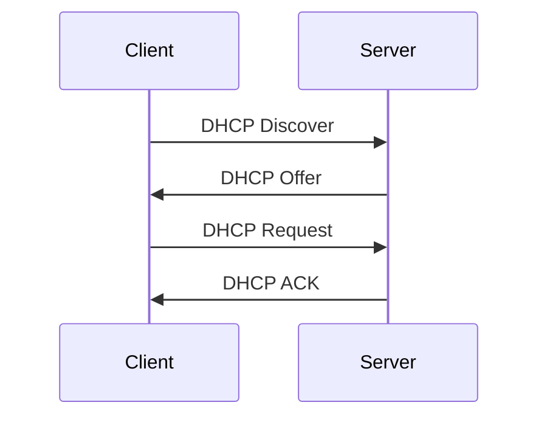

# How Devices Join the Network: DHCP Explained

*Part 7 of the [networking and home lab series](2025-04-25-networking-and-home-lab-series.md).*

Imagine you're setting up a small farm, and you need to make sure each animal has its own space. You could manually assign spots, but that’s a faff, especially as the herd grows. Instead, you use a system that automatically assigns each one a spot based on what's available. This is basically what DHCP does for your network devices.

<!-- more -->

## Introduction: Manual vs. Automatic IP Configuration

Back in the day, assigning IP addresses manually was like herding cats. Each device needed an IP address typed in by hand—prone to errors and definitely not scalable. Enter DHCP: Dynamic Host Configuration Protocol. It's like having a digital shepherd overseeing your network, ensuring everyone has a place without stepping on each other's toes.

### Benefits of DHCP

- **Efficiency**: Automates IP address assignment.
- **Scalability**: Easily handles large networks.
- **Flexibility**: Quickly adapts to changes in the network.
- **Reduced Errors**: Minimises human error in configuration.

## DHCP Process

DHCP operates through a four-step dance between client and server. Let's break it down:

1. **DHCP Discover**: A device (client) sends out a broadcast request saying, "I need an IP!"
2. **DHCP Offer**: The DHCP server replies with an offer, like a friendly wave, saying "Here's an available IP."
3. **DHCP Request**: The client responds, "I'll take that IP, please."
4. **DHCP Acknowledgement (ACK)**: Finally, the server confirms, "It's all yours!"

Here’s how it looks in a diagram:

This process ensures each device gets a unique IP address without manual intervention.

## DHCP Leases

When a device gets an IP address via DHCP, it's not permanent; it's leased.

- **Lease Duration**: Think of it like renting a flat; you can stay as long as the lease lasts.
  - Short leases are good for networks with lots of new devices frequently connecting.
  - Longer leases reduce DHCP traffic but may risk running out of available addresses if too many devices join.
  
- **Lease Renewal**: Before the lease expires, devices must request to renew their lease to keep the same IP address.

## DHCP Reservations

Sometimes you want certain devices to always have the same IP address—like reserving the best parking spot for your tractor.

- **Assigning Specific IPs**: You can configure reservations based on MAC addresses so specific devices always receive the same IP.
  
- **Use Cases**:
  - Servers where consistent addressing is crucial.
  - Network printers that multiple users access.
  
## Static vs. Dynamic IPs

Understanding when to use static or dynamic IPs is key to effective network management.

### Differences and Use Cases

- **Static IPs**:
  - Manually assigned and never change unless you intervene.
  - Ideal for servers and network equipment where stability is paramount.
  
- **Dynamic IPs**:
  - Assigned by DHCP and can change over time.
  - Perfect for general devices like laptops and smartphones.

### When to Use Each

- Use static IPs for critical infrastructure.
- Use dynamic IPs for general devices to ease management.

## DHCP Options

Beyond just handing out IPs, DHCP can configure other settings:

- **Gateway Configuration**: Tells devices which router to use as their gateway to the outside world.
- **DNS Server Configuration**: Informs devices which DNS servers to use for translating domain names into IP addresses.

These options ensure all networked devices are singing from the same hymn sheet.

## Conclusion

DHCP is like the unsung hero on your network—a digital traffic warden managing device addresses seamlessly. Without it, managing any sizeable network would be tedious at best and chaotic at worst.

With its ability to dynamically allocate and manage addresses while providing flexibility and reducing errors, DHCP is vital for modern networks. Whether you're running an enterprise-scale setup or just keeping your home gadgets connected smoothly, understanding DHCP will help you keep everything running like clockwork.

---

## Key Takeaways

- **DHCP automates** the process of assigning IP addresses on a network.
- It involves a four-step process of discover, offer, request, and acknowledge.
- Leases define how long an IP address is assigned to a device before requiring renewal.
- Reservations help ensure critical devices have consistent addressing.
- Static IPs suit stable infrastructure; dynamic ones suit mobile or general-purpose devices.
- Additional options allow configuration of gateways and DNS servers through DHCP.

Remember this next time you set up or troubleshoot your network—it might just save you from pulling your hair out!
