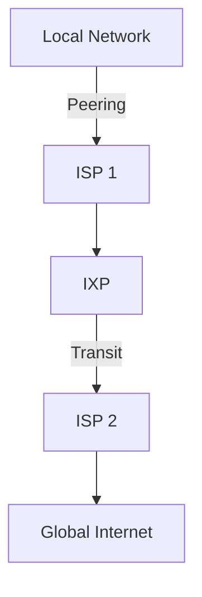

# How the Internet Actually Works (ISPs, IXPs, Routing)

*Part 17 of the [networking and home lab series](2025-04-25-networking-and-home-lab-series.md).*

## Introduction

Imagine the internet as a sprawling metropolis, full of roads, bridges, and highways. It's vast, complex, and constantly buzzing with activity. But how does it all come together? This post will take you on a journey through the architecture of the internet, exploring the key components like ISPs, IXPs, and routing protocols that make it all tick.

<!-- more -->

We'll delve into:

- **ISPs (Internet Service Providers):** The gatekeepers connecting us to the internet.
- **IXPs (Internet Exchange Points):** The hubs where networks collaborate.
- **Routing:** The method by which data finds its way across this digital landscape.

So grab your brew, settle in, and let's unravel the mystery of how the internet actually works.

## ISPs (Internet Service Providers)

### Tiers of ISPs

Think of ISPs as the utility companies of the internet world. They provide the infrastructure that connects our homes and businesses to this massive network.

- **Tier 1 ISPs:** These are the big players—global companies like AT&T or BT that own large portions of the internet's backbone. They don't pay for transit because they peer with each other.
  
- **Tier 2 ISPs:** These often serve regional areas. They connect to Tier 1 networks and may peer with other Tier 2s to reduce costs.
  
- **Tier 3 ISPs:** These are your local ISPs, providing service directly to consumers and small businesses. They usually purchase access from Tier 2 providers.

### How ISPs Connect Users to the Internet

ISPs use a mix of fibre optics, copper lines, and wireless technologies to bring the internet to your doorstep. Here’s how it generally works:

1. **Local Loop:** This is the connection from your home to your local exchange—think of it as your driveway leading to a main road.
   
2. **Network Backbone:** Once data leaves your local loop, it travels over high-capacity lines managed by Tier 1 or Tier 2 providers.
   
3. **Peering & Transit:** Data hops between different ISP networks at peering points to reach its destination.

## IXPs (Internet Exchange Points)

### Peering and Transit

IXPs are like bustling roundabouts where multiple roads converge, allowing traffic from different networks to flow smoothly. 

- **Peering:** When two networks exchange traffic directly without charging each other—like two neighbours agreeing to share their garden hose without any money changing hands.

- **Transit:** One network pays another for access to parts of the internet they can't reach directly—like paying a toll to use someone else’s motorway.

### Reducing Latency and Improving Efficiency

By facilitating direct connections between networks, IXPs play a crucial role in reducing latency (the time it takes for data to travel from point A to B) and improving efficiency. Imagine fewer roundabouts on your morning commute; you get there faster with less hassle.



## Routing

### How Data Packets Travel Across the Internet

Data on the internet travels in packets—small chunks that find their way through a maze of routers and switches. Picture each packet as a letter in an envelope with an address written on it.

Here's how it happens:

1. **Packet Creation:** Your device breaks down data into packets.
   
2. **Routing Decision:** Each router along the way decides which path is best for forwarding these packets based on various factors like speed or cost.
   
3. **Destination Arrival:** Packets reach their destination where they’re reassembled into usable information.

### Autonomous Systems (AS)

An Autonomous System is a collection of IP networks and routers under the control of one entity—like a single team managing all the buses in a city.

- Each AS is assigned a unique number (ASN).
- ASes make independent routing decisions but coordinate through peering agreements.

### BGP (Border Gateway Protocol)

BGP is like air traffic control for data packets—it decides which routes data should take across different ASes.

**Key Features:**

- **Path Selection:** Chooses routes based on policies rather than shortest paths alone.
  
- **Robustness:** Designed to handle network failures by finding alternative paths.

```plaintext
AS1 --> AS2 --> AS3 --> Destination
AS1 <-- AS4 <-- AS5 <-- Source
```

## Traceroute

### Visualizing the Path of Data

Traceroute is a handy tool that helps you see the path data takes from your computer to its destination—a bit like following bread crumbs through a forest.

**Usage:**

```bash
traceroute example.com
```

This command reveals each hop along the route, helping diagnose where delays or problems might occur.

### Troubleshooting Network Issues

When something goes wrong on your network excursion:

- Use traceroute to pinpoint where packets are getting lost or delayed.
- Identify if it's an issue with your ISP or further upstream.

## Internet Governance

Just like we have rules for driving on roads, there are organisations that set standards for how data travels over networks:

- **ICANN (Internet Corporation for Assigned Names and Numbers):** Manages domain names and IP addresses.
  
- **IETF (Internet Engineering Task Force):** Develops technical standards that ensure smooth communication between devices on different networks.

## Conclusion

The internet is a marvel of collaboration—a patchwork quilt stitched together by thousands of different networks working in harmony. Whether you're streaming your favourite show or sending an email halfway around the world, it's this intricate dance between ISPs, IXPs, and routing protocols that makes it all possible.

Takeaway: Next time you click 'send', remember there's more going on behind those bits than meets the eye!

If you've made it this far without nodding off—well done! You've got a better grasp than most on how this fantastic virtual world operates. Now go impress someone with your newfound knowledge over another brew!
